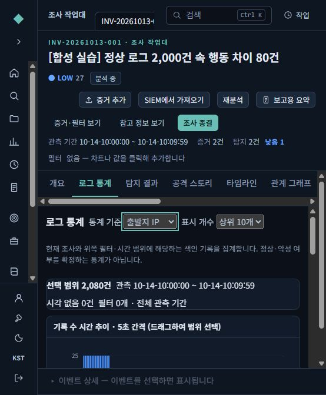
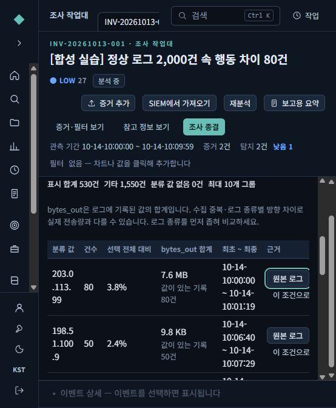
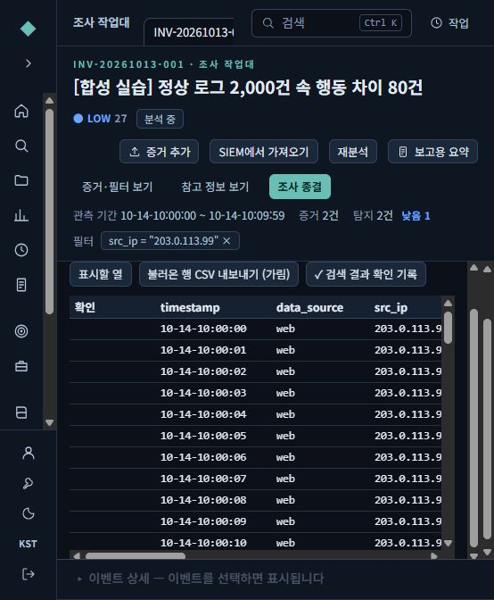
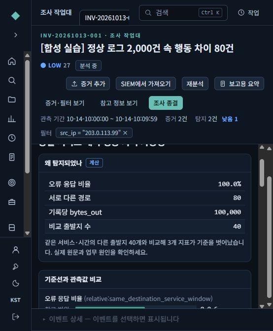
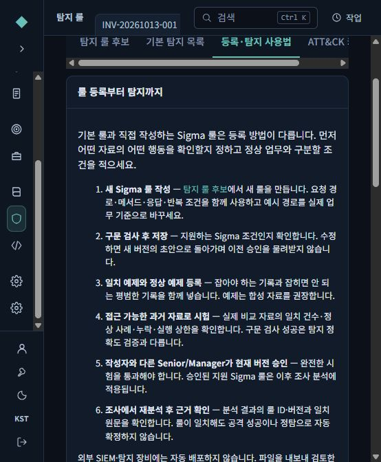
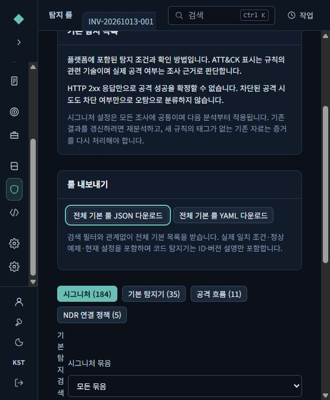
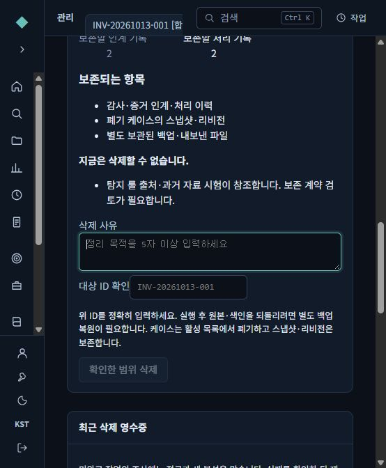
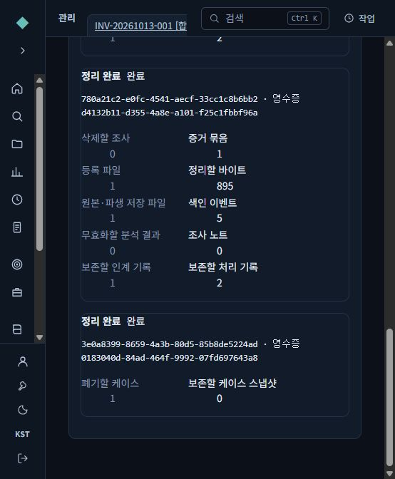

# 관리자 정리·룰 등록·로그 통계 따라하기

2026-10-14 복사본 기준입니다. 아래 화면은 실제 실행한 SAW에서 캡처했으며, **모든 자료는 합성 로그**입니다. 은행 자료나 운영 계정은 사용하지 않았습니다.

현재 개발 PC의 실습 화면은 http://127.0.0.1:57284/ 입니다. 서버가 실행 중일 때 같은 PC에서 접속합니다. 다른 분석가 PC의 운영 접속 주소는 폐쇄망 서버 설치·TLS 설정 뒤 정합니다. 이 주소는 운영 서버 주소가 아닙니다. 브라우저 세션이 끝나면 지정된 시험 계정으로 로그인하며, 비밀번호는 문서에 기록하지 않습니다.

## 1. 먼저 로그의 전체 모습을 보세요

**조사 목록 → 조사 열기 → 로그 통계**로 들어갑니다. 예시 제목은 **[합성 실습] 정상 로그 2,000건 속 행동 차이 80건**입니다.

**통계 기준**에서 다음 중 하나를 고릅니다.

| 기준 | 확인하는 질문 |
|---|---|
| 로그 종류 | 웹·연결 등 어떤 자료가 얼마나 있는가? |
| 파일 | 어느 업로드 파일에 기록이 몰렸는가? |
| 출발지 IP | 어느 출발지가 많이 요청했는가? |
| 목적지 IP | 어느 대상에 접근이 몰렸는가? |
| 목적지 포트 | 어떤 서비스 포트가 자주 사용됐는가? |

예시는 전체 **2,080건**입니다. 출발지 IP를 선택하면 **203.0.113.99는 80건**, 다른 40개 출발지는 각각 50건으로 나옵니다. 이 숫자만으로 악성이라고 판단하지 않습니다.

표에는 건수·선택 전체 대비 비율·bytes_out 합계·최초/최종 시각이 표시됩니다. **상위 10개**를 보면 표시 합계 530건, 기타 1,550건입니다. 표의 합계가 전체 2,080건과 다르다고 로그가 사라진 것은 아닙니다. 분류 값 없음과 시각 없음도 따로 표시합니다.

상단 필터와 시간 범위를 바꾸면 같은 범위로 다시 집계됩니다. 시간 차트를 드래그하면 기존 범위 안에서 좁힙니다. 범위를 되돌릴 때는 상단 필터·시간 조건을 해제하세요.

**bytes_out 주의:** 값이 없는 기록은 0으로 채우지 않습니다. 로그별 방향 정의·중복 수집 때문에 이 합계를 실제 반출량이라고 확정할 수 없습니다. 먼저 같은 로그 종류로 좁혀 비교하세요. 파일은 증거 ID와 파일 이름을 함께 사용하지만 같은 증거 안에 이름이 중복된 파일은 합쳐질 수 있습니다. OpenSearch 상위 그룹은 근사 집계 안내가 나올 수 있습니다.

## 2. 의심되는 출발지에서 원본으로 이동하세요

표의 **203.0.113.99 → 원본 로그**를 누르면 출발지 조건과 현재 시간 범위를 유지한 채 **원본 로그** 탭으로 이동합니다. 실제 화면 시험에서 **80건 불러옴**을 확인했습니다.

원본의 경로·응답 코드·시각·요청 내용과 승인된 작업 여부를 확인합니다. 원본 화면의 CSV는 **현재 불러온 행**을 내보냅니다. 조사 전체를 내보냈다고 해석하지 마세요.

화면이 좁으면 왼쪽 메뉴를 접고, **증거·필터 보기 / 참고 정보 보기**로 보조 패널을 조절하세요. 표의 오른쪽 열은 가로 스크롤로 볼 수 있습니다. 통계 탭은 좁은 화면에서도 중앙 분석 영역이 사라지지 않도록 보완했습니다.

## 3. 정상 로그 사이의 행동 차이를 확인하세요

**탐지 결과 → 동일 서비스 대비 행동 차이 가능성**을 엽니다. 예시에서는 같은 목적지 192.0.2.200, 포트443, 같은 15분 구간의 **다른 출발지 40개**와 비교했습니다.

오류 응답 비율·서로 다른 경로·기록당 bytes_out 등 **3개 지표**가 비교 기준을 벗어났습니다. **근거 이벤트 80**에서 해당 기록을 확인할 수 있습니다. 분석가가 정상 배치·점검·NAT 공유·수집 차이를 검토하기 전에는 공격이나 유출로 확정하지 않습니다.

이 탐지는 다음 조건이 갖춰져야 의미가 있습니다.

- 같은 조사·로그 종류·목적지 IP·목적지 포트·15분 구간끼리 비교합니다.
- 비교 출발지가 20개 이상이고 각 출발지의 기록도 5개 이상이어야 합니다. 자기 자신은 비교 기준에서 뺍니다.
- 요청 수·오류 비율·경로 수·기록 크기 중 2개 이상이 보수적 기준을 넘어야 후보가 됩니다.
- 목적지/포트가 없는 일반 웹 로그에서 값을 추측하지 않습니다. 표본 부족·필드 누락·처리 상한은 적용 범위 안내로 남깁니다.
- 최대 100,000건, 비교 그룹200개·출발지 그룹5,000개, 후보10개라는 처리 상한이 있습니다. 잘린 범위를 “이상 없음”으로 처리하지 않습니다.

현재 비교 기준은 **이 조사 안의 자료**입니다. 다른 비공개 사건의 기록을 몰래 기준선으로 재사용하지 않습니다. 새 탐지는 ATT&CK나 분석가 판정을 자동 확정하지 않습니다. 기존 탐지들도 함께 표시되므로 같은 행위를 여러 결과가 설명할 수 있습니다.

## 4. 룰을 등록하고 실제 탐지에 쓰세요

**탐지 룰 → 등록·탐지 사용법**에 6단계 안내를 넣었습니다.

1. **탐지 룰 후보 → 새 Sigma 룰**에서 조건을 작성합니다.
2. **구문 검사 → 저장**합니다.
3. 반드시 일치해야 할 합성 예제와 걸리면 안 될 정상 예제를 함께 넣습니다.
4. **접근 가능한 과거 자료 시험**으로 일치 건수와 검사 범위를 봅니다.
5. **작성자와 다른 승인자**가 현재 버전을 승인합니다.
6. 조사에서 **재분석**한 뒤 룰 ID·버전과 근거 원문을 확인합니다.

기본 예시는 가상 경로 /saw-demo/restricted-export에 POST하고 HTTP200인 요청을 같은 출발지가 10분 동안 5번 이상 보낸 경우입니다. 예제를 실제 환경의 정상 업무와 비교해 조정하세요. HTTP200이나 admin 같은 단어 하나만으로 공격을 확정하면 안 됩니다.

예제 시험은 개별 조건을, 합성 조사 시험은 반복 횟수·시간 조건을 확인합니다. 실제 화면에서는 예제 2개 통과, 과거 합성 기록 2,085건 중 일치0건을 확인했고 **승인 상태로 바꾸지 않았습니다**. 자동 시험에서는 4건은 미탐지, 5건은 탐지되는 반복 조건도 확인했습니다.

지원되는 승인 Sigma가 SAW 조사에 자동 적용됩니다. 외부 SIEM·EDR·Suricata에 자동 배포하는 기능은 아닙니다. 자세한 필드 예제와 기본 YAML 편집 위치는 [룰 사용 설명](DETECTION-RULES-HOWTO.md)을 보세요.

## 5. 들어 있는 룰을 Export해서 살펴보세요

**탐지 룰 → 기본 탐지 목록**에서 JSON 또는 YAML을 받습니다.

| 내려받기 | 포함 내용 |
|---|---|
| 전체 기본 룰 JSON/YAML | 웹 시그니처184개, 흐름11개, NDR정책5개 등의 실제 조건·정상/일치 예제·현재 설정. 코드 탐지기35개는 ID/버전/설명 |
| 현재 룰 묶음 JSON | 직접 만든 룰의 현재 버전·논리·임계값·예외·상태 |
| 개별 원본 룰 파일 | 원래 Sigma 등 룰 논리. SAW 별도 반복 조건·예외는 묶음 JSON도 함께 확인 |

기본 목록 Export는 검색 필터와 관계없이 전체입니다. 사용자 룰 묶음에는 과거 시험 원문이나 사건 스냅샷을 넣지 않습니다. 파일 다운로드가 승인·배포를 뜻하지 않으며 JSON/YAML을 반입하는 것만으로 서버 룰을 교체하지 않습니다.

한 파일 최대2MiB, 사용자 묶음 최대1,000개입니다. 초과하면 오류를 표시하고 일부만 성공 파일처럼 내보내지 않습니다. 사용자 룰은 개별 파일로 나누어 확인할 수 있습니다. 코드 탐지기의 구현 전체가 범용 룰 파일로 변환되는 것은 아닙니다.

## 6. 관리자가 조사·파일·케이스를 정리하는 방법

**관리·감사 → 데이터 관리**에서 대상 종류를 고릅니다. 관리자에게 원문 열람 권한을 새로 부여하지 않고 ID·상태·건수만 보여줍니다.

1. **조사 전체 / 증거 묶음·포함 파일 전체 / 케이스 폐기**를 선택합니다.
2. **삭제 영향 확인**을 누릅니다. 삭제·무효화할 건수와 보존할 이력을 읽습니다.
3. 차단 사유가 없을 때 삭제 사유를 5자 이상 쓰고 화면에 보이는 대상 ID를 정확히 입력합니다.
4. **확인한 범위 삭제**를 실행하고 최근 삭제 영수증에서 완료 여부를 확인합니다.
5. 실패하면 원인을 해결한 뒤 **재시도**합니다. 최초 요청자와 실제 재시도 관리자는 감사에 따로 남습니다.

위 화면은 룰의 과거 자료 시험이 조사를 참조해서 차단된 예입니다. 법적 보존·진행 작업·공유 근거도 자동 해제하지 않습니다. 연결된 활성 케이스가 있다면 먼저 보존 필요를 검토하고 케이스를 폐기해야 합니다. 강제 삭제로 참조를 끊는 기능은 제공하지 않습니다.

**증거 묶음**은 업로드 하나와 압축 내부 파일 전체입니다. 내부 파일 하나만 지우지 않습니다. 일부 증거를 지우면 이 조사의 자동 분석 결과는 무효화되므로 남은 자료를 재분석하세요. 사람의 확인 기록 등 보존 충돌이 있으면 증거 단독 삭제를 막습니다.

**케이스 폐기**는 활성 목록에서 제외하되 스냅샷·리비전을 보존합니다. **조사·증거 정리**도 감사·증거 인계·처리 이력, 별도 백업·기존 Export를 소거하지 않습니다. 원본 파일과 색인은 정상 화면에서 되돌릴 수 없으므로 복원은 별도 백업 절차가 필요합니다. S3 저장소 삭제는 이번 구현에서 지원하지 않습니다.

검증에서는 별도 합성 조사10건에서 파일5건을 삭제해5건이 남는 것, 이어 조사 전체를 삭제하는 것, 다른 조사의2,080건은 유지되는 것을 실제 HTTP로 확인했습니다. 브라우저에서는 미리보기·차단·완료 영수증을 확인했으며 최종 삭제 클릭까지의 전 과정을 브라우저로 수행한 것은 아닙니다.

## 7. 16GB·GPU 없는 서버의 모델 선택

**우선 시험 후보는 Kanana1.5 2.1B Instruct Q4_K_M**입니다. 작은 한국어·영어 지시 모델이어서 16GB 서버에서 검토할 후보로 골랐습니다. **보안 특화 모델은 아니며**, 보안 정확도는 SAW의 결정적 분석·승인된 근거와 별도 합성 평가로 보완해야 합니다.

모델 파일 약1.52GB, 실행 메모리2.5~4GB는 계획 추정치입니다. Windows·PostgreSQL·OpenSearch·SAW가 함께 쓰는 메모리를 제외하고 판단해야 하며 실제 16GB 장비에서 확인한 수치가 아닙니다. 동시1요청·짧은 문맥으로 시작하고 대량 색인 중에는 추론을 피하는 시험을 권합니다.

현재 지정 Foundation-Sec-8B BASE는 그대로 유지했습니다. 이번에 후보 가중치를 내려받거나 모델을 바꾸거나 새 추론·학습을 실행하지 않았습니다. Kanana GGUF의 템플릿 적합성도 실제 등록·생성 시험 전까지 미검증입니다. Qwen3 후보는 현재 어댑터가 거부하므로 그대로 등록할 수 없습니다.

정확한 후보 revision·권리·hash, 반입 파일, 모델 팩 생성·검증·등록·선택·되돌리기 명령은 [16GB 한국어 모델 반입 안내](MODEL-16GB-KOREAN-GUIDE.md)에 있습니다.

## 배포와 검증의 범위

이번 소스에는 새 기능이 들어 있지만 **기존 2026-10-12 설치 ZIP에는 포함되어 있지 않습니다**. 운영 반입 전 새 소스로 설치 매체를 다시 만들고 별도 시험해야 합니다. 실제 Windows11 개발기와 격리 PostgreSQL/OpenSearch에서 시험했으며 깨끗한 LTSC2019·인터넷 차단·16GB 다중 접속 인수는 남아 있습니다.

자동 시험과 실제 실행 결과는 [검증 기록](ADMIN-RULES-ANALYTICS-VALIDATION-2026-10-14.md)을 참고하세요.
