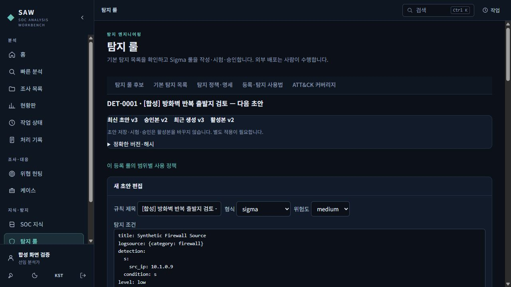
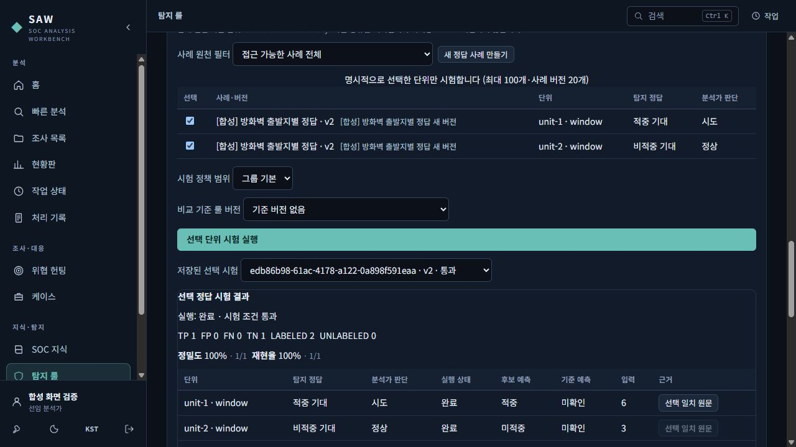
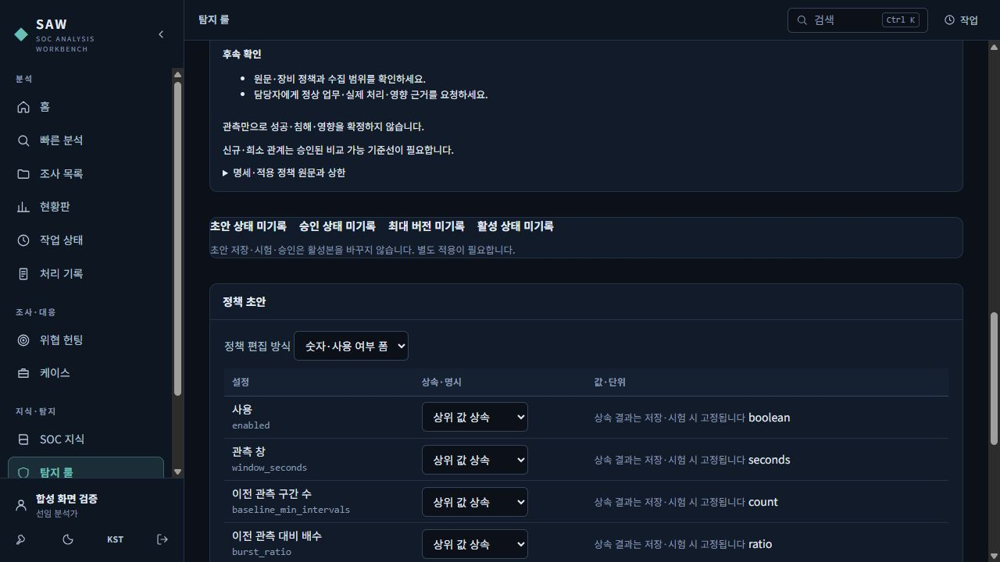

# 관계사·장비별 탐지 설정과 선택 정답 시험

2026-10-21 P2 기능 안내입니다. **탐지 룰**에서 시작합니다. 초안 저장, 시험, 독립 승인, SAW 적용은 각각 별도 동작입니다. 이 문서의 화면은 정상 MFA 로그인 후 합성 자료로 확인한 개발 환경입니다.

## 1. 초안과 현재 활성본을 구분하세요

| 화면 표시 | 의미 |
|---|---|
| 최신 초안 | 편집·시험할 저장 버전 |
| 승인본 | 독립 검토자가 승인한 정확한 버전 |
| 활성본 | 현재 SAW 분석에 적용되는 버전 |
| 최근 생성 | 가장 최근 할당된 버전 번호. 활성본이라는 뜻은 아닙니다. |

조건을 바꾼 뒤 **새 초안 버전 저장**을 누르세요. 숫자·그룹 폼 또는 고급 JSON을 사용할 수 있습니다. 저장하지 않은 편집은 시험·승인·내보내기에 포함되지 않습니다. JSON 오류가 나면 입력을 고친 뒤 다시 저장합니다.

위 상태는 v2를 승인·적용한 뒤 새 초안 v3을 저장한 화면입니다. v3을 만들었다는 이유로 기존 활성본 v2가 바뀌지 않습니다. **정확한 버전·해시**를 펼치면 저장 버전의 식별값을 확인할 수 있습니다.

## 2. 선택한 판정 단위로 시험하세요

1. **선택 단위 정답 시험 → 새 정답 사례 만들기**에서 접근 가능한 원천 조사를 선택합니다. 판정 단위와 근거를 저장하면 정답 사례의 버전이 생깁니다. 정답을 수정할 때는 기존 기록을 덮어쓰지 않고 새 버전을 만듭니다.
2. 각 단위에 **탐지 정답**(적중 기대·비적중 기대·정답 미지정)과 **분석가 판단**(공격·시도·승인 활동·정상 등)을 따로 적습니다. 승인된 점검도 룰에 적중할 것으로 기대할 수 있습니다.
3. 시험할 단위를 명시적으로 선택하고 **시험 정책 범위**를 정합니다. 활성본이 있으면 **비교 기준 룰 버전**에서 현재 활성본을 선택합니다.
4. **선택 단위 시험 실행** 후 단위별 실행 상태, 후보·기준 예측, 입력 건수와 근거를 확인합니다. **선택 일치 원문**은 해당 단위의 일치 기록을 확인하는 버튼입니다.

이벤트·시간 구간·개체 단위의 정확도 분모를 섞지 않습니다. 장비 관측 정책은 시간 구간(window)을 지원하며, Sigma·시그니처는 이벤트·시간 구간·개체를 지원합니다. 순서(sequence) 단위는 현재 미지원입니다. 선택은 최대 100개 단위·20개 사례 버전입니다.

화면의 룰 v2는 합성 연결 기록 9건을 두 시간 구간으로 시험했습니다. 적중 기대 구간의 입력 6건은 적중하여 **TP 1**, 비적중 기대 구간의 입력 3건은 미적중하여 **TN 1**입니다. FP·FN은 각각 0입니다. 이는 선택한 시간 구간 2개의 결과이며, 기록 9개를 각각 정답 판정했다는 뜻이 아닙니다.

정밀도는 TP/(TP+FP), 재현율은 TP/(TP+FN)로 표시합니다. 이 예제의 100%는 작은 합성 사례의 결과이며 운영 탐지 품질을 보증하지 않습니다. 전체 조사의 공격·정상 판정을 모든 단위의 정답으로 간주하지 않습니다. **기존 조사 판단 기반 시험 (legacy)**은 별도 과거 방식이며 새 선택 시험의 승인 증명으로 사용하지 않습니다.

## 3. 독립 승인 후 별도로 적용하세요

1. 작성·수정에 기여하지 않은 승인 권한자가 정확한 초안·선택 시험·범위·입력과 정책 버전을 검토합니다. 권한이나 계정 이름만으로 독립 검토 자격이 정해지지 않습니다.
2. **승인·적용 사유**를 적고 **선택 시험으로 승인**을 누릅니다. 승인만으로 활성본은 바뀌지 않습니다.
3. 승인된 정확한 버전을 확인하고 **승인본 SAW에 적용**을 누릅니다. 활성본과 적용 이력을 확인합니다.
4. 복구가 필요하면 **복구할 승인 버전**에서 과거 승인·적용 이력이 있는 정확한 버전을 고르고 사유를 적은 뒤 **선택 승인본으로 복구**를 누릅니다. 복구도 새 적용 이력으로 남으며 과거 버전을 다시 쓰지 않습니다.

**현재 승인 증명 없음**이 보이면 정답·입력·정책·비교 활성본 또는 원천 접근 권한이 달라졌는지 확인하고 재시험하세요. 동시 편집·적용 충돌은 서버가 거부합니다. 화면의 저장·승인·활성 상태를 다시 확인한 뒤 진행합니다.

## 4. 관계사·장비 정책과 카운터를 읽는 방법

탐지 카탈로그의 **설정 변경**에서 실제 탐지 대상의 정책을 엽니다. **그룹 기본 → 관계사 → 장비** 범위를 선택하고, 명세에 표시된 숫자·단위·범위 및 최종 설정의 출처를 확인합니다. 관계사는 표시 이름이 아닌 안정 ID로 구분하고, 장비 정책은 **관계사 ID와 장비 ID의 조합**으로 구분합니다. 공유 센서의 소유 관계사와 관측 대상 관계사는 다를 수 있습니다.

각 값은 상속하거나 명시적으로 덮어쓸 수 있습니다. `false`, `0`, 빈 예외 목록 `[]`도 명시적 값입니다. 예외의 **상위 예외 상속**과 **명시적 예외 목록**은 다릅니다. 변경은 **정책 초안 버전 저장 → 선택 시험 → 독립 승인 → SAW 적용**을 거칩니다. 폼에서 숫자를 바꾸거나 저장했다는 이유로 실행 설정이 즉시 바뀌지 않습니다.

| 결과 표시 | 읽는 기준 |
|---|---|
| 기록·요청·룰 적중·경보·구간·세션·후보 | 서로 다른 집계입니다. 원시 경보 수를 SAW 후보 수로 대체하지 않습니다. |
| 미확인·미기록·자료 부족 | 0건·정상·미적중이 아닙니다. 입력과 의미를 확인해야 합니다. |
| 일부 완료·한도 도달 | 전체 범위가 평가됐다는 뜻이 아닙니다. 품질·한계 상세를 확인합니다. |
| 미지원 단위 | 해당 단위를 평가하지 못했습니다. TN으로 세지 않습니다. |
| 정밀도·재현율 계산 불가 | 분모가 0이거나 미기록입니다. 0% 또는 100%로 바꾸어 읽지 않습니다. |

WAF는 요청과 룰 적중, Edge와 Origin 응답을 구분합니다. IPS는 inline/mirror와 패킷 가용성, DDoS는 bps/pps/rps·평균/최대·관측 구간·샘플링, NDR은 flow/경보/PCAP 종류를 확인합니다. FW 바이트는 검증된 방향·카운터 의미에 따라 읽습니다. 이름이 비슷하다는 이유로 응답 바이트·전송량·정상 기준을 추정하지 마세요. 누락값은 0이 아닙니다.

위 화면은 최종 서버를 재시작한 뒤 실제 브라우저에서 확인한 정책 입력 부분입니다. 이 화면에서는 새 정책을 저장하거나 활성화하지 않았습니다.

## 5. 정확한 저장 버전을 내보내세요

**룰 내보내기·외부 수동 배포 기록 → 내보낼 저장 버전**에서 v번호와 버전 ID를 확인하고 다운로드하거나 변환 결과를 봅니다. 내보내기는 선택한 저장 버전을 사용하며 저장하지 않은 편집을 제외합니다. 원본 형식 변환에 SAW의 반복 조건·예외가 모두 포함되지는 않으므로 대상 엔진에서 별도로 검토해야 합니다.

**외부 수동 배포 사실 기록**은 승인 버전·대상·메모를 남기는 기록입니다. 외부 장비에 자동 배포하거나 SAW 활성본을 바꾸는 버튼이 아닙니다.

## 6. 이번에 실제로 확인한 범위

| 확인 방법 | 확인한 동작 |
|---|---|
| 실제 브라우저·정상 MFA·합성 자료 | 연결 기록 9건, 룰 v2의 선택 시간 구간 2개 시험(TP 1·TN 1, 입력 6+3), 같은 작성자의 승인 거부, 새 초안 v3 생성 후 승인본·활성본 v2 유지 |
| 독립 검토자 API 검증 | 다른 검토자의 정확한 룰 v2 승인과 SAW 적용 |
| 별도 합성 native API 회귀 | PostgreSQL·OpenSearch에서 선택 증명과 정확한 버전의 승인·적용·복구 경로 |

화면 이미지는 위 합성 검증의 기록입니다. 독립 검토자의 승인·적용을 브라우저에서 클릭한 것으로 표시하지 않습니다. 운영 자료의 정확도, 실제 장비 연동·외부 배포, 설치 환경·성능이나 운영 승인을 입증하는 자료는 아닙니다.
