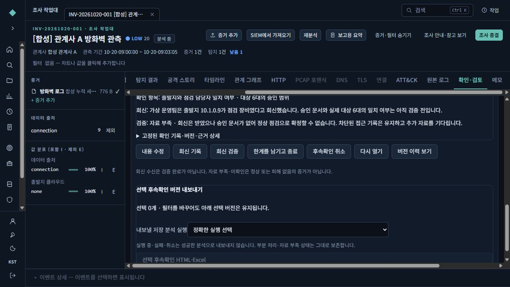
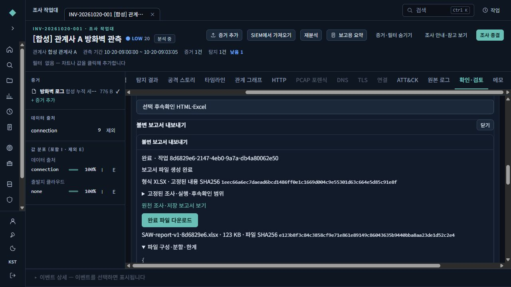
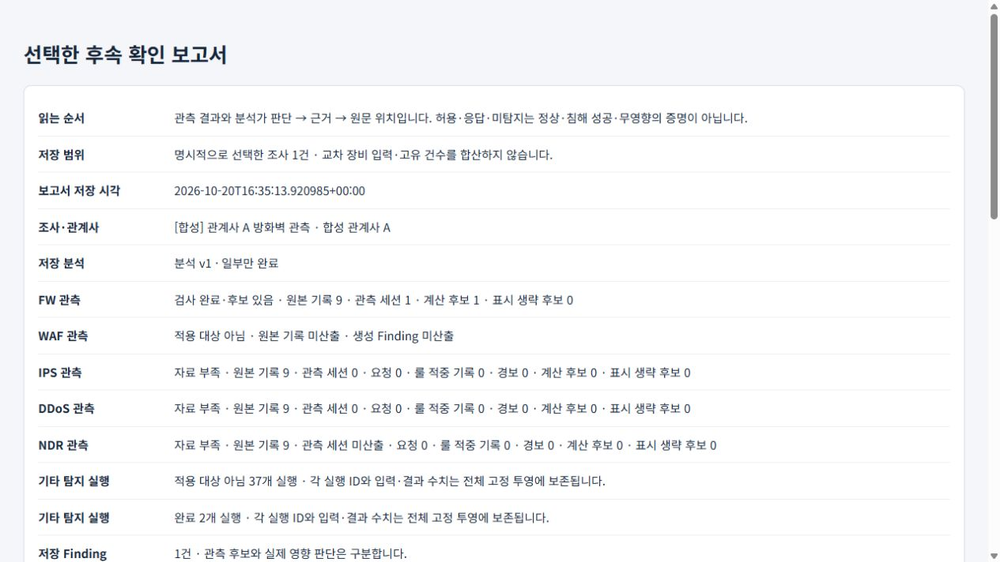

# 후속확인과 정확한 버전 보고서·Excel 사용법

2026-10-21 P3 안내입니다. 조사 작업대에서 **확인 기록 → 후속확인 요청 → 회신 → 검증 → 저장 버전 내보내기**를 진행합니다. 화면을 열거나 회신을 받는 것만으로 확인·검증 완료가 되지 않습니다.

이 문서는 정상 MFA 로그인 후 합성 조사로 확인한 실제 브라우저 흐름을 설명합니다. 아래 사례의 **자료 부족**과 **분석 일부 처리**는 보고서에서도 그대로 유지됩니다.

보고서는 먼저 **저장 범위·분석 상태·장비별 관측·분석가 확인·후속확인과 한계**를 요약해 보여줍니다. HTML의 전체 근거 표는 접혀 있으며 필요할 때 **원문 위치와 전체 고정 투영**을 펼칩니다. Excel은 **요약** 시트 상단의 읽기 쉬운 안내부터 봅니다. 긴 문구의 요약 표시와 원래 저장된 전체 값은 구분합니다.

## 1. 탐지에서 실제 확인한 내용을 기록하세요

1. 조사 작업대의 탐지 상세에서 **확인 기록**을 엽니다.
2. 질문 중 **성공 여부 — 실제로 실행·성공했는가**를 선택합니다.
3. 성공을 확인할 자료가 부족한 이 사례에서는 **판단 불가**를 고르고 확인 범위·근거를 적어 **확인 기록 저장**을 누릅니다.
4. 작업대의 **확인·검토** 탭으로 이동합니다. 해당 확인 기록 행에서 **이 확인에서 후속확인 만들기**를 누릅니다.

확인 기록은 분석가의 해석입니다. 허용·응답 기록만으로 실행 성공이나 피해 없음을 확정하지 않습니다. 확인 기록을 남겨도 계산된 관측값이 바뀌지는 않습니다.

## 2. 요청 v1을 만드세요

**확인할 질문**, **필요한 이유**, 필요한 자료·확인 항목과 우선순위를 입력하고 **후속확인 저장**을 누릅니다. 실제 확인 기록에 연결된 후속확인 v1이 만들어집니다.

책임 관계사·담당자·부서·기한은 미지정으로 둘 수 있습니다. 책임 관계사는 관측 대상이나 장비 소유 관계사와 다를 수 있습니다. 부서는 설명이며 담당자 지정으로 권한을 부여하지 않습니다. 빈 기한은 **기한 없음**이고 연체가 아닙니다. 기한을 입력할 때는 `2026-10-25T18:00:00+09:00`처럼 시간대를 포함합니다.

목록에서 **후속확인 열기: …**를 누르면 현재 질문·상태·담당·회신·검증과 연결된 확인 기록을 봅니다. 내용을 바꾸면 새 버전이 생기며 이전 버전을 덮어쓰지 않습니다.

## 3. 회신 v2와 검증 v3을 구분하세요

1. 후속확인 상세에서 **회신 기록**을 누릅니다. 변경 사유와 받은 내용을 적고 필요한 경우 실제 근거 원문 참조를 추가한 뒤 **회신 저장**을 누릅니다.
2. 이 합성 사례의 v2는 **회신 수신 · 검증 전**입니다. 담당자의 답변이 도착했다는 기록이며 답변 내용이 확인됐다는 뜻은 아닙니다.
3. 회신을 검토한 뒤 **회신 검증**을 누릅니다. 검증 결과·변경 사유·검증 근거와 실제 접근 가능한 조사 ID·이벤트 ID를 입력합니다.
4. 이번에는 합성 원문 참조로 검토했지만 성공을 확인하기에는 부족하여 **자료 부족**을 선택하고 **검증 결과 저장**을 눌렀습니다. 후속확인 v3에 검증 기록과 근거가 저장됐습니다.

| 표시 | 의미 |
|---|---|
| 확인 대기 | 요청을 남겼으며 회신을 기다림 |
| 회신 수신 · 검증 전 | 회신을 받았으나 명시적 검증 전 |
| 검증 기록됨 · 자료 부족 | 검증 절차를 기록했으나 필요한 사실은 확인되지 않음 |
| 한계를 남기고 종료 | 남은 불확실성과 사유를 명시해 후속확인을 종료함 |

**검증 기록됨**은 성공·정상·피해 없음의 확인과 다릅니다. 이 사례의 v3은 끝까지 **자료 부족**입니다. 후속확인 상태가 조사 판정이나 탐지 상태를 자동으로 바꾸지 않습니다.

**버전 이력 보기**에서 과거 저장 버전을 읽을 수 있습니다. 과거 버전은 읽기 전용이며 현재 상태와 구분됩니다. 동시 수정으로 충돌하면 작성 중 입력이 유지됩니다. 입력을 확인한 뒤 **편집을 닫고 최신 버전 다시 열기**로 최신 내용을 다시 열 수 있습니다.

## 4. 정확한 v3과 분석 실행을 선택해 Excel을 만드세요

1. 후속확인 목록의 **선택 버전**에서 내보낼 정확한 v3을 선택합니다. 과거 버전은 이력 화면의 **이 저장 버전을 내보내기 선택에 추가**로 고를 수 있습니다. 선택한 버전 ID와 개수를 확인합니다.
2. **내보낼 저장 분석 실행**에서 정확한 분석 실행을 고릅니다. 실제 브라우저 사례에서는 **일부 처리 상태의 분석 v1**을 선택했습니다.
3. **선택 후속확인 HTML·Excel**을 누르고 조사·분석 실행 ID·선택한 후속확인 버전을 확인합니다.
4. 출력 형식 **Excel (.xlsx)**을 선택하고 **선택 범위로 파일 생성**을 누릅니다.
5. **불변 보고서 내보내기** 작업이 완료되고 파일 정보가 표시되면 **완료 파일 다운로드**를 누릅니다.

실제 합성 검증에서는 XLSX 파일을 생성·다운로드하고 다음 **8개 시트**를 확인했습니다: **요약 / 상세 / 확인 필요 / 통계 / 시간 추이 / 근거 / 적용 기준 / 범위·한계**. 파일 크기는 자료와 표시 구성에 따라 달라지므로 완료 화면의 현재 값을 확인하세요. 파일 생성 완료는 분석 전체 완료나 자료 부족 해소를 뜻하지 않습니다.

Excel의 A:G 기술 열은 처음에 숨겨져 있습니다. 행 참조·원본 경로·ID·항목 키가 필요하면 열 머리글에서 **숨김 해제**를 사용합니다. 요약 아래의 전체 투영은 행 그룹의 **+**로 펼칩니다. 숨김은 표시 편의이며 전체 저장값이 삭제된 것이 아닙니다.

HTML과 Excel은 고정된 같은 보고서 내용을 사용합니다. 파일 자체의 SHA256과 보고서 내용의 SHA256은 구분해서 표시합니다. 같은 저장 보고서의 HTML·Excel을 열면 현재 화면의 필터나 나중에 수정한 후속확인으로 다시 계산하지 않습니다.

선택한 후속확인 내보내기에는 선택한 정확한 버전과 그 버전이 참조하는 확인 기록만 포함됩니다. 현재 목록 전체나 이후 새 버전을 자동으로 합치지 않습니다. 미산출·자료 부족은 0이나 정상으로 바꾸지 않으며 부분 처리·범위와 한계를 함께 읽어야 합니다.

실패·취소 작업에는 완료 파일을 제공하지 않습니다. **같은 보고서로 다시 시도**는 같은 고정 보고서에 대한 새 작업을 만듭니다. 다운로드 때 원천 접근 권한이나 무결성 검사가 거부되면 정상 다운로드로 표시하지 않습니다.

## 5. 조사 전체나 여러 조사를 내보낼 때

- **한 조사:** 작업대의 **분석 실행 이력**에서 정확한 실행을 고르고 **선택 실행 HTML·Excel 내보내기**를 누릅니다. 이 방식은 생성 시점의 현재 확인 기록·후속확인까지 고정합니다. 특정 과거 후속확인만 필요하면 앞 절의 선택 버전 내보내기를 사용합니다.
- **여러 조사:** **조사 목록**에서 내보낼 조사에 체크하고 **선택 조사 HTML·Excel**을 누릅니다. 최대 20개이며 관계사 필터를 바꾸거나 이전 페이지를 열어도 아래 선택 목록을 유지합니다. 각 조사에 대해 정확한 저장 분석 실행을 하나씩 선택해야 합니다.
- 선택한 조사 중 권한이 없거나 삭제·변경 충돌이 있으면 요청이 거절될 수 있습니다. 화면에 불러온 일부 목록을 모든 조사로 간주하지 않습니다. 출력 범위를 확인한 뒤 파일을 생성하세요.

여러 조사 보고서는 장비 입력 수를 그대로 더해 하나의 실제 접속 건수로 표시하지 않습니다. 서로 비교 가능한 범위·단위인지와 비교에서 빠진 이유를 함께 확인하세요. 분석이 일부 처리됐거나 근거가 부족한 경우 그 상태를 보존합니다.

## 6. 확인한 범위와 남은 검증

이 안내의 요청 v1 → 회신 v2 → 자료 부족 검증 v3 → 정확한 v3 및 분석 v1 선택 → 실제 XLSX 작업 완료 흐름은 정상 MFA를 거친 실제 브라우저와 합성 근거로 확인했습니다. 파일의 8개 시트도 확인했습니다. 최신 HTML 요약 화면도 실제 브라우저에서 확인했습니다. 2026-10-23에는 같은 저장 보고서 v1의 최신 Excel 파일(129,766바이트)도 실제 브라우저에서 내려받아 8개 시트·읽기 쉬운 요약·숨김 기술 열과 외부 링크·매크로 미포함을 확인했습니다. 앞의 123 KB 완료 화면은 이전 생성 파일의 실제 캡처이며 그대로 보존했습니다. 차트 참조는 자동 시험으로 확인했고, 실제 Excel·LibreOffice 화면 렌더링은 아직 확인하지 않았습니다.

합성 자료를 사용한 실제 PostgreSQL 16.15·OpenSearch 2.19.6 통합 시험은 **13건 통과·건너뜀 0건, 143.532초**였고 정상 종료를 확인했습니다. 이 실행은 이후 다운로드 권한·부분 파일 정리 보완 전에 수행한 결과입니다. 이후 최종 다운로드 권한·부분 파일 정리 수정은 새 PostgreSQL/OpenSearch 환경에서 **15건 통과·실패/건너뜀0건, 159.04초**로 별도 검증하고 정상 종료했습니다. 전체 서버 회귀는 최종 코드 동결 후 **2,060건 통과·6건 건너뜀·실패0건**입니다. [상세 검증](verification/affiliate-p3-validation-20261023.md)을 함께 확인하세요.

**Excel·LibreOffice의 실제 화면 렌더링, 16GB 장비와 깨끗한 LTSC 2019 설치·재시작, 운영 자료·설치 환경 검증은 아직 완료한 것으로 표시하지 않습니다.** 이 합성 예시는 탐지 정확도·운영 품질·최종 운영 승인을 보증하지 않습니다.
