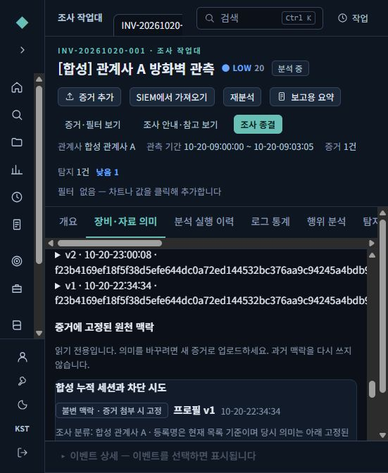
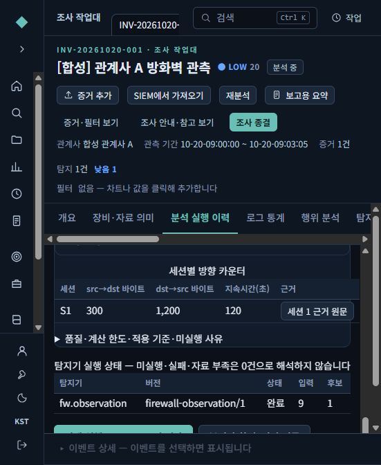
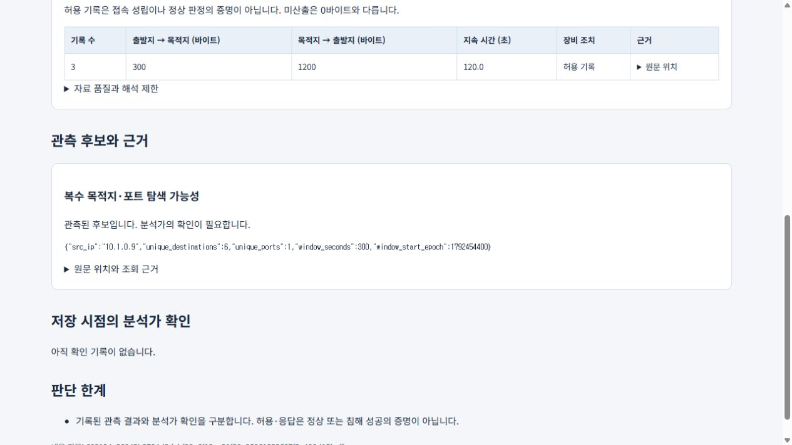

# 관계사·장비를 고른 방화벽 분석 사용법

이 안내는 합성 자료로 실제 실행한 P1 화면입니다. 운영 로그·계정은 사용하지 않았습니다.
P2~P5 기능과 새 설치 매체의 완료 안내는 아닙니다.

## 1. 조사와 장비를 등록합니다

조사 목록에서 관계사를 고르고 조사를 만듭니다. 서비스명이나 의심 IP는 없어도 됩니다.
조사 안의 **장비·자료 의미**에서 장비를 만들고, 로그의 필드 사전에 맞는 프로필 버전을 저장합니다.

관계사는 이름이 같아도 별도 ID로 관리합니다. 같은 사설 IP가 있어도 다른 관계사·망의 자산이나 기준을 자동으로 가져오지 않습니다.
장비 이름은 FW-LAB-01 같은 식별 가능한 이름을 사용합니다.

시간의 역할·시간대, 세션 시작/중간/종료 구분, 송수신 카운터의 누적 여부와 단위를 확인합니다.
의미를 모르면 미확인으로 둡니다. 검증된 값으로 바꾸려면 근거를 기록하고 확인해야 합니다.
합성 예제 버튼은 연습용이며 실제 제조사 로그에 대한 검증을 대신하지 않습니다.

## 2. 증거에 프로필을 지정하고 분석합니다

**증거 추가**에서 파일을 선택하고 관계사·장비 프로필을 지정합니다.
프로필은 해당 증거가 처리될 때의 버전으로 고정됩니다. 이후 프로필을 고쳐도 과거 분석은 바뀌지 않습니다.

파일 속 행의 관계사·장비 정보가 지정한 범위와 충돌하면 미확인으로 분리합니다.
검증된 발생/시작/종료 시각은 검색과 분석에서 같은 기준으로 사용합니다.
원문 시각과 업로드 기본 시간대의 이전 해석은 추적 정보에 남습니다.
수집 시각이나 미검증 시각을 발생 시각이라고 바꾸지 않습니다.

## 3. 같은 범위를 서버에서 계산합니다

**분석 실행 이력**에서 관계사와 장비를 고른 뒤 **선택 범위로 장비 분석 실행**을 누릅니다.
현재 화면의 기간·필터를 적용할지 선택할 수 있습니다.
완료된 실행을 선택하면 그 당시의 입력·범위·계산 기준으로 저장된 결과가 나옵니다.

합성 예제는 기록 9개입니다.

- S1 세션의 시작·중간·종료 3개: 0/0 → 100/900 → 300/1,200바이트
- 별도 출발지의 목적지 6곳에 대한 거부 시도 6개

결과는 기록 9개, 세션 1개, 시작 기록이 있는 접속 1개, 거부 시도 6개입니다.
S1은 최종값인 300/1,200바이트입니다. 중간값을 더한 400/2,100바이트로 계산하지 않습니다.
시작 기록은 핸드셰이크 성공이나 침해 증거와 다릅니다.

## 4. 후보에서 근거로 내려갑니다

탐색 후보의 **근거 원문**을 누르면 해당 후보의 6개 기록으로 범위가 좁혀집니다.
현재 예제의 나머지 정상 세션 기록 3개까지 탐색 근거에 섞이지 않습니다.
세션의 근거 버튼은 해당 세션 기록으로 이동합니다.

자료 부족·부분 계산·실패는 일치 0건과 구분합니다.
상한 때문에 결과 표시가 줄어들면 생략 건수와 계산 범위를 함께 확인합니다.
“허용”이라는 장비 조치만으로 연결 성공·자료 유출을 확정하지 않습니다.

## 5. 저장 보고서를 만듭니다

완료된 실행을 고르고 **선택 실행 HTML 보고서 저장**을 누릅니다.
저장 보고서는 화면의 실시간 값을 다시 읽지 않고 고정된 실행 내용을 보여줍니다.
다른 분석을 수행해도 이전 보고서 내용은 유지됩니다.

분석가의 최종 확인·판단은 **확인·검토**에서 따로 기록합니다.
보고서 열람만으로 확인 완료나 사건 종결 상태가 바뀌지 않습니다.

## 검증 범위

실제 브라우저에서 합성 계정의 로그인·MFA, 조사 열기, 관계사·장비 선택, 서버 작업 실행,
완료 표시, 후보 원문 6개 조회, 저장 HTML 열기를 실행했습니다.
합성 예제에 대한 결과이며 제조사별 실제 로그 정확도나 LTSC2019 설치 인수를 뜻하지 않습니다.
