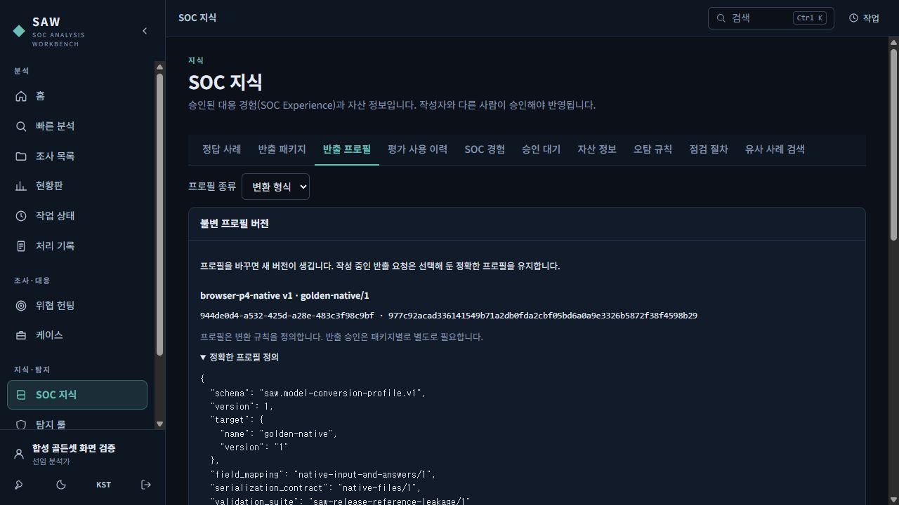
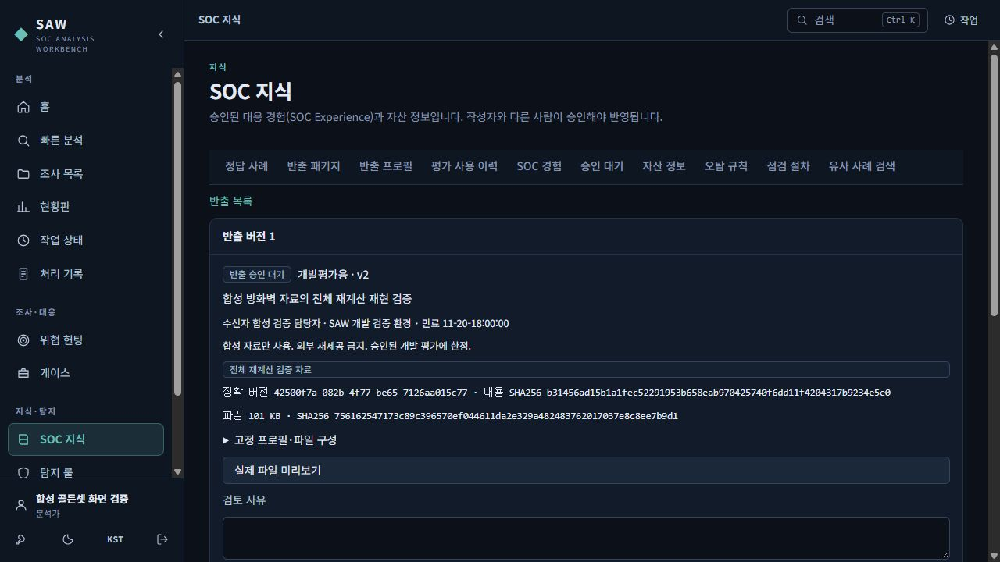
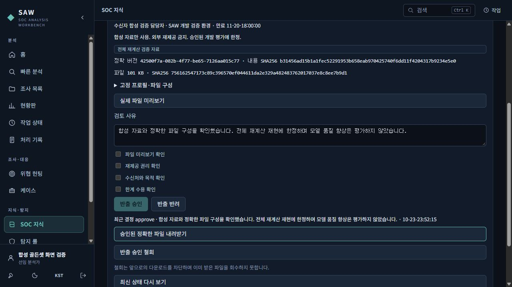
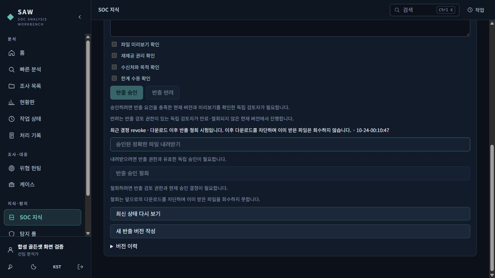
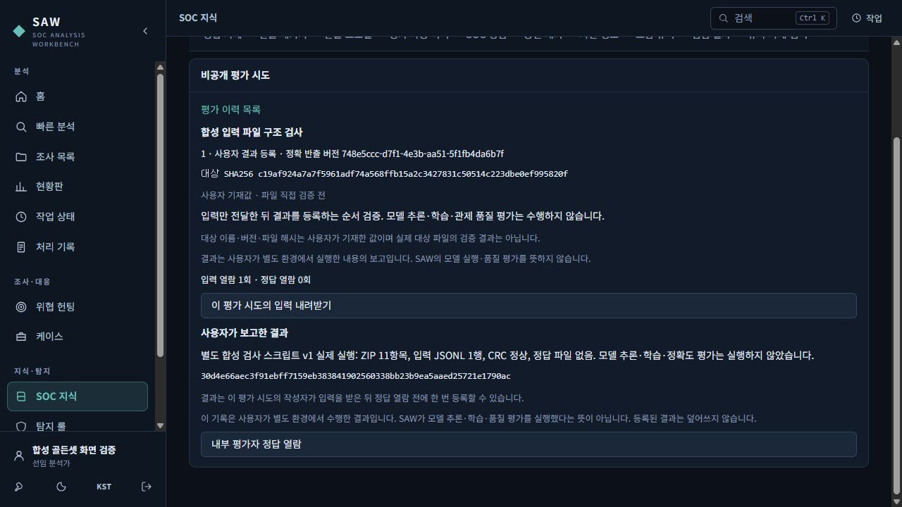
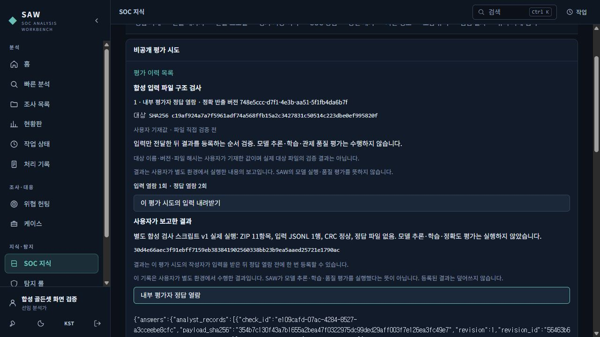

# 분석 경험을 검토용 골든셋으로 내보내기

확인일: 2026-10-24. 합성 방화벽 자료로 조사 경험을 검토용 파일로 만드는 흐름을 설명합니다. 아래 그림은 실제 합성 자료 화면이며 원본 캡처를 그대로 사용했습니다.

골든셋은 분석 근거와 검토한 정답을 묶은 예제입니다. 분석을 다시 확인하거나 모델·탐지기·프로그램을 평가할 때 쓸 수 있습니다. 이 기능은 모델을 자동으로 학습시키거나 평가 프로그램을 자동 실행하지 않습니다.

## 먼저 알아둘 두 가지 승인

| 단계 | 확인하는 내용 | 누가 확인하나요? |
|---|---|---|
| 지식 채택 | 분석 경험과 골든셋의 근거·정답을 지식으로 써도 되는지 | 작성·수정에 참여하지 않은 검토자 |
| 반출 승인 | 정확히 생성된 파일을 이 목적과 수신자에게 보내도 되는지 | 해당 반출의 자료·프로필·파일 작성에 참여하지 않은 반출 승인자 |

골든셋을 채택했다고 외부 반출까지 허용된 것은 아닙니다. 가명처리·변환 프로필을 저장한 것도 반출 승인이 아닙니다. 프로필은 파일을 바꾸는 규칙을 정하며, 실제 파일은 별도로 생성하고 미리 보고 승인합니다.

반출 승인자는 분석 경험, 확인 기록, 후속확인, 탐지 정답, 골든셋, 프로필과 반출 요청에 참여한 사람과 독립적이어야 합니다. 직책 이름만으로 버튼이 열리지 않습니다. 서버가 현재 권한, 모든 원천 조사에 대한 접근 권한, 작성 참여 여부와 파일 상태를 다시 확인합니다.

## 예제: 21행과 7개 세션

이 안내의 예제는 합성 방화벽 로그입니다. 21행은 실제 연결 7개 세션의 시작·중간·종료 기록입니다. 누적 전송량을 행마다 더하지 않습니다. 각 세션의 최종 값은 출발지→목적지 300바이트, 반대 방향 1,200바이트입니다.

첫 5분에는 목적지 포트 6개가 관측되어 포트 분산 후보가 나옵니다. 뒤의 5분에는 포트 하나만 관측됩니다. 이것은 탐지 조건에 맞는지에 대한 정답입니다. 실제 침해·피해·정상 업무 여부는 자료가 부족하므로 미확인으로 남깁니다.

## 1. 조사에서 근거와 미확인 사항을 남깁니다

관계사·장비 해석 기준을 지정하고 로그를 올립니다. 기록 수, 세션 수, 누적 전송량과 후보의 시간 범위를 확인한 뒤 관련 이벤트로 확인 기록을 남깁니다.

예를 들어 “포트 분산은 관측했으나 프로세스와 업무 승인 자료가 없다”고 적습니다. 자료가 없다는 이유로 정상이나 침해로 확정하지 않습니다. 후속확인이 필요하면 요청·회신·검증을 구분해 기록합니다. 조사를 종결할 때 Experience 저장을 선택합니다. 종결은 모든 의문이 해결되었다는 뜻은 아닙니다.

## 2. 정확한 버전으로 골든셋을 만들고 채택합니다

지식 화면에서 해당 Experience의 골든셋을 엽니다. v2 초안에서 사용할 확인 기록의 수정본, 완료된 분석 실행과 필요한 탐지 정답 사례의 버전을 선택합니다. 이후 기록이 바뀌어도 과거 초안의 근거를 최신 기록으로 자동 교체하지 않습니다. 정확한 당시 버전이 없거나 선택한 분석 범위가 다르면 그대로 진행할 수 없습니다.

탐지 조건의 일치 여부와 사건의 의미·영향을 나누어 검토합니다. 예를 들어 승인된 업무도 탐지 조건에는 맞을 수 있습니다. 정답을 붙이지 않은 단위는 정답 미지정으로 남깁니다. 작성자와 다른 검토자가 Experience를 승인하고 골든셋을 채택합니다. 검토자가 내용을 고치면 새 초안의 작성 참여자로 기록됩니다.

분할은 사용 목적에 맞춥니다.

| 분할 | 사용할 때 |
|---|---|
| 학습(train) | 별도로 승인된 학습·개발 절차에 예제를 제공할 때 |
| 개발(dev) | 답을 보면서 구현이나 탐지 조건을 조정할 때 |
| 평가(holdout) | 답을 미리 보지 않고 결과를 제출해 평가할 때 |

같은 사건에서 나온 자료를 학습과 평가에 나누어 넣으면 평가가 부풀려질 수 있습니다. 서버는 실제로 재사용한 원천 자료·근거와 명시적인 사건 관계로 사건 묶음을 관리합니다. 주소나 제목이 같다는 이유만으로 같은 사건으로 묶지는 않습니다. 새 사례 이름이나 반출 이름으로 같은 사건의 분할 제한을 피할 수 없습니다.

## 3. 목적에 맞는 반출 파일을 요청합니다

채택한 정확한 골든셋 버전을 선택하고 반출 요청으로 이동합니다. 목적, 받는 사람·조직, 사용 조건, 만료일과 반출 권리의 근거를 적습니다. 가명처리 프로필과 변환 프로필은 정확한 버전을 선택합니다. 나중에 새 프로필이 저장되어도 요청의 프로필이 자동으로 바뀌지 않습니다.

반출 프로필 화면입니다. 변환 규칙의 정확한 버전이 표시되며, 프로필 저장과 패키지 반출 승인이 별개임을 안내합니다.

| 방식 | 할 수 있는 일과 한계 |
|---|---|
| 해석용 | 저장한 대표 근거로 설명과 판단을 검토합니다. 전체 로그가 들어 있다는 뜻은 아닙니다. |
| 전체 재계산 | 지원하는 완전한 입력 범위를 서버가 실제로 읽고, 원본·변환본의 분석과 탐지 정답이 유지되는지 비교한 경우에만 인정합니다. |

처음 지원하는 전체 재계산은 고정된 방화벽 분석과 시간창 단위 탐지 정답, 시간을 이동하지 않는 변환입니다. 해당 방화벽 탐지기만 선택한 완료 실행과 정확한 범위가 필요합니다. 다른 분석기가 함께 실행되어 전체 실행이 부분 상태라면 그 상태를 완료로 바꾸어 해석하지 않습니다.

대표 근거만 있거나 입력이 잘렸거나, 필요한 버전·수집 시각 근거가 없거나, 지원하지 않는 분석이면 전체 재계산 성공으로 표시하지 않습니다. 실패 이유를 확인한 뒤 필요하면 해석용 요청을 별도로 만듭니다. 전체 재계산 실패가 해석용 성공으로 자동 바뀌지는 않습니다.

파일 생성 상태는 작업 화면에서 확인합니다. 취소·실패 후 재시도는 검증된 같은 입력을 사용합니다. 이미 승인된 이전 파일이 있다면 새 파일 생성 실패가 그 파일을 덮어쓰지 않습니다.

안내 문구 정리 전의 실제 승인 대기 화면입니다. 개발 평가용 v2 파일에 ‘전체 재계산 검증 자료’가 표시되어 있고, 정확한 버전과 파일 지문을 확인할 수 있습니다. 이 상태는 반출 승인 전입니다.

## 4. 독립된 반출 승인자가 정확한 파일을 확인합니다

반출 승인자는 대상 버전의 미리보기를 열어 파일 구성, 목적·수신자·권리·사용 조건과 한계를 검토합니다. 미리보기는 일부 텍스트와 생략한 파일·바이트 범위를 보여줍니다. 전체 파일을 모두 표시하는 화면은 아닙니다.

가명처리는 익명화를 보장하지 않습니다. 자유 텍스트와 다른 정보의 조합으로 누군가를 알아볼 가능성도 함께 검토합니다. 승인 시 미리보기, 반출 권리, 목적·수신자, 한계를 각각 확인하고 사유를 남깁니다. 부적절하면 사유를 남겨 반려할 수 있습니다.

승인은 이 버전의 이 파일에만 적용됩니다. 다른 버전이나 새로 만든 파일에 승인이 이어지지 않습니다. 골든셋 채택 검토자가 반출 승인자로 자동 지정되는 것도 아닙니다. 서버가 승인할 때 정확한 파일과 현재 권한을 재확인하므로 사용자가 해시를 눈으로 비교할 필요는 없습니다.

안내 문구 정리 전의 실제 승인 완료 화면입니다. ‘최근 결정 approve’와 ‘승인된 정확한 파일 내려받기’가 보입니다. 검토 사유에는 합성 자료의 전체 재계산 재현만 확인했고 모델 품질 향상을 평가하지 않았다고 남겼습니다.

## 5. 승인된 파일을 받고 필요하면 철회합니다

다운로드는 승인된 저장 파일을 그대로 받습니다. 다운로드할 때 파일을 새로 생성하지 않습니다. 원천 조사 접근 권한, 채택·사건 묶음 상태, 승인자의 현재 자격, 만료·철회 여부와 파일 무결성을 다시 확인합니다.

철회하면 이후 다운로드가 차단됩니다. 이미 받은 파일을 원격으로 회수하지는 못합니다. 수신자에게 적용할 회수·폐기 절차는 별도로 관리합니다. 철회한 버전은 다시 승인하지 않고 새 후보 버전을 만들어 검토합니다.

원천 자료를 참조하는 반출·평가 기록이 있으면 삭제 시에도 보존 조건을 확인합니다. 취소·만료·철회가 승인과 감사 이력을 지우지는 않습니다.

최근 결정이 revoke로 바뀌고 다운로드가 비활성화된 실제 화면입니다. 이후 HTTP 다운로드 요청도 409로 차단되는 것을 확인했습니다. 화면에도 이미 받은 파일은 회수하지 못한다는 한계를 표시합니다.

## 6. Holdout은 입력 → 결과 등록 → 내부 답안 확인 순서입니다

평가용 반출 ZIP에는 답안을 넣지 않습니다. 일반 목록에서도 답안이나 답을 드러내는 판단 정보를 보여주지 않습니다. 학습·개발용 답안 파일과 평가용 입력 파일을 구분해 사용합니다.

1. 승인된 평가용 파일에서 평가 이력을 만듭니다. 대상 모델·탐지기·프로그램의 이름, 버전과 정확한 파일 지문을 적습니다. 사용자가 입력한 대상 정보라는 한계도 확인합니다.
2. 이 평가 이력으로 입력 파일을 받습니다. 답안을 보지 않은 상태에서 승인된 외부 절차로 대상 프로그램을 실행합니다.
3. 실행 결과의 파일 지문과 요약을 등록합니다. SAW에 등록한 내용은 “사용자 제출 결과”입니다. 등록만으로 SAW가 모델을 실행했거나 결과 품질을 검증했다는 뜻은 아닙니다.
4. 결과 등록 뒤, 내부 답안 열람 권한이 있는 평가자가 명시적으로 답안을 엽니다. 반출 승인 권한과 답안 열람 권한은 별도입니다. 결과를 제출한 사람에게 자동으로 답안 권한이 생기지 않습니다.

같은 사건 묶음과 같은 대상 파일을 새 이름으로 다시 평가하여 사용 이력을 초기화할 수 없습니다. 같은 평가 이력에서 입력을 다시 받는 것은 새 평가가 아닙니다. 대상 파일이 달라져도 앞선 사건 사용 이력은 남습니다.

실제 결과 등록 화면입니다. 입력 열람 1회·정답 열람 0회이며, ZIP 11항목·입력 JSONL 1개·답안 파일 없음이라는 검사 결과를 남겼습니다. QA 입력 검사 프로그램을 실제로 실행한 결과이며 LLM 실행이나 모델 품질 평가가 아닙니다.

결과 등록 뒤 내부 평가자가 명시적으로 연 답안입니다. 답안은 화면 아래에 텍스트로 표시되며 앱이 유지됩니다. 입력 열람 1회·정답 열람 2회는 앞서 화면 표시가 실패한 요청과 수정 후 재확인 요청을 모두 남긴 이력입니다.

## 현재 확인 범위

실제 합성 브라우저에서 프로필 생성, 21행·7세션의 전체 재계산 반출, 일반 MFA로 로그인한 독립 승인자의 승인, ZIP 다운로드와 철회를 확인했습니다. 철회 뒤 다운로드 차단은 HTTP 요청으로 확인했습니다. Holdout 반출 준비는 HTTP로 수행했고 브라우저에서는 평가 이력 생성·입력 다운로드·결과 등록을 확인했습니다.

답안 텍스트 처리 오류를 수정한 뒤 최종 빌드 화면으로 서버를 다시 시작하고, 실제 브라우저에서 내부 답안 표시와 앱 유지를 확인했습니다. 재시작 전후 기존 고정 기록 7종이 그대로 유지되는 것도 비교했습니다.

전체 서버 시험과 실제 화면 확인을 마쳤습니다. 최종 모델 제외 매체와 설치·업데이트·복구 확인은 P5에서 이어집니다. 실제 PostgreSQL·OpenSearch와 웹 자동 시험은 실행별 결과·실패 이력을 구분합니다. 이 문서는 LTSC 2019 설치 인수나 운영 자료의 반출 승인을 대신하지 않습니다.

자세한 실행 결과와 한계는 [P4 검증 기록](verification/affiliate-p4-validation-20261024.md)을 확인하세요.
