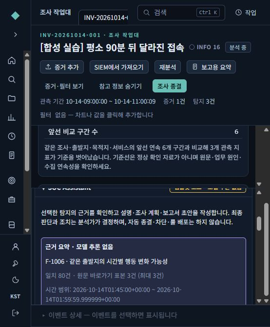
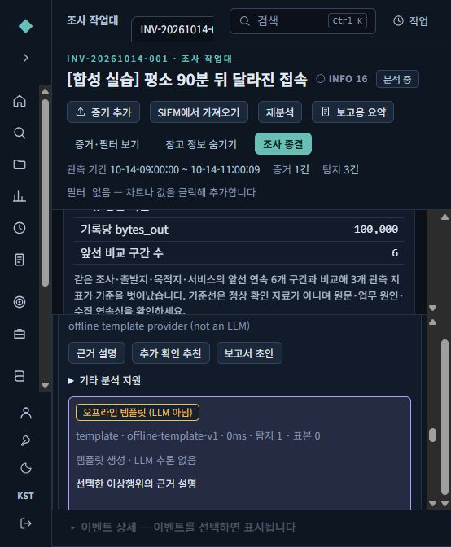
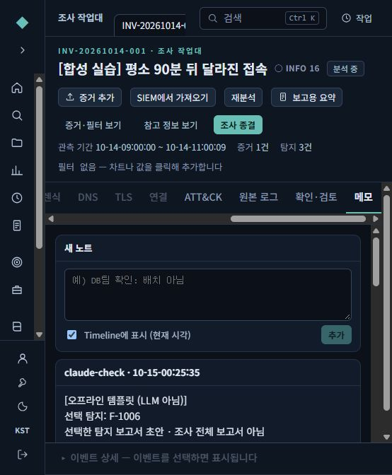
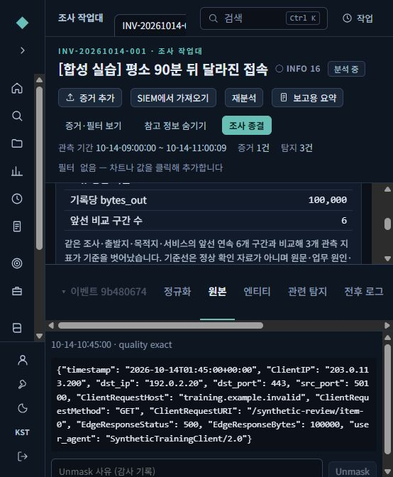

# 선택한 이상행위 설명과 조사 보조 사용법

2026-10-15. 현재 작업본 `F:/codex/SAW-Claude-main`의 조사 보조 기능 안내다. 원본 Claude 폴더는 수정하지 않는다.

## 1. 어디에서 시작하나

조사 작업대에서 **탐지 결과**를 열고 분석할 탐지 하나를 선택한다. 위쪽 **참고 정보 보기**를 누른 뒤 참고 패널의 **SOC Assistant**로 이동한다. 창이 좁으면 참고 패널이 본문 아래로 내려갈 수 있다.

먼저 **근거 요약 · 모델 추론 없음**을 읽는다. 선택 탐지 번호, 근거 조건에 맞는 현재 로그 건수, 조회 시간, 저장된 지표와 비교 기준을 표시한다. 원문 바로가기 표본은 최대 3건이다. 전체 로그를 읽은 모델 답변이 아니다.

- 실제 표본을 읽으려면 **측정값·확인 결과·근거 열기**에서 이벤트 참조를 누른다.
- 표본 참조 3건과 근거 일치 건수는 구분한다. 예를 들어 일치 80건이어도 바로가기는 3개만 제공한다.
- 조회 범위가 없거나 현재 일치 로그가 없으면 그 사유를 표시한다. 이 상태가 정상·오탐 판정은 아니다.
- 저장된 비교 기준은 탐지 시점의 계산이다. 이전 구간이 정상이라고 승인됐다는 의미는 아니다.

## 2. 세 가지 버튼을 사용하는 순서

| 버튼 | 사용 목적 | 검토할 부분 |
|---|---|---|
| 근거 설명 | 관측값과 비교 기준을 이해한다 | 어떤 값이 달라졌는지, 근거에 없는 해석이 섞였는지 |
| 추가 확인 추천 | 다음에 확인할 자료를 정리한다 | 정상 작업·재시도·장애 가능성과 실제 실행 근거 |
| 보고서 초안 | 선택한 탐지에 대한 짧은 초안을 만든다 | 현재 조사 전체를 대표하는 보고서로 오해하지 않았는지 |

이 세 동작은 선택한 탐지의 제한된 지표·체크·시간·건수와 한계를 사용한다. CPU 자원을 고려해 원시 이벤트 본문, 조사 전체 메모, 다른 탐지, 과거 Experience를 함께 전달하지 않는다. 원문을 직접 검토한 모델이라고 해석하면 안 된다. 기존 과거 사례 비교 등은 **기타 분석 지원**에서 별도로 사용한다.

예를 들어 가상 자료에서 요청 수가 직전 구간의 10건에서 80건으로 늘고 오류 비율도 증가했다면, 관측 사실과 정상 배치·재시도·장애·공격 가능성을 구분해 검토한다. 요청 증가만으로 유출이나 침해 성공을 확정하지 않는다. 수집 연속성과 해당 시간의 승인 작업도 확인한다.

생성 결과를 검토한 다음 **노트로 저장**을 누른다. 저장 성공 또는 실패가 화면에 표시된다. 저장은 분석가의 명시적인 선택이며 탐지 판정·승인·룰 배포·차단을 변경하지 않는다. 다른 탐지를 선택하면 이전 답변을 새 탐지의 결과로 보여주거나 저장하지 않는다.

## 3. 모델 상태를 읽는 법

| 화면 상태 | 의미 |
|---|---|
| 근거 요약 · 모델 추론 없음 | 기존 분석 결과를 정해진 방식으로 정리한 화면 |
| 템플릿 모드 · 모델 추론 없음 | 버튼 결과도 정해진 템플릿으로 작성됨 |
| 모델 추론 비활성 | 모델 생성은 불가능하지만 근거 미리보기는 사용할 수 있음 |
| AI 생성 초안 · 사실 검토 필요 | 모델이 생성했고 응답 형식·인용 ID 검사를 통과한 초안 |
| AI 출력 검증 실패 · 답변 미채택 | 형식이나 인용을 확인하지 못해 답변을 숨김 |
| 실행 상태 확인 실패 / CPU 실행 오류 | 생성 성공으로 처리하지 않음 |

인용 ID가 존재한다는 검사와 문장이 실제 근거로 뒷받침된다는 검토는 다르다. “실제 모델 추론 실행됨”도 한국어 품질이나 보안 판단 정확성의 합격 표시가 아니다. 모델에는 작업 실행 도구를 주지 않는다.

## 4. 폐쇄망 모델 운영 방향

지정 Foundation-Sec-8B BASE는 유지한다. Foundation-Sec-8B-Instruct를 보안 평가 우선 후보로, Kanana 1.5 8B Instruct를 한국어 비교 후보로 둔다. 새 후보의 실제 반입·직렬화 호환성·한국어 평가가 끝나기 전에는 사용 가능한 모델로 표시하지 않는다.

GPU 없는 16GB 환경에서는 모델 하나씩, 선택한 탐지에 대한 요청만 처리하는 구성을 우선 시험한다. 현재 CPU 실행 상한은 동시 1건, 4스레드, 문맥 1,024토큰, 출력 128토큰, 300초, 프로세스 8GiB다. 짧은 초안 용도이며 전체 사건 장문 보고서 생성 능력을 뜻하지 않는다. SAW·OpenSearch와 함께 쓸 때의 전체 RAM·응답 지연·공동 접속은 별도 대상 장비 시험이 필요하다.

현재 native 모델 실행은 승인된 합성 조사만 허용한다. 운영 자료 반입·모델 학습·운영 모델 채택·배포 승인은 그대로 유지한다.

- [모델 후보·다운로드·반입 가이드](MODEL-8B-KOREAN-SECURITY-GUIDE.md)
- [고정 합성 한국어 보안 평가 8사례](samples/assistant-korean-security-evaluation.json)
- [기존 모델팩 반입·선택 안내](LOCAL-MODEL-GUIDE.md)

평가 사례의 질문과 근거만 모델에 전달한다. 정답 기준과 중대 오류 목록은 검토자가 별도로 사용한다. 한국어 글자가 포함됐다는 검사, JSON 성공, 학습 loss 감소만으로 관제 품질을 승인하지 않는다.

## 5. 실제 화면으로 따라하기

아래는 2026-10-15 개발기 브라우저에서 직접 확인한 합성 실습이다. 현재 실습 주소는 `http://127.0.0.1:57284/`이다. 이 주소는 개발 PC에서만 열리며 폐쇄망 서버 설치 주소는 아니다. 화면의 답변은 **템플릿**이며 LLM 답변으로 세지 않는다.

1. 조사 `[합성 실습] 평소 90분 뒤 달라진 접속` → **탐지 결과** → `F-1006 같은 출발지의 시간별 행동 변화 가능성` → **참고 정보 보기**를 누른다. 좁은 창에서는 본문 바깥쪽 스크롤을 내리고 참고 패널 안에서 다시 스크롤한다. 넓은 창에서는 오른쪽에 나타난다.
2. 근거 요약에서 일치 **80건**, 원문 바로가기 **3건**을 구분한다. 전체 조사 160건 중 선택한 15분 구간이다. UTC 조회 시각과 상단 KST 표시 시각은 9시간 차이가 난다.

3. **근거 설명 → 추가 확인 추천 → 보고서 초안** 중 목적에 맞는 버튼을 누른다. 현재 실습은 `오프라인 템플릿 (LLM 아님)`으로 표시된다. 요청 수·오류 비율·전송량 변화는 관측 사실이고, 배치·장애·공격 가능성은 추가 확인 대상이다.

4. 내용을 검토하고 **노트로 저장**을 누른다. 이번 실습에서는 저장 성공 뒤 새로고침하고 **메모** 탭에서도 같은 초안이 남는 것을 확인했다. 노트는 정탐 승인이나 사건 종결이 아니다.

5. 근거 요약의 **측정값·확인 결과·근거 열기** → `evt:…` → 하단 **원본**을 누른다. 이번에는 `synthetic-temporal.jsonl`의 **71번째 줄**, `2026-10-14T01:45:00+00:00` 합성 이벤트로 이동했다. 다른 탐지로 바꾸면 이전 생성 결과는 지워진다.

## 6. 이번 실제 모델 실행 결과

지정 Foundation BASE Q4는 개발기의 CPU에서 짧은 생성 시험을 통과했다. 그러나 선택한 탐지 설명 요청은 입력 598토큰으로도 전체 300초 예산을 초과하여 답변을 채택하지 않았다. 한국어 보안 품질 합격이나 실사용 준비 완료가 아니다. 실행 후 시험 모델을 비활성화했고 브라우저는 계속 템플릿 모드이다.

이 시험은 Windows 11·32GB 개발기이며 LTSC2019·16GB 서버의 결과가 아니다. 새 Instruct/Kanana 후보, 고정 8사례 품질 평가, SFT/adapter 학습은 실행하지 않았다. 자세한 성공·실패·환경 경계는 [검증 기록](ASSISTANT-EVIDENCE-VALIDATION-2026-10-15.md)에 남겼다.
