# 웹 행위 분석 사용 안내

이 기능은 기존 조사에 올린 웹·WAF 기록을 수치와 시간 흐름으로 확인하고, 분석가의 판단을 근거와 함께 보존합니다. AI 모델 없이 동작합니다. **참고 임계값에 도달했다는 사실은 악성·ARTEX·AI 사용·침해 성공의 판정이 아닙니다.**

## 1. 합성 자료로 시작하기

[사례 A](examples/behavior/case-A.csv), [사례 B](examples/behavior/case-B.csv), [사례 C](examples/behavior/case-C.csv), [사례 D](examples/behavior/case-D.csv)는 각각 83건의 가상 요청입니다. 실제 고객·은행 자료는 포함하지 않습니다.

| 사례 | 준비된 관측 | 확인할 점 |
|---|---|---|
| A | 짧은 집중 요청과 여러 경로·404, 요청 사이 공백 | 자동화 탐색 가능성을 설명하고 도구와 AI 사용은 단정하지 않기 |
| B | norma/0.4 문자열과 일부 허용 기록 | 문자열 일치, WAF 조치, 원본 처리 결과를 구분하기 |
| C | 가상의 승인 점검·배치가 요청·경로 기준을 초과 | 승인 대상·시간·방식의 일치 여부를 별도 근거로 확인하기 |
| D | UA 열 없음, 초 단위 시각, 관측 사이 공백 | 미수집을 헤더 부재나 0개로 바꾸지 않기 |

조사를 열고 **증거 추가**로 CSV를 올립니다. 처리 작업이 완료되면 **로그 통계**에서 출발지·서비스를 살펴보고 **행위 분석** 탭으로 이동합니다. 별도 조사로 IP마다 복제할 필요가 없습니다.

## 2. 범위를 고르고 계산하기

**분석 IP**에 `203.0.113.44`를 입력하고 **IP 역할 → 출발지**를 선택한 뒤 **행위 분석 실행**을 누릅니다. 여러 IP는 쉼표로 구분하며 최대 16개입니다. 비우면 현재 조사 필터·시간 범위의 모든 IP를 사용합니다. 목적지와 어느 쪽이든도 선택할 수 있습니다.

IP 한 개가 한 사람이라는 뜻은 아닙니다. 프록시·NAT·공유 계정을 확인합니다. 서비스와 기간은 작업대의 기존 필터를 함께 사용합니다.

결과는 버전별로 저장됩니다. 범위를 바꾸고 다시 계산하면 새 결과가 생깁니다. **저장 버전**으로 과거 계산을 다시 열 수 있습니다. **비교 대상**은 다른 저장 결과와 비교하는 기능이며 자동으로 정상 기준으로 인정하지 않습니다.

**SAW 로컬 분석 기준 · 제외 조건**에서 이번 분석의 기준만 조정합니다. 이 설정은 운영 탐지 정책을 배포하거나 바꾸지 않습니다.

## 3. 자료 품질부터 읽기

**수집 범위와 자료 품질**에서 파일·파서·성공/실패 건수와 필드 수집 상태를 먼저 봅니다.

- **미수집**: 해당 필드가 제공되지 않았습니다.
- **기록된 빈 값**: 필드는 있었으나 빈 값 또는 빈 값 표식이 기록되었습니다. 실제 HTTP 헤더 부재의 증거는 아닙니다.
- **알 수 없음**: 예전 정규화 기록 등으로 수집 상태를 구분할 수 없습니다.
- **일부 자료**: 필요한 값이 일부 없거나 관측 기간·실행 한도에 제약이 있습니다.

WAF만 올린 결과는 수집된 WAF 이벤트입니다. 사이트의 전체 HTTP 요청 수·전체 공격 비율로 읽지 않습니다. 여러 센서가 같은 요청을 기록했을 가능성도 확인합니다.

## 4. 표와 시간 그래프 읽기

| 지표 | 이동 시간창 | 문서 참고 기준 |
|---|---:|---:|
| 요청 수 | 10초 | 30건 |
| 서로 다른 경로 | 60초 | 30개 |
| 404 응답 | 60초 | 15건 |
| 동일 요청 후보 | 60초 | 20건 |
| 고유 User-Agent | 600초 | 2개 + 같은 창의 404 2건 |

각 출발지·목적 서비스별로 관측 시각에서 시작하는 **[시작 포함, 끝 제외)** 시간창을 계산합니다. 표는 최대 관측값과 해당 구간을 보여줍니다. UA의 전체 최대 구간과 404 조건을 함께 만족한 구간이 다르면 구분해서 읽습니다.

요청·경로·반복 지표만 설정한 정적 확장자와 OPTIONS를 제외합니다. 404·UA에는 같은 제외 조건을 일괄 적용하지 않습니다. Cookie 존재만으로 제외하지 않습니다. 반복 후보는 메서드·원본 URI·서비스가 같은 기록입니다. 쿼리 값은 보존하며, 본문까지 동일하다는 뜻은 아닙니다.

그래프는 별도의 고정 구간 집계입니다. 표의 이동 시간창 최대값과 막대 높이를 혼동하지 않습니다. **최대 구간** 버튼과 그래프 확대 조절부로 구간을 좁혀 봅니다. 빈 시간은 관측 공백이며 AI가 생각한 시간이나 확정된 수집 장애가 아닙니다.

## 5. 근거와 요청 비교

**표본 원문**, **근거 표본**, **기록 상세**는 보존한 대표 근거로 이동합니다. 전체 일치 로그를 복제한 것이 아니므로 표본 건수와 전체 관측 건수를 구분합니다. 원문 조회에는 기존 조사 권한과 마스킹을 적용합니다.

**저장된 대표 근거 · 원문과 요청 비교**에서 두 건 이상을 고르고 **선택 요청 비교**를 누릅니다. 저장된 분석에 속한 당시 요청 값으로 비교합니다. 이후 재파싱한 현재 색인으로 과거 결과를 바꾸지 않습니다. 로그에서 제공하지 않은 헤더·본문은 확인할 수 없습니다.

## 6. 해석과 보고서를 남기기

**분석가 확인 기록**을 눌러 관측 사실과 해석을 구분해서 적습니다. 예를 들어 사례 B는 다음처럼 기록합니다.

> norma/0.4 문자열과 허용 기록은 관측했다. 원본 서버 처리 결과가 없어 침해 성공은 미확인이다. 웹 서비스 담당자에게 해당 시간대 WAS 처리 로그와 파일 변경 기록을 요청한다.

미확인 사항은 **후속확인 필요**로 남기고 확인 대상·필요 자료·확인 내용을 채웁니다. 정상 점검이라고 판단할 때는 승인 근거와 대상·시간·방법의 일치 여부를 기록합니다.

**저장 결과 보고서**는 같은 저장 결과에서 만든 9개 절의 독립 HTML입니다. 인터넷 없이 열고 브라우저 인쇄에서 A4 또는 PDF 저장을 선택할 수 있습니다. 계산값과 현재 활성 분석가 확인 기록을 분리해서 보여 줍니다. 결과 ID·버전·SHA-256을 함께 보관합니다.

## 7. 경험과 Golden 사례로 연결하기

기존 **조사 종결**에서 최종 판단과 한계를 적고 Experience 초안 저장을 선택합니다. 종결에 사용한 행위 분석 결과와 확인 기록의 참조가 해당 Experience 버전에 고정됩니다.

기존 Experience 검토 흐름에서 작성자와 다른 검토자가 경험 승인과 Golden 채택을 결정합니다. 미승인 초안은 평가 정답으로 내보낼 수 없습니다. 기준 초과만으로 악성 정답을 만들지 않습니다.

Golden 내보내기는 **평가 입력**과 **평가자 정답**을 분리합니다. 입력에는 승인 당시의 측정값·근거·계산 정의를, 정답에는 판단·필수 확인·후속확인·금지할 단정을 보존합니다. 동일 사건의 파생 사례는 분할 경계를 넘지 않도록 기존 사건군 검사를 적용합니다. 이것은 모델 훈련 실행이 아닙니다.

## 8. 계산 범위와 보존 제한

한 번의 계산은 최대 100,000건·협력적 120초·추정 입력 64MiB·4,096개 출발지/서비스 조합으로 제한합니다. 그래프는 최대 400구간, 대표 근거는 최대 200건을 저장합니다. 한도에 도달하면 부분 결과로 표시하고 정상 판정으로 바꾸지 않습니다. 필터·기간을 좁혀 새 버전으로 계산합니다.

실행 중 원본 처리 상태가 바뀌면 결과 저장을 거부합니다. 취소와 재시작은 기존 작업 체계를 사용합니다. 승인 뒤 변경은 새 버전과 재검토를 거칩니다. 원본·지문·스냅샷이 훼손된 Golden 사례는 검증에 통과한 정상 사례로 내보내지 않습니다.

## 9. 참고와 검증 구분

참고 문서는 사용자가 제공한 Theori ARTEX Whitepaper의 표 7과 부록 A.2입니다. 문서의 실험 결과·로고를 재사용하지 않았습니다. 창의 경계·서비스 구분·정적 확장자·동일 요청 후보 정의는 SAW가 명시한 로컬 계산 계약입니다.

실제 실행 결과와 화면은 [검증 기록](BEHAVIOR-VALIDATION-2026-10-16.md)에 따로 기록합니다. Windows 11 개발기 시험은 LTSC 2019 배포 시험을 대신하지 않습니다.

## 10. 실제 화면으로 따라 하기

아래는 합성 A·B·D 자료를 사용해 실제 앱에서 촬영한 화면입니다. A의 v1·v2와 B의 v2는 서로 다른 저장 결과입니다. 각 보고서·Golden의 결과 ID와 버전을 기준으로 비교하세요.

### ① IP 선택과 실행

조사 작업대 → **행위 분석** → **분석 IP**에 `203.0.113.44` → **IP 역할: 출발지** → **행위 분석 실행**. 완료되면 저장 버전이 생깁니다.

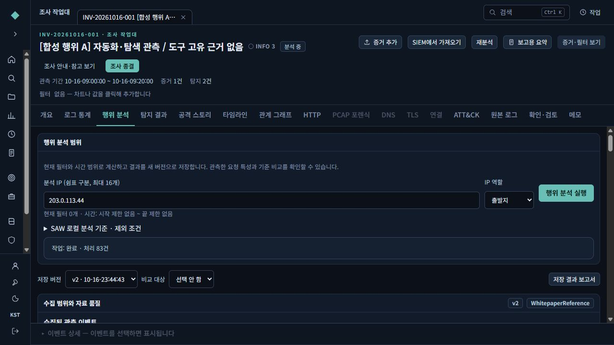

### ② 집중 시간대로 확대

**10초 요청 수 최대 구간**을 눌러 집중된 시간을 봅니다. 사례 B의 그래프는 수집한 WAF 이벤트 기준입니다. 빈 구간의 조치 자료가 없으면 미수집으로 표시합니다.

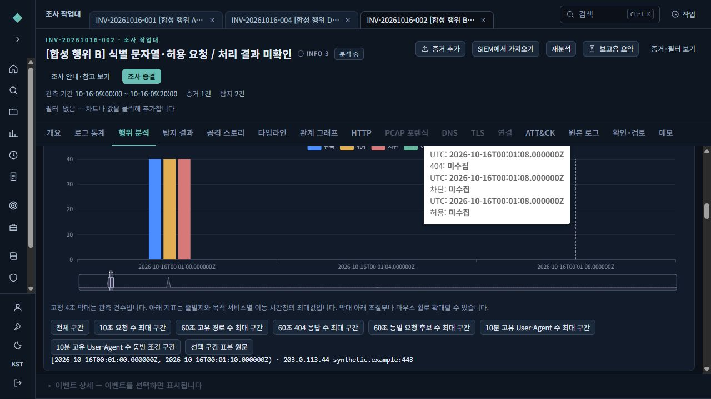

### ③ 지표와 분모 읽기

사례 B의 최대10초 요청40건,60초 경로40개,404 40건을 확인합니다. **대상/제외**와 자료 상태도 함께 읽습니다. 기준 초과는 침해 성공이 아닙니다.

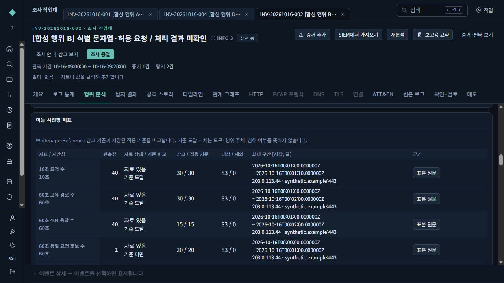

### ④ 원문으로 확인

지표의 **표본 원문**을 눌러 대표 기록으로 이동합니다. 행을 고르고 아래 **원본**을 누릅니다. 파일명·줄 번호·파서가 함께 표시됩니다. 이 화면의16건은 표본이며 관측 전체40건을 뜻하지 않습니다.

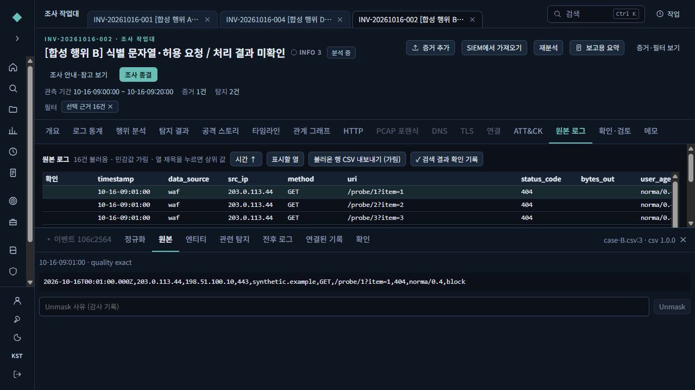

### ⑤ 두 요청의 차이 확인

**행위 분석**으로 돌아와 대표 근거에서 두 건을 체크하고 **선택 요청 비교**를 누릅니다. 사례 A는 경로와 `item` 값이1→2로 바뀝니다. 이는 저장 당시 요청 비교이며 요청 본문까지 같다는 뜻은 아닙니다.

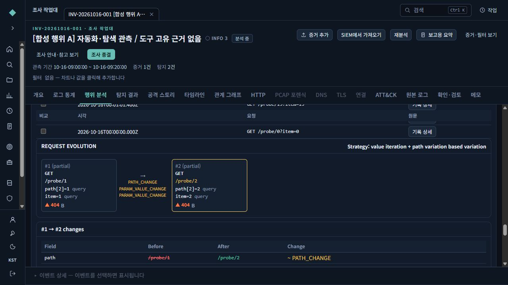

### ⑥ 후속확인 항목 읽기

사례 B에서는 문자열이 관측되어 도구 관련 질문이 추가됩니다. 자료·허용된 확인 행동·해결 조건·미해결 처리·금지 단정·버전을 읽습니다. 문자열만 보고 도구 실행이나 AI 사용으로 판정하지 않습니다.

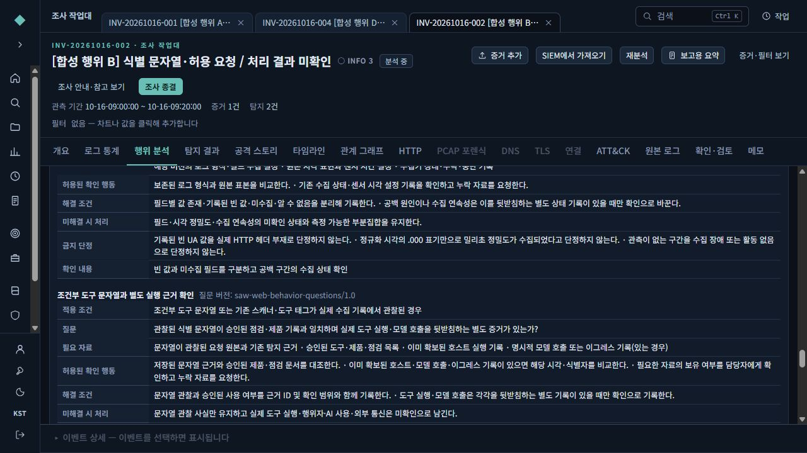

### ⑦ 분석가 확인 기록 저장

**분석가 확인 기록** → **후속확인 필요** → 대상·필요 자료·확인 내용을 입력하고 근거와 함께 저장합니다. 아래 예는 공격 성공과 피해가 미확인이라는 해석을 따로 남긴 것입니다.

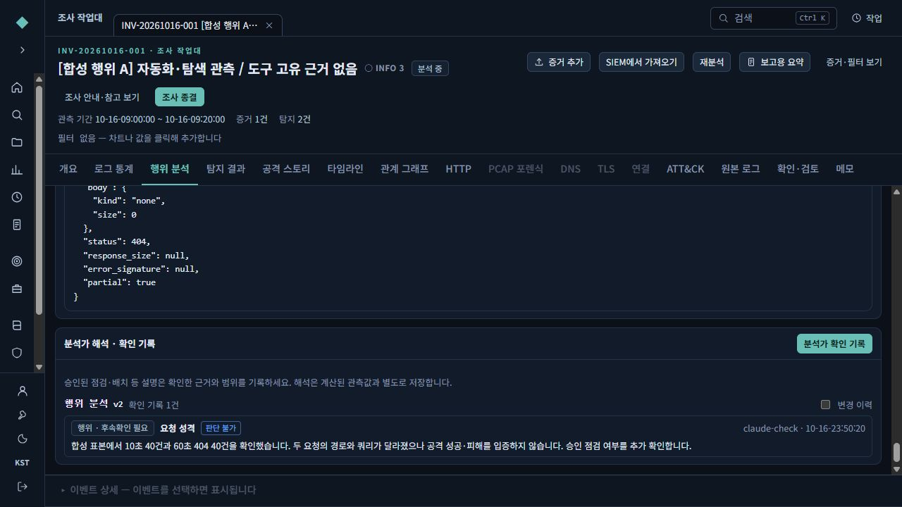

### ⑧ 보고서 열기

상단 **저장 결과 보고서**를 엽니다. 결과 버전·분석 범위부터 확인합니다. 예시 파일은 [A 보고서](examples/behavior-case-A-report.html)와 [새 질문 계약을 포함한 B 보고서](examples/behavior-case-B-report.html)입니다. 파일을 저장하면 인터넷 없이 열 수 있습니다.

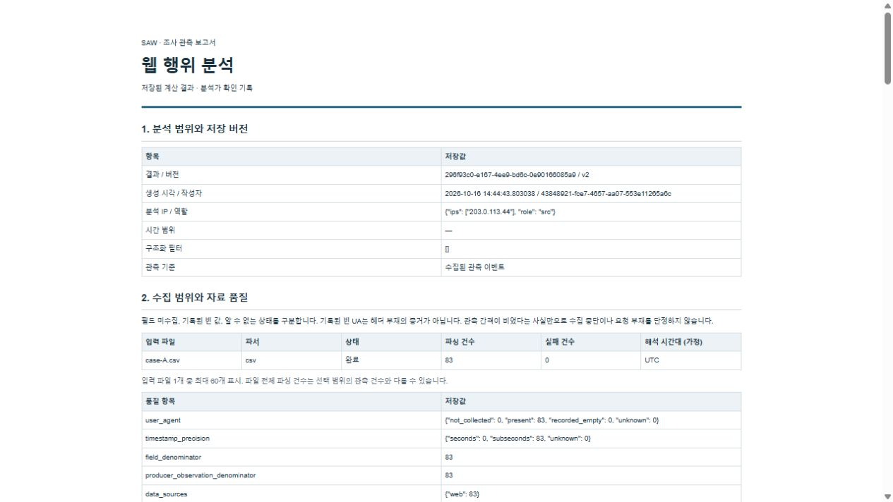

### ⑨ 보고서 숫자와 그래프 대조

보고서도 같은 저장 결과를 사용합니다. 화면에서 본40건과 해당 시간 구간이 일치하는지 확인합니다. 인쇄용 A4 서식은 준비되어 있으나 이번 작업에서 실제 종이 인쇄/PDF 출력까지 검증하지는 않았습니다.

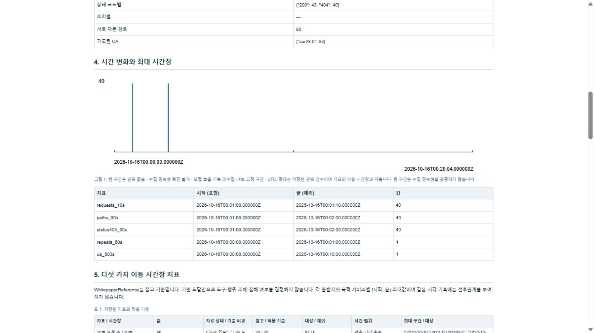

### ⑩ 자료 부족 사례 읽기

사례 D의 UA는 미수집83건이며 고유 UA 지표는 `—`입니다. 이를 UA0개나 헤더 부재로 읽지 않습니다. 초 단위 시각의 동시 기록에는 임의의 순서를 부여하지 않습니다.

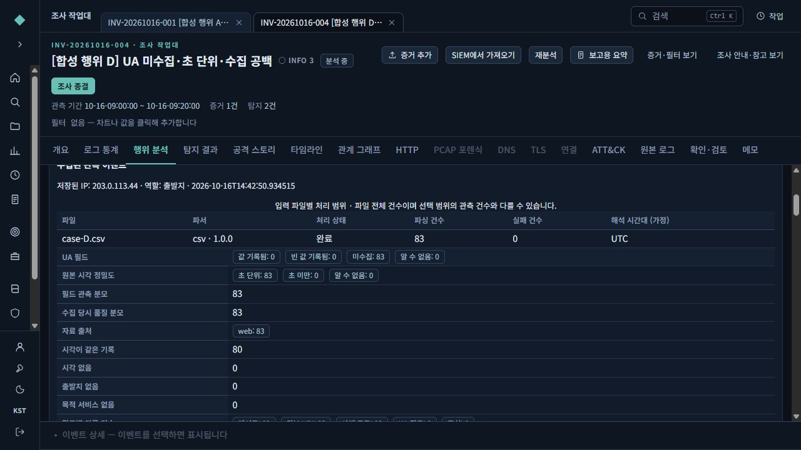

### ⑪ 경험 검토와 Golden 채택

**조사 종결**에서 판단과 한계를 적고 Experience 초안을 만듭니다. 다른 검토자가 **SOC 지식 → 승인 대기**에서 경험 승인과 **정답 사례 채택**을 검토합니다. 아래는 실제 HTTP로 다른 합성 계정이 승인한 결과를 브라우저에서 확인한 화면입니다.

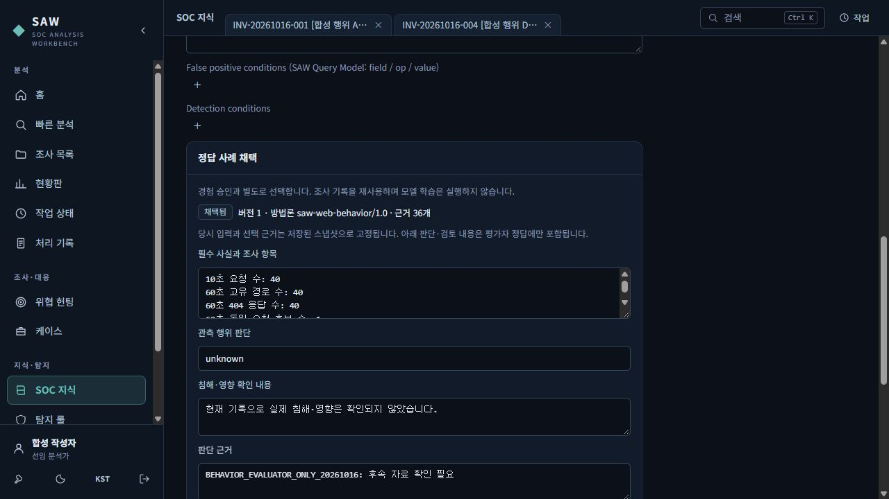

### ⑫ 입력과 정답을 분리해서 내보내기

**SOC 지식 → 정답 사례 보기**에서 용도와 채택 상태를 고르고 사례를 체크합니다.

- **선택 근거 묶음**: 에이전트 입력과 근거 ZIP. 실제 브라우저 다운로드를 확인했습니다.
- **에이전트 JSONL**: 입력 메타데이터와 근거 참조.
- **평가자 정답 JSONL**: 판단·필수 확인·금지 단정. 모델 입력/RAG에 섞지 않습니다.
- **목록 CSV**: 채택된 선택 사례 목록.

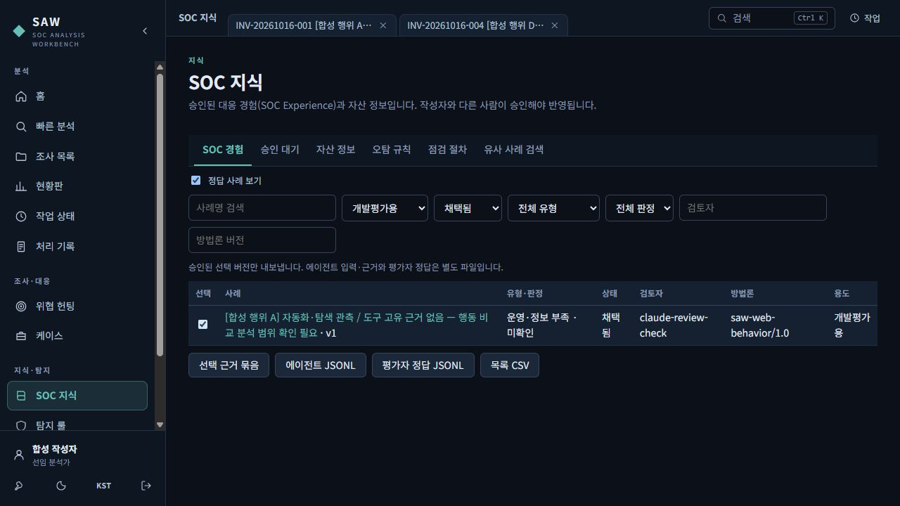

연습 파일: [입력 근거 ZIP](examples/behavior/agent-evidence.zip), [평가자 정답 JSONL](examples/behavior/evaluator-answer.jsonl). 합성 자료만 포함하며 모델 훈련을 실행하는 파일은 아닙니다.
