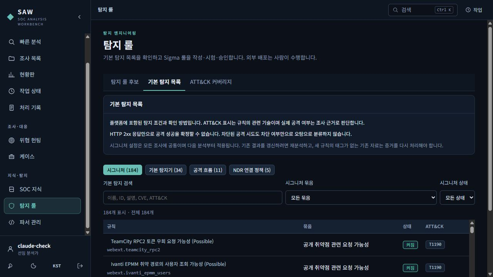
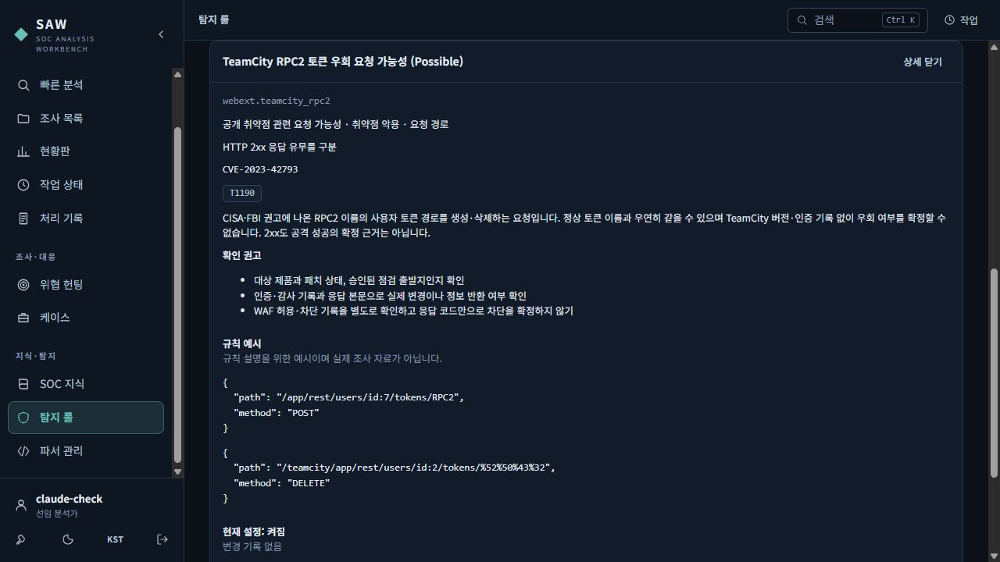
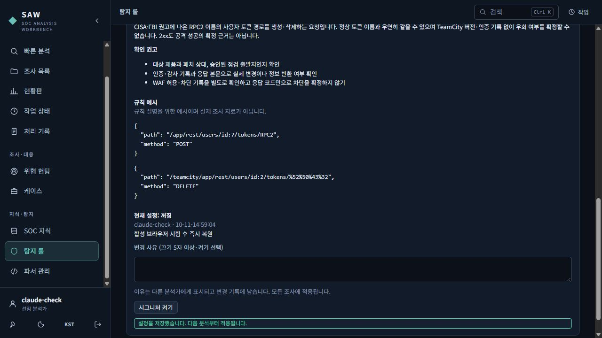
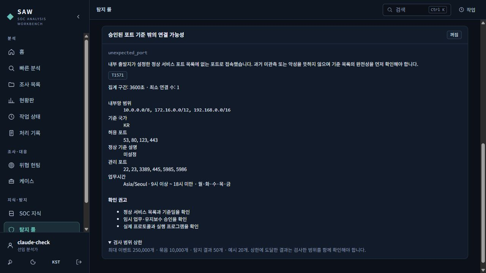
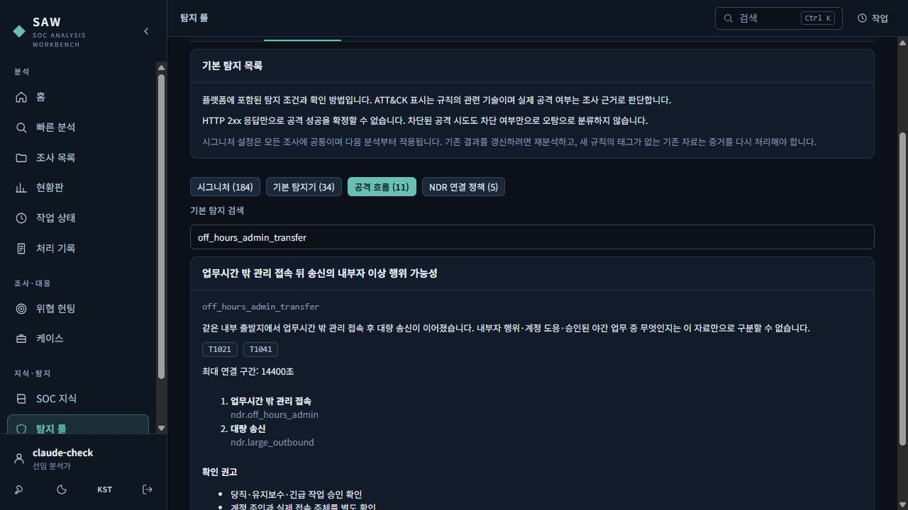
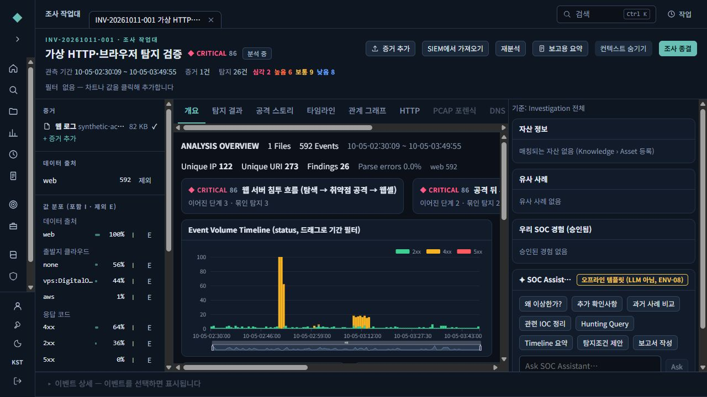

# 실제 화면으로 보는 탐지 목록 사용법

2026-10-11 밤~12일 새벽, 새 작업본 `F:\codex\SAW-Claude-main`의 빌드된 화면을 실제 브라우저로 조작하며 확인했습니다. 모든 화면의 계정과 자료는 별도로 만든 합성 시험용입니다. 운영 자료와 원본 계정은 사용하지 않았습니다.

## 1. 포함된 규칙부터 확인하기

왼쪽 **탐지 룰 → 기본 탐지 목록**으로 들어갑니다. 시그니처 184개, 공격 흐름 11개, NDR 연결 정책 5개가 표시됩니다. `TeamCity`를 검색하면 관련 2개 규칙이 나옵니다. 묶음을 `민감한 관리 API 오용 가능성`으로 고르면 14개가 표시됩니다.

## 2. 규칙 이름을 눌러 판단 범위 확인하기

예를 들어 TeamCity 규칙을 누르면 관련 CVE·ATT&CK·요청 예시와 추가 확인 항목이 나옵니다. **경로가 일치했다는 사실과 실제 공격 성공을 구분**해서 읽으세요. 예시는 설명용 가상 문자열이며 실행하지 않습니다.

## 3. 규칙을 끌 때에는 이유 남기기

끄기 권한이 있는 계정에서만 변경할 수 있습니다. 사유가 비어 있으면 끄기 버튼이 비활성입니다. 앞뒤 공백을 제거한 뒤 5자 이상의 이유를 적어 저장하면 현재 설정, 변경자, 이유가 표시됩니다.

아래는 합성 시험에서 잠시 끈 장면입니다. 시험 후 다시 켜고 새로고침해 복원된 상태를 확인했습니다. 실제로는 승인된 정상 운영과의 충돌을 조사한 뒤 조직 절차에 맞게 변경하세요. 설정은 모든 조사에 적용됩니다.

## 4. NDR 기준은 조직 환경에 맞추기

새 NDR 정책 5종은 모두 꺼져 있습니다. `unexpected_port`를 검색하면 승인된 포트 기준 밖의 연결을 확인하는 정책이 나옵니다. **정상 기준 설명이 미설정**이므로 예시 포트만 보고 켜면 안 됩니다. 내부망·업무시간·허용 포트와 기준 설명을 YAML에서 조정하고 검토한 뒤 적용합니다.

`검사 범위 상한`을 펼치면 최대 이벤트·묶음·결과·표본 수가 보입니다. 상한 안내가 있는 분석은 전체 자료를 확인한 결과와 구분해야 합니다.

## 5. 공격 흐름은 연관 후보로 읽기

`공격 흐름`에서 `off_hours_admin_transfer`를 검색한 모습입니다. 업무시간 밖 관리 접속 뒤 대량 송신이 이어져도 승인된 야간 작업·계정 도용·내부자 행위 중 무엇인지는 추가 확인이 필요합니다. 최대 연결 구간 14,400초는 4시간입니다.

## 6. 실제 조사에서 근거로 내려가기

이번 브라우저 시험의 합성 자료는 592줄이며 처리 완료 후 작업대에 **592이벤트·26탐지 결과**가 표시됐습니다. 이 결과에는 시그니처 11개와 흐름 3개가 포함됩니다. 목록의 규칙 설명을 확인한 다음 조사 작업대의 탐지 결과·공격 스토리·원본 로그로 내려가 실제 근거를 확인하는 방식으로 사용합니다.

이 화면의 SOC Assistant는 **오프라인 템플릿(LLM 아님)**으로 표시됩니다. 이번 검증은 Foundation-Sec 모델 실행이나 품질 검증이 아닙니다.

작업대 위쪽 관측 기간과 개요의 시각은 같은 시간대를 표시합니다. 왼쪽 KST/UTC 버튼을 누르면 새로고침 없이 함께 바뀝니다. 컨텍스트 숨김 상태도 유지됩니다.

자동화 도구가 여러 줄 링크의 글자 사이 빈 곳을 눌렀던 경우를 구분하고, 실제 조사 제목의 글자를 눌러 이동하는 동작을 확인했습니다. 제품 경로 결함으로 판정하지 않았습니다. [이번 검증 기록](DETECTION-VALIDATION-2026-10-12.md)을 함께 보세요.
