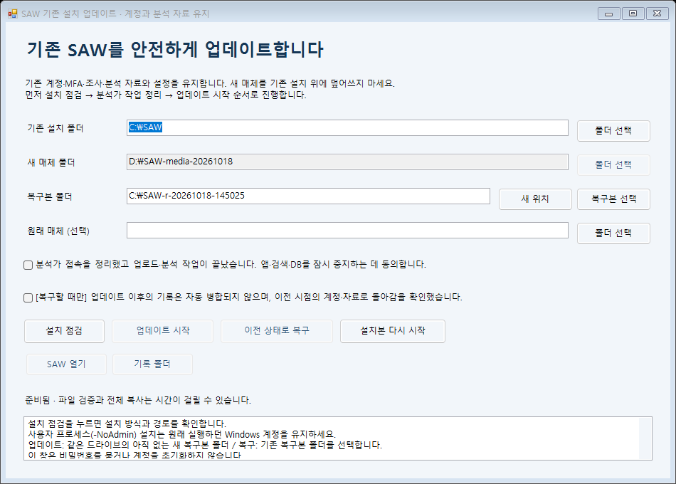

# 더블클릭으로 SAW 업데이트·복구하기

[그림과 큰 글씨로 보는 안내](DOUBLE-CLICK-UPDATE-GUIDE.html)를 브라우저에서 열어도 됩니다. 인터넷 연결은 필요하지 않습니다.

이 안내는 새 매체에 **UPDATE-SAW.cmd**가 들어 있는 버전용입니다. 명령어를 입력하지 않아도 됩니다. 기존 설치 폴더 위에 ZIP을 풀거나 install.ps1로 업데이트하지 마세요.

**기존 설치 폴더는 그대로 유지합니다.** C:\SAW를 사용 중이면 업데이트 후에도 C:\SAW를 사용합니다. 이 기능은 C:에서 D:로 설치를 옮기는 기능이 아닙니다.

위 그림은 새 프로그램의 실제 WinForms 창을 안내용 C:/D: 경로로 표시한 화면입니다. 이 화면 자체가 실제 업데이트 성공을 뜻하지 않습니다.

## 1. 새 매체 준비

1. 받은 모델 제외 설치 ZIP을 폐쇄망으로 반입합니다.
2. ZIP을 기존 설치 밖의 별도 폴더에 압축 해제합니다. 예: D:\SAW-media-new. D:가 없으면 C:\SAW-media-new를 사용합니다.
3. 압축 해제한 폴더 안의 **UPDATE-SAW.cmd**를 더블클릭합니다. 창 제목은 **SAW 기존 설치 업데이트 · 계정과 분석 자료 유지**입니다.
4. 파일 탐색기에서 확장자가 숨겨져 있으면 UPDATE-SAW로 보일 수 있습니다.

필요한 런타임은 매체에서 사용합니다. 인터넷 접속이나 대상 PC의 Python·Node 설치가 필요하지 않습니다. 매체 손상 여부는 프로그램이 자동 확인합니다. 사용자가 긴 해시 값을 비교할 필요는 없습니다.

## 2. 기존 설치 확인

| 화면 항목 | C: 설치 예 | 선택 방법 |
|---|---|---|
| 기존 설치 폴더 | C:\SAW | 현재 SAW가 설치된 폴더 선택 |
| 새 매체 폴더 | D:\SAW-media-new | 실행한 매체 위치가 자동 표시 |
| 복구본 폴더 | C:\SAW-r-새날짜 | 업데이트 때는 아직 없는 새 이름 지정 |
| 원래 매체 (선택) | D:\SAW-media-old | 구형 설치 이력을 확인할 때 요청된 경우만 선택 |

**설치 점검**을 누릅니다. 이 단계는 서버 중지·프로그램 교체를 하지 않습니다. 설치 방식, 파일, 설정과 프로세스 소유권을 확인합니다. 실행 중인 자료 전체 복사 검사는 서버 중지 후 별도로 합니다.

- 일반 사용자 방식(NoAdmin)으로 설치했다면 설치할 때 사용한 **같은 Windows 계정**으로 실행합니다.
- Windows 서비스 방식이면 창의 안내에 따라 **관리자 권한으로 열기**를 누릅니다. 새 서비스 설치·등록은 하지 않습니다.
- 설치·매체·복구본 폴더는 서로 중첩하지 않게 둡니다. 복구본은 설치와 **같은 드라이브**에 있어야 합니다.
- 공간이 부족하면 업데이트를 중단하고 여유 공간을 확보합니다. 복구본을 삭제해서 진행하지 마세요.

## 3. 업데이트

1. 분석가에게 잠시 접속을 중단하도록 안내하고, 진행 중인 업로드·분석 작업이 끝났는지 확인합니다.
2. 창에서 **서버 중지 동의**를 체크합니다.
3. **업데이트 시작**을 누릅니다.
4. 매체 확인 → 해당 설치의 서버 중지 → 전체 복구본 생성 → 새 앱 적용 → 서버 시작·접속 확인 순서로 진행됩니다.
5. 진행 중에는 창을 닫거나 전원을 끄지 않습니다. 자료가 많으면 시간이 오래 걸립니다. 진행 막대는 실제 백분율을 뜻하지 않습니다.
6. 완료 후 **SAW 열기**를 눌러 기존 계정과 MFA로 로그인하고 조사·증거·원본 파일을 확인합니다. 공동 접속 서버의 별도 호스트명을 쓰는 경우에는 기존 접속 주소로 직접 들어갑니다. 자동 열기는 로컬 HTTPS 주소만 지원합니다.

계정·비밀번호·MFA·권한, PostgreSQL 자료, OpenSearch 색인, 원본 증거, 설정·키·인증서는 기존 설치에서 보존합니다. 새 관리자 계정을 만들거나 기존 비밀번호를 초기화하지 않습니다. 서버 상태 정상과 분석가의 업무 확인은 구분됩니다.

## 4. 문제가 있으면 이전 상태로 복구

1. 같은 새 매체의 **UPDATE-SAW.cmd**를 다시 더블클릭합니다.
2. 기존 설치 폴더와 **해당 업데이트에서 만든 복구본 폴더**를 **복구본 선택** 버튼으로 선택합니다.
3. 분석가 작업이 끝난 뒤 서버 중지 동의를 체크합니다.
4. **계정·자료를 백업 시점으로 되돌린다는 확인**도 체크합니다.
5. **이전 상태 복구**를 누릅니다.
6. 복구·서버 접속 확인이 끝나면 **SAW 열기**로 기존 계정·자료를 확인합니다.

복구는 전체 시점 복구입니다. 업데이트 뒤 변경한 비밀번호·MFA·권한, 새 조사·업로드 자료도 백업 시점으로 돌아갑니다. 복구 직전 상태는 별도 보관 폴더로 남고 창에 위치가 표시됩니다. 두 시점의 자료를 자동으로 합치지 않습니다.

복구본·설치 폴더를 임의로 지우거나 덮어쓰지 마세요. 복구 실패 시에도 자동 삭제·자동 반복·자동 롤백은 하지 않습니다. **기록 폴더** 버튼에서 안전한 상태 기록을 확인할 수 있습니다. 서버 시작 실패는 업데이트 자체가 전혀 적용되지 않았다는 뜻이 아닙니다. **설치본 다시 시작**은 설치 확인을 거쳐 다시 시작하려는 경우에만 사용합니다.

## 지원 범위와 검증

동일한 고정 런타임·의존성 조합의 앱 업데이트용입니다. DB 제품 버전 변경, 설치 위치 변경, 외부 데이터 경로 이전, 손상된 저장장치 복구는 포함하지 않습니다. 설치 폴더 전체가 사라진 경우에도 버튼 복구를 진행하지 않습니다. 이때는 남아 있는 설치·복구본·보관 폴더를 삭제하지 않고 별도 복구 점검을 받아야 합니다.

Windows 11 build26200 / Windows PowerShell 5.1.26100.9711 / 가상 자료를 넣은 NoAdmin 설치에서 실제 창의 버튼 이벤트로 업데이트 474.55초, 복구 406.54초를 실행했습니다. 업데이트 후와 복구 후에 계정 2개, 로그 9건, Finding 10개, 증거 2개, 노트 1개, 완료 작업 2개를 대조했고 동일한 암호·MFA로 HTTPS 로그인을 확인했습니다. 업데이트 뒤 추가한 가상 파일은 복구된 설치에서는 빠지고 별도 보관 폴더에 그대로 남았습니다. 마우스로 런처를 직접 더블클릭한 시험과는 구분합니다. 자세한 [검증 기록](verification/desktop-update-2026-10-18.json)을 참고하세요. 개발 PC에서 성공한 결과를 깨끗한 Windows 10 LTSC 2019 설치나 실제 관리자 서비스 인수 완료로 간주하지 않습니다. 운영 인수·운영 데이터 반입 승인은 기존 경계를 유지합니다.

탐지 룰·파서만 반입하는 경우에는 [오프라인 콘텐츠 실습](OFFLINE-CONTENT-GUIDE.md)을 사용합니다. 기존 명령형 도구가 필요한 관리자는 [명령형 업데이트 안내](OFFLINE-UPDATE-GUIDE.md)를 참고할 수 있습니다.
