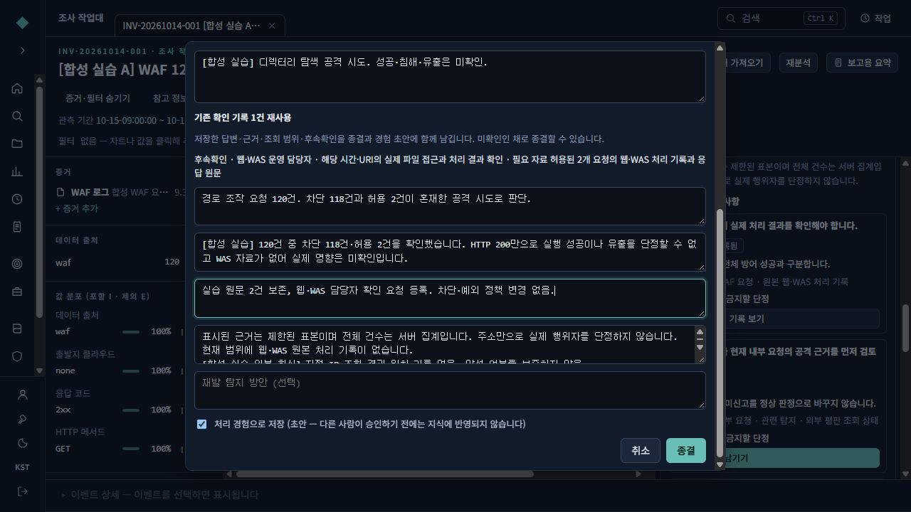

# 조사 안내에서 검토된 정답 사례까지

2026-10-15. 현재 작업본의 조사 안내와 정답 사례(Golden) 사용법이다. 조사 중에 실제로 확인한 내용과 남은 일을 기록하고, 이를 종결·처리 경험·검토된 평가 사례로 이어서 사용한다. 조사 안내는 AI 없이 동작한다. 정답 사례 채택이나 내보내기로 모델 학습이 실행되지는 않는다.

## 1. 같은 조사에서 확인할 범위를 정한다

조사 작업대에서 **조사 안내·참고 보기**를 열고 참고 패널의 **조사 안내**를 찾는다. 탐지를 선택했으면 해당 탐지의 근거 범위를, IP를 선택했으면 해당 IP 범위를 사용한다. 선택한 대상이 없으면 현재 조사의 필터와 시간 범위를 사용한다. 창이 좁으면 참고 패널이 본문 아래에 나타날 수 있다.

다른 IP를 확인하려면 **조사할 IP**에 주소를 넣고 **이 조사에서 IP 확인**을 누른다. 새 조사를 만들 필요는 없다. IP를 선택한 상태에서는 **IP 역할**도 확인한다.

| 화면의 IP 역할 | 실제 조회 범위 |
|---|---|
| 출발지 (`src`) | 선택 IP가 출발지인 기록 |
| 목적지 (`dst`) | 선택 IP가 목적지인 기록 |
| 출발지 또는 목적지 (`either`) | 두 방향에 해당하는 기록. 양쪽에 모두 해당하는 기록은 한 번만 셈 |

패널에 표시된 필터 수와 조회 시간을 확인한다. 대상·필터·시간·IP 역할을 바꾸면 새 범위로 다시 조회하므로, 이전 범위의 답변을 그대로 제출하지 않는다. 승인된 점검도 이번 출발지·대상·시각·방법에 맞는지 확인해야 한다.

**범위·조회 기록**의 판단 기준시점은 기본적으로 이번 조회 시점이다. 과거 시각을 넣는 것만으로 당시의 자료가 복원되지는 않는다. 현재 구현은 과거 기준시점을 지정한 새 기록을 평가 가능한 과거 스냅샷으로 인정하지 않는다.

## 2. 건수, 원문, 자료 상태를 함께 읽는다

**현재 확인된 내용**은 선택한 범위에서 조회한 사실이다. 각 항목의 **근거 ↗**를 누르면 **범위·조회 기록**에서 실행 시각·일치 건수·표시 표본·조회 상한을 확인할 수 있다.

**이 조회의 원문**으로 조건에 맞는 기록을 열거나, **원문 … ↗**로 개별 표본을 연다. 두 방향 조회에서는 **출발지 일치 원문**과 **목적지 일치 원문 (출발지 중복 제외)**을 각각 확인한다. 전체 일치 건수와 표시한 표본 수는 다르다. 표본 2건을 읽었다면 전체 120건을 확인한 것으로 적지 않는다.

**아직 확인하지 못한 내용**에서는 자료가 없는 이유를 확인한다.

| 자료 상태 | 읽는 방법 |
|---|---|
| 자료 있음 | 해당 조회에 사용할 자료가 있음 |
| 조회했으나 해당 기록 없음 | 조회는 수행했으며 해당 조건의 일치 기록이 없음 |
| 일부 자료만 있음 | 수집·처리·조회 범위에 제한이 있으므로 전체에 대한 결론을 피함 |
| 미수집 | 필요한 자료를 확보하지 못함 |
| 조회 실패 | 조회가 실패했으므로 건수를 확정할 수 없음 |
| 조회 권한 없음 | 접근 권한으로 확인하지 못함 |
| 아직 조회하지 않음 | 조회가 수행되지 않음 |
| 이번 범위에 해당 없음 | 이번 확인 범위에 적용되지 않음 |

미수집·조회 실패·권한 없음은 0건이나 정상 판정의 근거가 아니다. 외부 자료 상태에 **분석가 기록**이 붙으면 사람이 남긴 상태 설명이다. 외부 EDR·평판 서비스가 실제로 연결되어 조회됐다는 뜻으로 읽지 않는다.

예를 들어 합성 사례 A는 WAF 요청 120건 중 차단 118건, 허용 2건이다. 허용 요청의 웹·WAS 처리 결과가 없으면 공격 시도와 실제 영향을 나눠 적는다. “모두 차단됐다” 또는 “당사 영향이 없다”고 단정할 수 없다.

## 3. 실제로 확인한 내용을 Check에 저장한다

**다음에 확인할 사항**에서 목적과 필요한 자료를 읽고, **판단 근거·금지할 단정**을 펼친다. 확인한 내용을 남길 준비가 되면 **답변·근거 남기기**를 누른다. 화면을 열거나 원문을 누른 것만으로 확인 완료 기록이 생기지는 않는다.

1. **답변 상태**를 고른다. 근거를 확보했으면 **답변 기록**, 추가 자료가 필요하면 **후속확인 필요**, 적용되지 않으면 **이번 범위에 해당 없음**을 선택한다.
2. **선택 근거**에서 실제로 읽은 기록을 고른다. **답변 기록** 상태는 근거 선택이 필요하다. 원문이 없는 경우에도 자료 부족과 후속확인은 기록할 수 있다.
3. **근거**에 현재 확인한 내용과 판단 이유를 적는다. 아직 판단하기 어렵다면 판단을 비워 두고 확인한 사실을 남길 수 있다.
4. **후속확인 필요**를 선택했다면 **확인할 대상**, **필요 자료**, **후속 확인 항목**을 적고 우선순위를 고른다. 확인 기한은 선택 항목이다.
5. 외부 자료를 사람이 별도로 확인했다면 **외부 자료 상태 기록 (분석가가 확인한 내용)**에 상태와 그 이유를 적는다.
6. **확인 기록 저장**을 누른다. 이후 **저장한 확인 기록 보기** 또는 조사의 확인 기록 화면에서 저장 결과를 확인한다.

합성 사례 A에서는 허용 원문 2건을 읽고 선택한 뒤, 웹 서비스 담당자에게 WAS 처리 로그와 실제 실행 결과를 확인하도록 후속확인을 남겼다. 후속확인 등록은 그 요청이 이미 처리됐다는 의미가 아니다.

저장할 때 서버가 범위와 선택 근거를 검사하고 실제 조회 결과를 다시 기록한다. 확인 기록에는 답변과 함께 당시 조회 범위·자료 상태·조회 기록·선택 근거 스냅샷이 남는다. 본인이 기록을 수정하면 이전 내용은 이력으로 보존된다.

## 4. 남은 일을 드러낸 채 종결하고 경험 초안을 만든다

**조사 종결**을 열면 기존 확인 기록에서 만든 초안을 가져온다. **기존 확인 기록 …건 재사용**과 표시된 후속확인을 확인한다. 종결 전 점검에 남은 항목이 있어도, 미확인 사항과 후속확인을 남기고 종결할 수 있다.

**판정**에서 **공격·정상 활동·오탐·판단 보류** 중 하나를 선택한다. 판정 선택과 판정 사유 입력이 있어야 **종결** 버튼이 활성화된다. 이어서 **판정 사유**, **행위 판단**, **실제 영향 판단**을 구분해 검토한다. 합성 사례 A라면 공격 요청의 관측 사실을 행위 판단에, WAS 자료가 없어 실제 처리 결과를 확정하지 못했다는 내용을 실제 영향 판단과 범위 제한에 적는다. 사람이 수행한 대응은 **조치한 내용**에 남긴다.

**처리 경험으로 저장**을 선택하고 **종결**하면 SOC Experience 초안이 만들어진다. 실제 Check의 답변·근거·조회 범위·후속확인을 재사용하며, 모든 탐지를 검토 완료로 바꾸지는 않는다. 새 경험은 다른 사람이 승인하기 전까지 승인된 지식으로 반영되지 않는다.

그림: 실제 개발기 브라우저에서 확인한 합성 사례의 종결창이다. **최신 화면 문구 정리 이전 화면이며, 종결창의 아래쪽으로 스크롤한 부분**을 보여준다. 최신 버튼·항목 이름은 본문 설명을 따른다.

**SOC 지식 → SOC 경험**에서 생성된 경험을 열어 내용을 검토한다. 수정한 내용은 먼저 **저장 (새 revision)**하고 **검토 요청 (Submit)**을 누른다. 승인 대기 목록에서 다른 검토자가 이어서 확인할 수 있다.

## 5. 경험 승인과 정답 사례 채택을 따로 선택한다

경험 상세의 **정답 사례 채택**에서 **조사 기록에서 채택 초안 만들기**를 누른다. 원본 조사에 접근할 수 있어야 하며, 평가에 쓸 수 있는 당시 입력이 저장된 확인 기록이 필요하다. 경험 내용을 수정했다면 **현재 경험 버전으로 초안 다시 만들기**로 같은 버전에 맞춘다.

작성자·편집 기여자와 다른 승인 권한자가 내용을 검토한다. 정답 사례에 포함된 Check 작성자도 자기 기록을 채택하는 검토자가 될 수 없다. 검토자는 원본 조사에 접근할 권한도 필요하다.

**정답 사례 결정**에서는 다음 중 하나를 고른다.

- **이번에는 경험만 승인**: 경험 승인만 진행한다. 정답 사례는 자동 채택되지 않는다.
- **정답 사례로 채택**: 평가용 사례로 별도 채택한다.
- **정답 사례 미채택**: 경험 승인과 별개로 해당 정답 초안을 채택하지 않는다.

채택할 때는 필수 사실과 조사 항목, 판단과 근거, 후속확인, 금지 주장을 각각 확인한다. 후속확인이 필요 없다면 **후속확인이 불필요한 이유**를 직접 적는다. 대상과 할 일이 없는 빈 후속확인으로 이 검토를 대신할 수 없다.

경험이 승인 대기 중이면 선택한 결정과 함께 **경험 승인**을 누른다. 이미 승인된 경험이면 **정답 사례 결정 저장**으로 별도 결정을 남길 수 있다. 판단·근거를 바꾸었다면 **새 초안으로 저장**한 뒤 다른 검토자가 채택해야 한다. 이미 채택된 버전은 그대로 남고 변경본은 새 버전으로 검토한다.

**사용 용도**는 학습용(`train`), 개발평가용(`dev`), 비공개 평가용(`holdout`) 중 선택한다. 여기서 학습용은 분류 이름이며 모델 훈련을 실행하는 버튼이 아니다. 같은 사건으로 연결된 조사들은 한 용도로 묶이며 최초 채택 후 고정된다. 이후 연결이 다른 용도의 사건군과 충돌하면 채택·내보내기가 거부된다.

## 6. 채택된 버전을 골라 별도 파일로 내보낸다

**SOC 지식 → SOC 경험 → 정답 사례 보기**를 선택한다. 용도·채택 상태·유형·판정·검토자·방법론으로 찾은 뒤 내보낼 버전을 체크한다. 같은 용도의 채택된 버전만 선택한다. **평가 불가 · 근거·승인 확인 필요** 표시가 있으면 근거와 승인 상태를 먼저 확인한다.

| 버튼 | 파일과 내용 |
|---|---|
| 선택 근거 묶음 | `golden-agent-evidence.zip`. `agent-input.jsonl`, 선택 근거 파일, 묶음 목록을 함께 제공 |
| 에이전트 JSONL | `agent-input.jsonl`. 당시 관측 사실·자료 상태·조회 범위와 선택 근거 참조를 제공. 참조된 근거 파일이 필요하면 묶음을 사용 |
| 평가자 정답 JSONL | `evaluator-answer.jsonl`. 필수 확인, 판단·근거, 후속확인, 금지 주장 등 검토된 정답 기준을 제공 |
| 목록 CSV | `golden-list.csv`. 사례명·분류·판정·검토자·용도·버전 등 목록을 제공 |

평가자 정답과 목록 CSV는 승인 권한자에게 제공한다. 에이전트에 입력할 자료와 평가자가 정답을 대조할 자료는 따로 보관한다. 에이전트 입력에는 종결 판단·경험 답변·검토 기준을 넣지 않는다. 내보내기에는 저장된 스냅샷을 사용하며, 현재의 과거 사례 검색이나 실시간 자료를 추가하지 않는다.

근거가 누락되거나 해시가 일치하지 않으면 내보내기가 실패한다. 원본 조사 접근권한, 경험의 만료·폐기 상태, 검토자의 현재 권한, 사건군 용도도 다시 확인한다. 내보내기 성공이 모델 평가 완료나 학습 품질 검증을 뜻하지는 않는다.

## 7. 이번에 확인한 범위와 설치 상태

| 구분 | 2026-10-15 확인 범위 |
|---|---|
| 실제 브라우저 | 합성 사례 A의 120건·차단 118건·허용 2건 확인, 허용 원문 2건 선택, 후속확인 저장, 종결, Experience 초안 검토 요청까지 |
| 실제 HTTP API | 분리된 합성 시험 환경에서 다른 검토자의 Golden 채택과 에이전트 근거 묶음·에이전트 JSONL·평가자 정답 JSONL·목록 CSV 응답을 확인 |
| 자동 시험 | 작성자와 검토자 분리, 입력·정답 분리, 버전·해시·범위·후속확인 검증 등. 실제 브라우저 실행 범위와는 구분 |
| 아직 확인하지 않은 범위 | 최종 Golden 채택·내보내기의 실제 브라우저 조작, 운영 자료·운영 서버에서의 적용, 대상 LTSC17763·16GB 환경 인수 |

실제 HTTP 확인은 로컬 주소의 별도 SQLite와 로컬 저장소를 사용했으며, 원본 로그와 비밀값은 이 문서에 포함하지 않았다. 실행 기록의 `golden_adoption_export` 단계에 네 종류 내보내기 결과가 남아 있다. 이는 PostgreSQL·OpenSearch 운영 구성의 인수 결과가 아니다.

이번 기능에는 **스키마 0013**이 필요하다. **기존 설치 ZIP에는 이번 변경이 포함되어 있지 않다.** 새 설치 매체 제작과 대상 환경 검증이 별도로 필요하다. 모델 훈련·운영 모델 채택·운영 배포는 이번 기능의 완료 범위에 포함되지 않는다.
