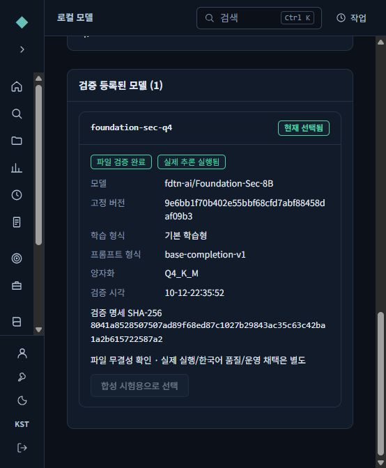
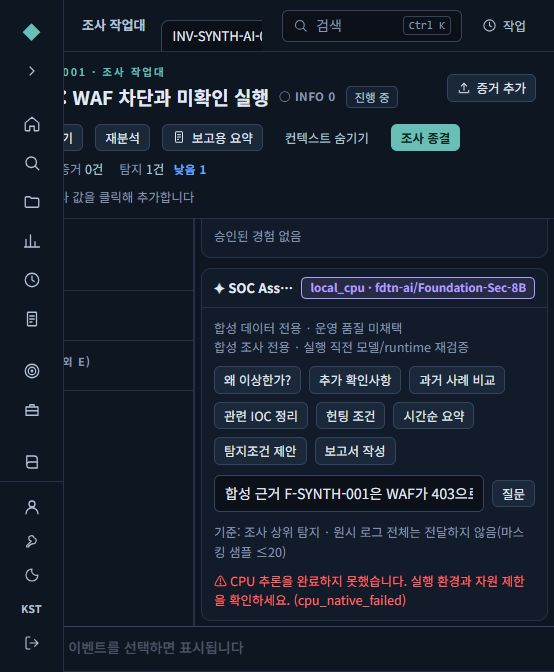

# 로컬 AI 실제 실행 검증 — 2026-10-12

이 기록은 Claude 기반 새 복사본의 개발 검증이다. 제품 전체 완료·운영 인수 승인이 아니며 기존 Phase/MITRE/Foundation 요구사항을 대체하지 않는다. 대상 OS는 Windows10 Enterprise LTSC2019 x64/build17763이고, 이번 실행 호스트는 Windows11 Pro/build26200이다.

## 구현과 자동 시험

- 별도 모델팩 생성 CLI·검증/등록/선택/해제 API·관리자 화면·Assistant 연결.
- BASE/Instruct 구분, 실제 GGUF 토크나이저 metadata·파일 해시 검사, 모델 폴더에 실행 코드/DLL·정션·미등록 파일 거부.
- 합성 조사 allowlist, 현재 계정/세션/MFA/조사 권한, 승인 Experience 범위·만료, 생성 중 변경 재검사. CPU 합성 경로에는 외부 Experience/전역 플레이북을 제외.
- 출력 형식·인용 범위를 검사하고 실패한 답변을 저장/노트로 채택하지 않음. 유효한 JSON도 사실 확인이나 품질 승인을 뜻하지 않음.
- 전체 서버 677통과·2건너뜀(165.32초). PostgreSQL 미설정 migration은 아래 native 시험으로 보완. Windows symlink 생성 권한 부족 시험은 미실행이며, 관리자 권한 없는 directory junction 원본/반입목적지 차단은 실제 추가 시험으로 확인(9통과·symlink1건너뜀).
- 실제 PostgreSQL16.15 전용 인스턴스에서 migration0011·모델 API·문맥 권한 48통과(380.74초), 정상 종료·포트 닫힘 확인.
- UI 전체110통과·TypeScript/build 성공. 최초 동시컴파일 중 기존 timezone시험 timeout1건 발생; 시간제한/테스트 코드 변경 없이 worker2 전체 재실행110통과. Vite의 큰 번들 경고는 남아 있음.

## 실제 지정 모델 실행

모델은 `fdtn-ai/Foundation-Sec-8B` BASE/revision `9e6bb1f70b402e55bbf68cfd7abf88458daf09b3`이며, 4,921,462,592-byte Q4_K_M GGUF의 SHA256은 `98989f9e89414f8607fe76727b46852a3ec6f3d534fc6f6259a50b02bf14e681`이다. 대체 소형 모델 시험을 이 결과로 세지 않았다.

최종 llama.cpp b11429/commit `d81235049384534c167caea52b85a694f6103d14`는 고정 공식 원본과 WinLibs GCC14.2/UCRT로 정적 빌드했다. 별도 MSVC C++ DLL 의존 없이 Windows system/UCRT만 사용한다. 빌드 도구는 설치 대상에 필요하지 않으며 재현 스크립트/고정 출처를 소스에 포함했다. runtime manifest SHA256은 `d0bb50baf0baf16516dea9feafcca4cdbfd449ab6e6fb68816b0281b125867e2`이다.

실제 API TestClient가 native tokenizer/completion 프로세스를 호출했다. 검증·선택·해제는 각 HTTP200이고, 해제 후 선택값은 null이었다. 두 실행 파일의 LPAC --help와 실제 생성에서 네트워크 capability0·registryRead capability·비상승·Job process1·8GiB memory상한을 확인했다. 성공 기록만 바꾼 모의 endpoint 전환이 아니다. 상세 영수증은 [고정 합성 실행 JSON](verification/local-ai-static-2026-10-12.json)에 있다.

합성 한국어 요청은 입력88/출력62토큰, 187.297초, 최대 working set4,873,842,688bytes였다. 포장·DB 시험과 병행한 값이므로 처리량 벤치마크나 대상16GB 서버 성능 보장이 아니다.

## 한국어·관제 품질

생성 JSON 구조는 유효했지만 답변은 영어였고, `F-TEST`를 인용해야 할 자리에 근거 문장 전체를 인용했다. **한국어·인용 품질 미채택**이다. 관제 품질 개선, 사실 정확성, 실제 검색 품질 향상을 증명하지 않는다.

RAG 권한 계약은 시험했으나 CPU 합성 경로의 실제 조직 Experience 검색 품질은 평가하지 않았다. 실제 SFT/optimizer/adapter 저장·재로딩·고정 품질 향상 시험은 이 작업에서 실행하지 않았다. 학습 기능 완료로 보고하지 않는다.

## 실제 브라우저

별도 합성 계정 claude-check로 로그인·MFA·반입 파일검증·고정 Foundation 선택·해제·서버 재시작 후 등록 상태 복원을 확인했다. 최종 정적 실행기로도 화면에서 실제 모델 선택을 실행했다. 초기 화면에서 줄임표로 보이던 모델ID/revision을 전체 줄바꿈 표시로 보완했다. 합성 조사에서 실제 Assistant 질문도 전송했으나 실행은 `cpu_native_failed`로 끝났고 화면은 실패를 표시하며 답변을 채택하지 않았다. 고정 짧은 probe의 실제 생성 성공과 이 조사 문맥 요청 실패를 구분한다. 제한을 올려 성공으로 처리하지 않았다. 시험 후 모델을 해제했다.

## 남은 인수 조건

깨끗한 LTSC17763 설치·16/32GB 무GPU 공동부하, 조직의 TLS 신뢰/방화벽, Windows 서비스 프로필, 운영 데이터 사용·모델 권리 검토·운영 배포·운영 모델 교체 승인은 별도이다. 모델을 선택해도 운영 자료 접근 범위가 확대되지 않는다. 모델 없는 본체 설치본에는 가중치가 포함되지 않는다.
