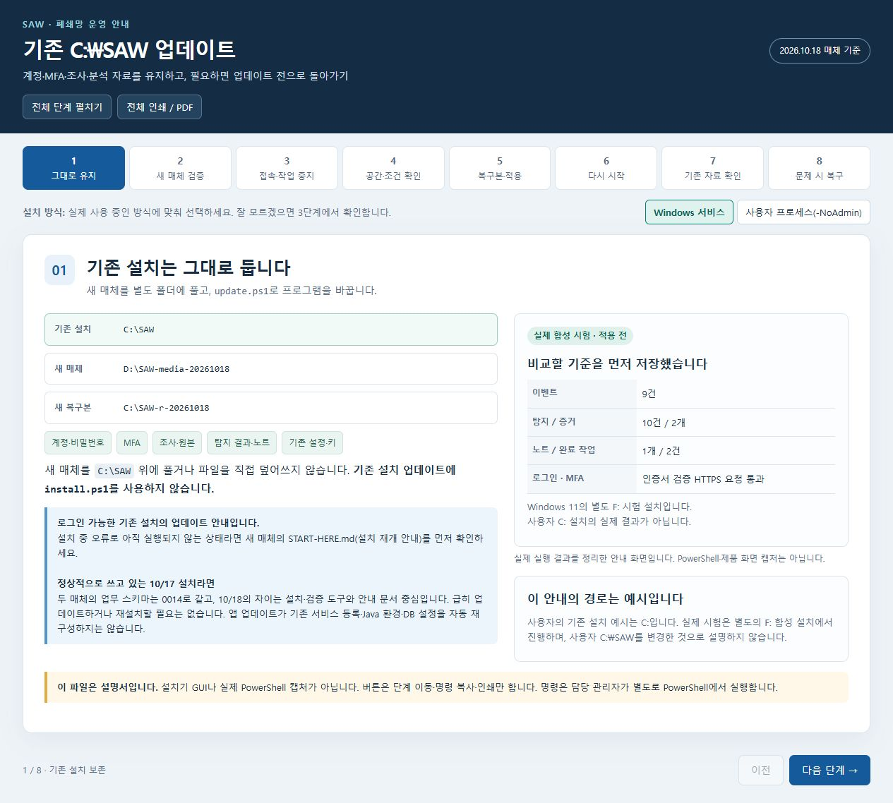
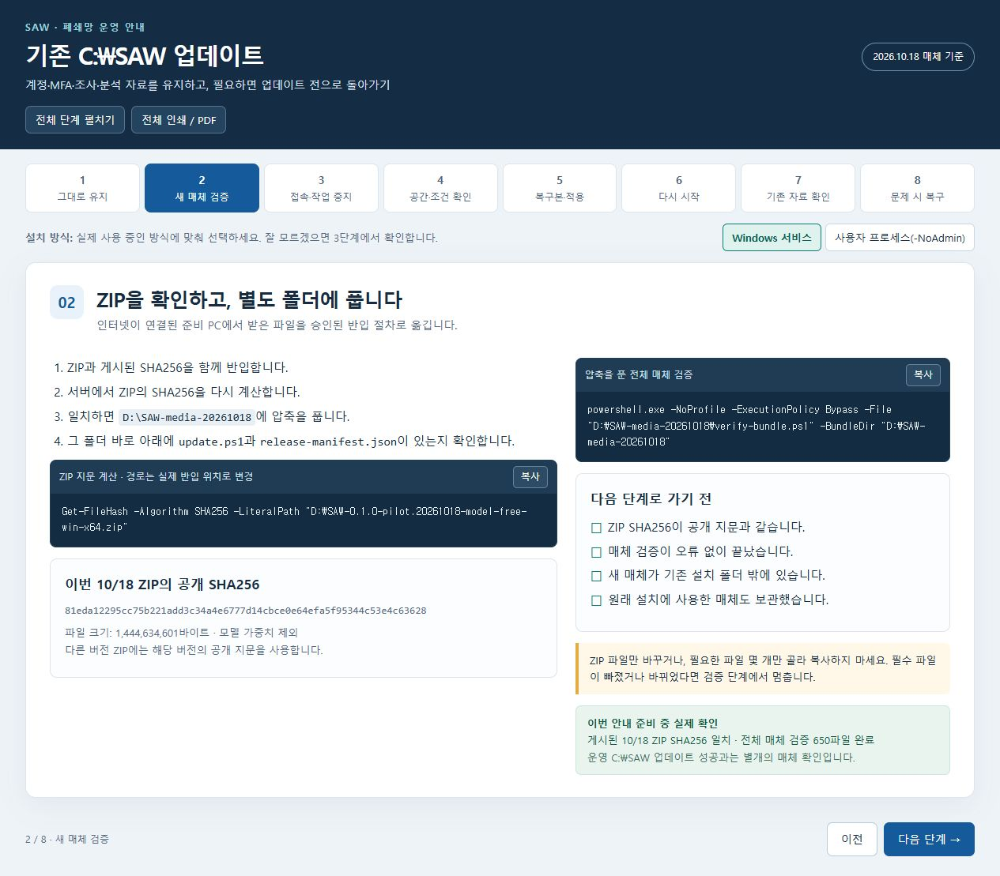
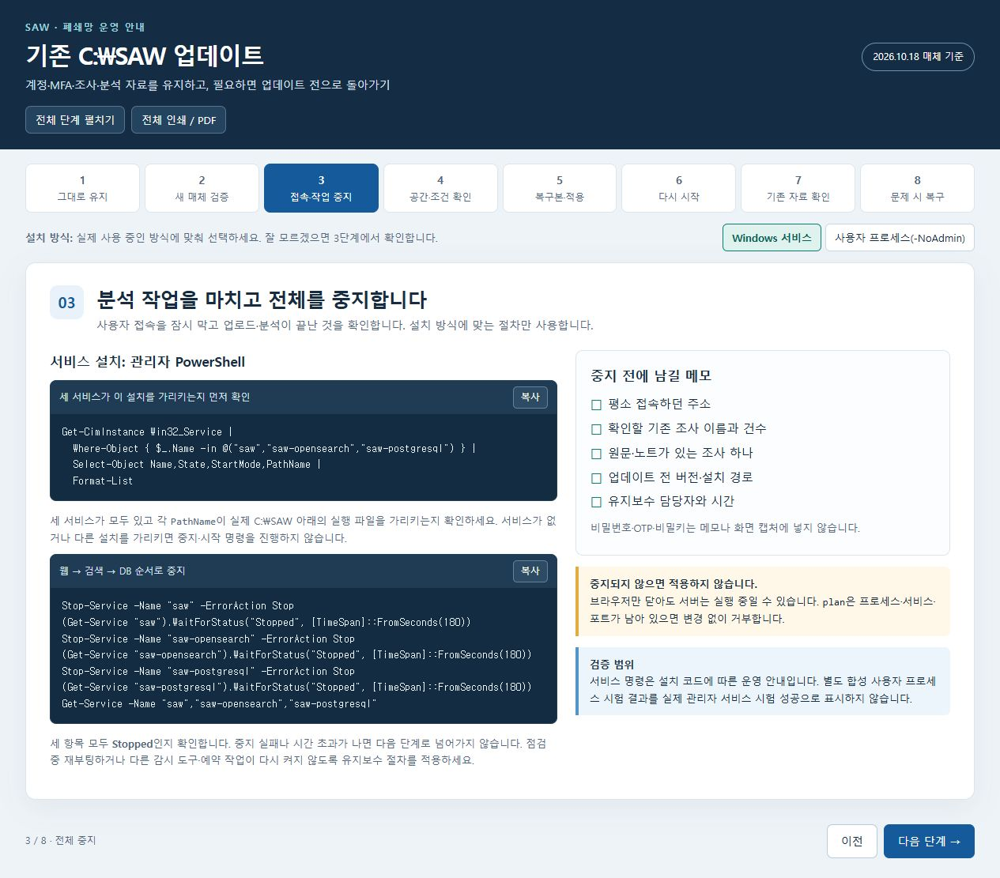
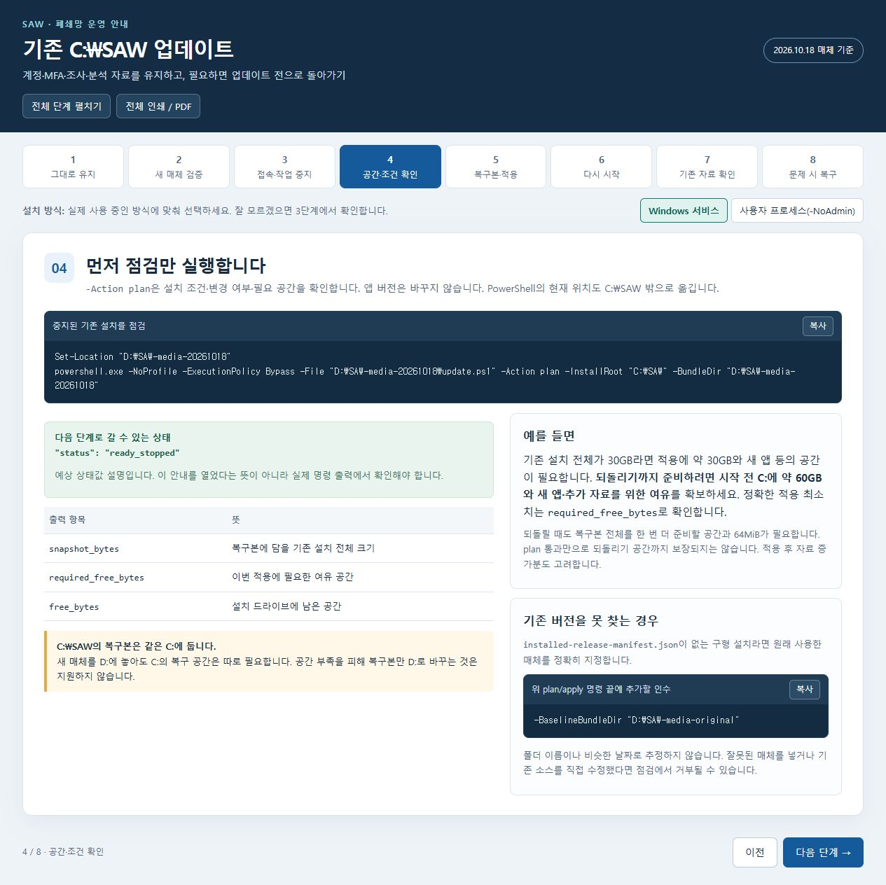
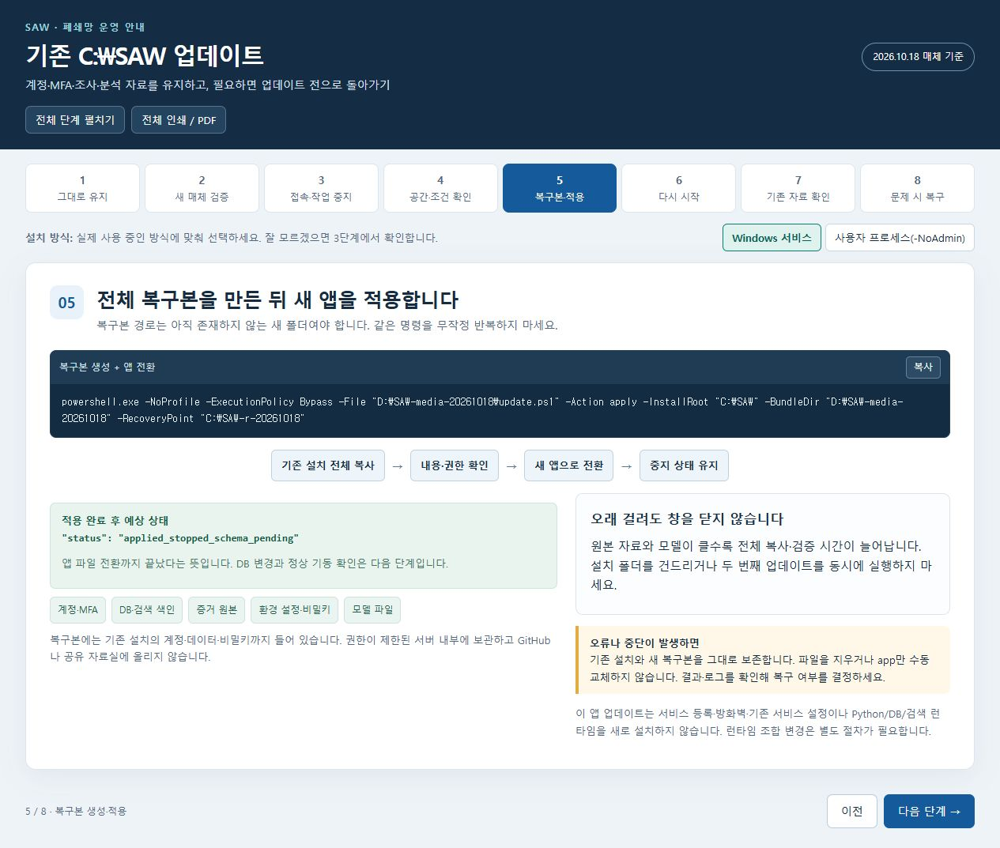
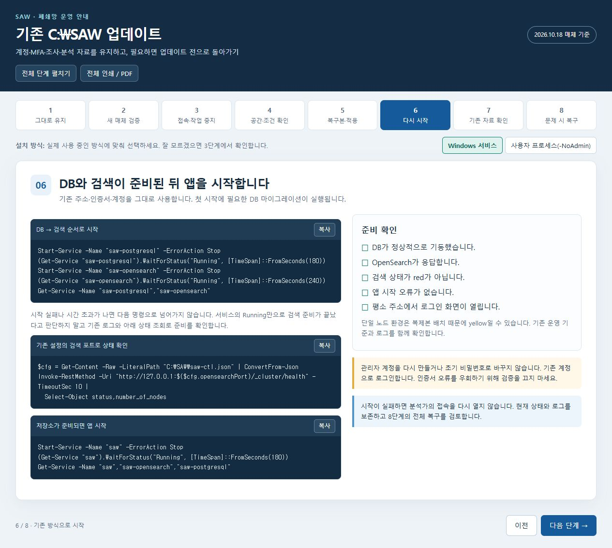
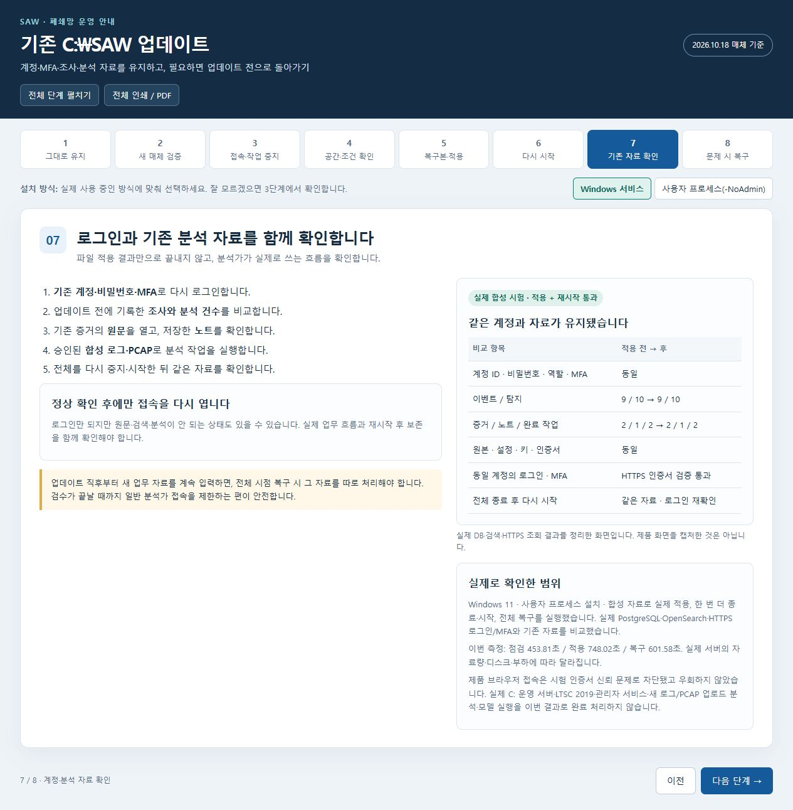
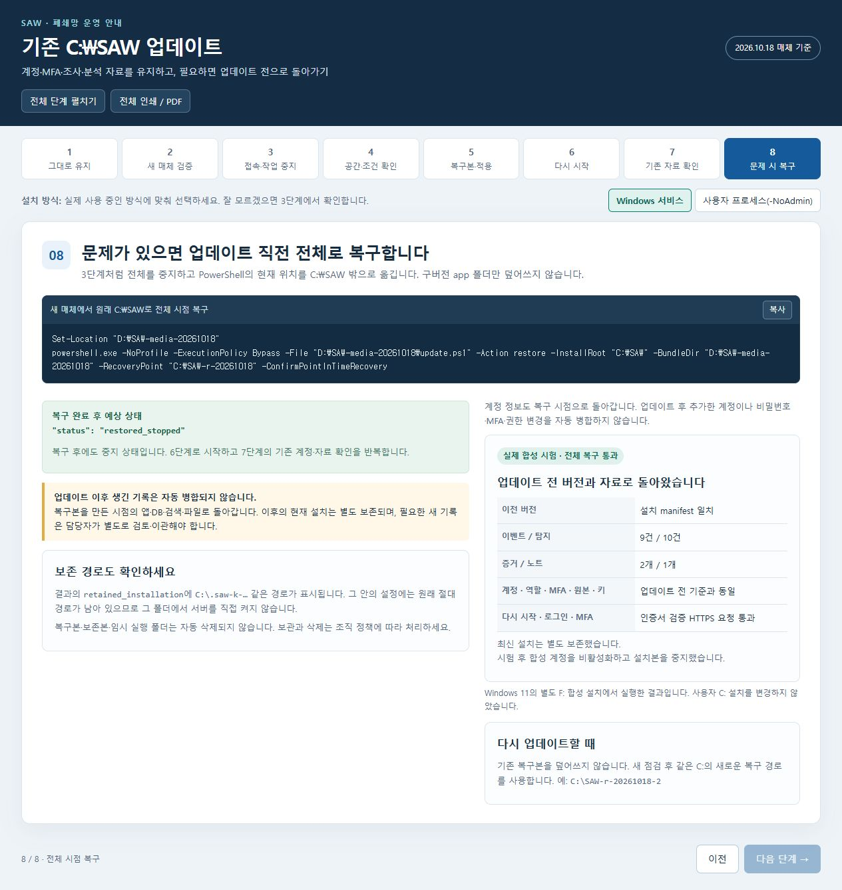

# 기존 C:\SAW를 계정·분석 자료 그대로 업데이트하기

**새 매체의 update.ps1을 사용합니다.** 기존 폴더에 ZIP을 덮어 풀거나 install.ps1로 재설치하지 않습니다. 기존 주소·아이디·비밀번호·MFA를 그대로 사용합니다.

[한 단계씩 보는 HTML 안내서](OFFLINE-UPDATE-WALKTHROUGH-2026-10-18.html)를 브라우저로 열면 명령을 복사할 수 있습니다. 아래 사진은 안내서를 실제 브라우저로 캡처한 것입니다. **설치기 화면이나 실제 PowerShell 창의 캡처가 아닙니다.** 합성 시험 결과는 별도 카드로 표시합니다.

## 1. 기존 설치·새 매체·복구본을 구분합니다

예시는 현재 설치 C:\SAW, 새 매체 D:\SAW-media-20261018, 아직 없는 복구 폴더 C:\SAW-r-20261018입니다. 실제 경로가 다르면 모든 명령의 경로를 바꿉니다. D:가 없으면 새 매체도 C:의 별도 폴더에 둘 수 있습니다. 기존 C: 설치를 D:로 옮기는 절차는 아닙니다.

설치가 중간에 실패한 상태라면 새 매체의 START-HERE.md(설치 재개 안내)를 먼저 확인하세요.

정상 실행 중인 10/17 설치는 10/18 설치기 보완만을 위해 급히 업데이트할 필요가 없습니다.

## 2. 반입한 새 ZIP을 검증합니다

[10/18 사전 배포](https://github.com/dewdorp/SAW/releases/tag/v0.1.0-pilot.20261018)에서 모델 제외 ZIP과 공개 SHA256을 받아 승인된 경로로 반입합니다. ZIP 지문을 대조하고 별도 폴더에 압축을 푼 뒤 verify-bundle.ps1로 전체 매체를 확인합니다.

## 3. 작업을 마치고 서버 전체를 중지합니다

분석가들의 작업·업로드가 끝난 뒤 중지합니다. **Windows 서비스 설치**와 **사용자 프로세스(-NoAdmin)** 중 원래 방식을 선택하세요. 서비스라면 해당 서비스의 경로를 확인한 뒤 웹 → 검색 → DB 순서로 중지합니다. NoAdmin이면 같은 Windows 사용자로 saw-ctl.ps1 stop을 실행합니다. 브라우저만 닫으면 서버는 계속 실행됩니다.

## 4. 변경 전 점검을 실행합니다

-Action plan의 결과가 **ready_stopped**인지 확인합니다. **C: 설치의 복구본도 현재 도구에서는 C:에 두어야 합니다.** 설치 전체가 30GB라면 되돌리기까지 고려해 C:에 약 60GB와 새 앱·자료 증가분의 여유를 준비합니다. 정확한 적용 최소치는 출력의 required_free_bytes입니다.

installed-release-manifest.json이 없는 구형 설치만 정확한 원래 매체를 -BaselineBundleDir로 지정합니다.

## 5. 복구본을 만들면서 새 앱을 적용합니다

-Action apply를 실행합니다. 전체 복구본의 파일·권한 검증 뒤 앱을 교체하며, 계정·MFA·DB·검색 색인·원본·키는 보존합니다. **applied_stopped_schema_pending**은 앱 적용이 끝났고 **아직 중지 상태**라는 뜻입니다. 시간이 걸려도 같은 업데이트를 동시에 실행하지 않습니다.

## 6. 원래 방식으로 시작합니다

서비스 설치라면 DB → 검색 → 웹 순서로 시작합니다. NoAdmin이면 saw-ctl.ps1 start를 사용합니다. 첫 실행 때 필요한 DB 마이그레이션이 진행됩니다. 기존 주소로 접속하고 새 관리자 계정을 만들거나 MFA를 초기화하지 않습니다.

## 7. 같은 계정과 기존 조사를 확인합니다

기존 로그인·MFA, 대표 조사의 이벤트·탐지 수, 원문·노트와 검색을 비교합니다. 별도 합성 자료로 새 분석을 시험하고 한 번 더 종료·시작해 저장 여부를 확인한 뒤 분석가 접속을 엽니다.

## 8. 문제가 있으면 전체 시점 복구를 합니다

다시 전체 중지한 뒤 -Action restore와 -ConfirmPointInTimeRecovery로 되돌립니다. **업데이트 직전 시점의 앱·DB·색인·원본·키 전체로 돌아갑니다.** 그 뒤 생성한 자료는 별도 retained_installation에 남고 자동 병합되지 않습니다. 새 계정이나 비밀번호·MFA·권한 변경도 복구 시점으로 돌아갑니다. 보존 폴더를 직접 시작하거나 임의로 지우지 않습니다.

## 확인 범위

실제 실행 결과는 [공개 검증 기록](verification/update-walkthrough-2026-10-18.json)을 확인하세요. 사용자 운영 C: 설치를 변경하지 않았습니다. Windows 11의 격리 합성 시험과 LTSC 2019·관리자 서비스·공동 운영 인수는 구분합니다. 서비스 명령은 이번에 실제 운영 서버에서 실행한 결과가 아닙니다.

복구 폴더에는 계정·비밀키·원본이 포함됩니다. **공유하거나 GitHub에 올리는 것은 이 설명서뿐이며, 실제 복구본은 서버 내부에서 보호합니다.**
