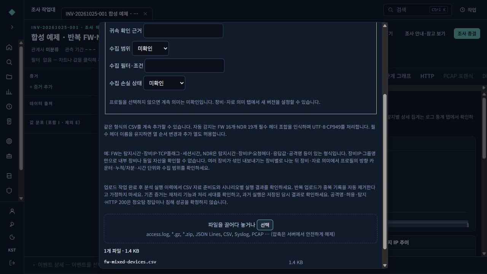
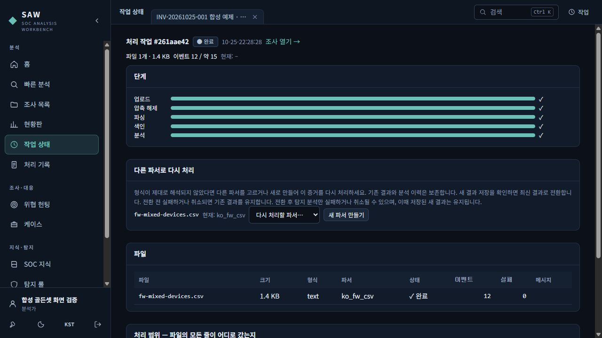
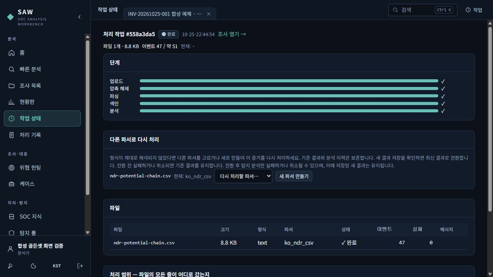
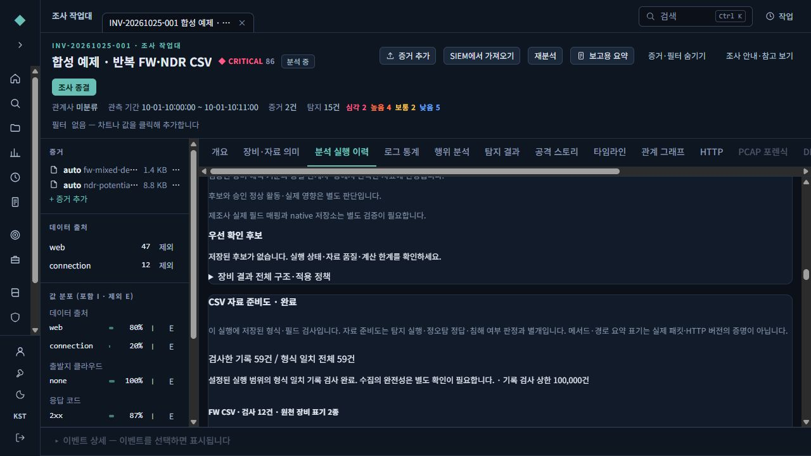
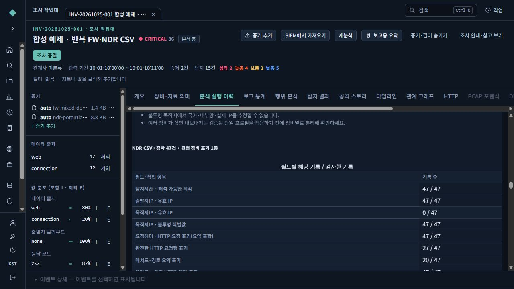
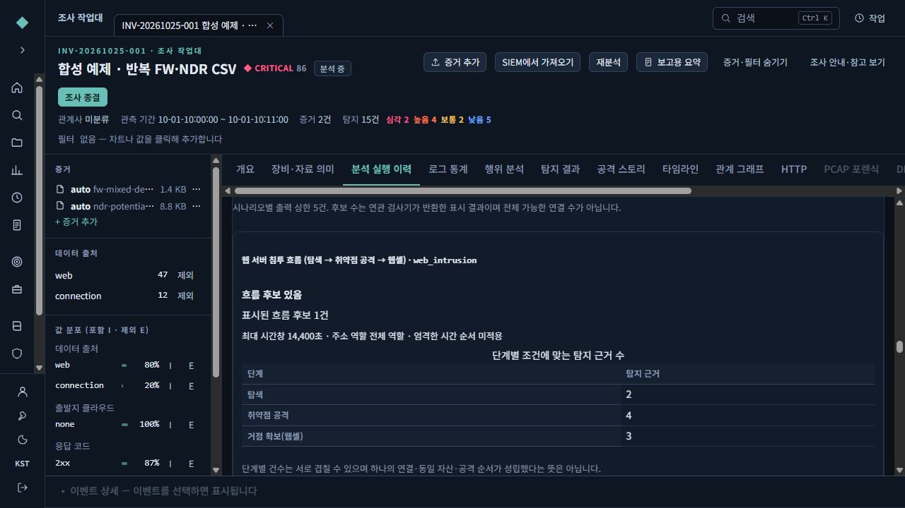
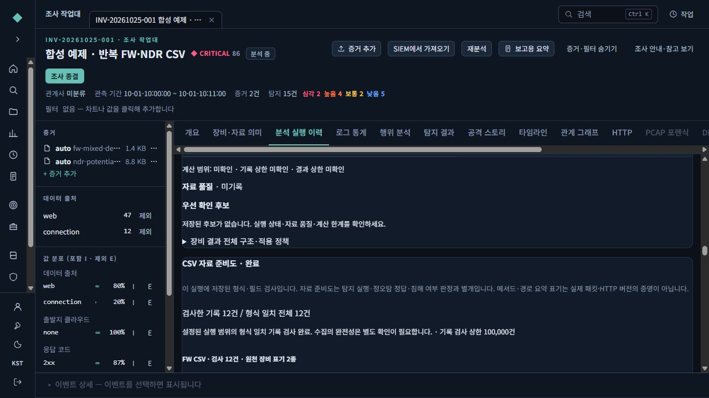

# FW·NDR CSV를 계속 올리고 시나리오를 확인하는 방법

같은 열 형식의 파일을 매번 **증거 추가 → 자동 감지 → 업로드 및 분석 시작**으로 올립니다. 작업이 끝나면 **분석 실행 이력**에서 자료 준비도와 시나리오 결과를 확인합니다. AI 모델이 없어도 이 과정은 동작합니다.

## 1. 어떤 파일을 준비하나요?

FW는 다음 16개 열을, NDR은 다음 19개 열을 유지합니다. 열 순서는 바꿔도 되고 다른 열을 추가해도 되지만, 전용 형식은 전체 199열까지 지원합니다. 필수·추가 열 모두 비어 있지 않은 평평한 이름을 사용해야 하며, 공백뿐인 이름이나 점(`.`)이 포함된 이름은 지원하지 않습니다. 필수 이름 중복·빠짐이나 지원하지 않는 열 이름이 있으면 전용 형식으로 인식하지 않습니다. 일반 CSV 등 다른 파서로 처리되더라도 이 FW·NDR 전용 형식을 지원한다는 뜻은 아닙니다. 작업 화면에서 실제 선택된 파서가 FW는 `ko_fw_csv`, NDR은 `ko_ndr_csv`인지 확인하세요.

FW: 탐지시간, 그룹명, 장비IP, 대응, 출발지IP, 출발지포트, 목적지IP, 목적지포트, 프로토콜, TCP플래그, 세션시간, 송신바이트, 수신바이트, 총패킷수, 송신패킷수, 수신패킷수

NDR: 탐지시간, 로그구분, 그룹명, 장비IP, 대응, 출발지IP, 출발지포트, 출발지국가, 목적지IP, 목적지포트, 프로토콜, 세션ID, 송신바이트, 수신바이트, 요청헤더, 호스트명, 응답값, User-agent, 공격명

UTF-8(BOM 포함)과 CP949 CSV를 지원합니다. 쉼표·줄바꿈이 들어간 값은 CSV 따옴표 규칙을 지켜야 합니다. 하나의 인용된 기록은 최대 64줄·1MiB입니다. 요청헤더에는 완전한 요청행(`GET /service/status HTTP/1.1`) 또는 메서드·경로 요약(`GET /service/status`)을 지원합니다. 요약에 HTTP 버전을 만들어 넣지 않습니다. 원문은 증거 위치로 보존합니다.

## 2. 처음 올리기

1. **조사 목록**에서 기간과 업무가 드러나는 이름으로 조사를 만듭니다. 예: “가상 관계사 10월 FW·NDR 점검”.
2. 조사 작업대에서 **증거 추가**를 누릅니다.
3. 종류는 **자동 감지**, 대상은 지금 조사를 선택합니다.
4. 확인된 장비 프로필이 없으면 미확인으로 둡니다. 자료가 부족해도 업로드는 가능합니다.
5. 파일을 선택하고 **업로드 및 분석 시작**을 누릅니다.
6. 작업 화면에서 파서가 FW는 `ko_fw_csv`, NDR은 `ko_ndr_csv`인지, 읽은 이벤트와 실패 건수가 얼마인지 확인합니다.

여러 장비가 한 파일에 섞여 있다면 검증된 단일 장비 프로필을 일괄 적용하지 마세요. 장비별 내보내기를 준비하거나 먼저 장비별로 구분하고 의미를 확인합니다. 원천 장비IP나 그룹명은 플랫폼 내부의 장비/관계사 ID와 같은 값이 아닙니다.

## 3. 다음 파일을 추가하기

같은 조사에서 다시 **증거 추가**를 누르면 기존 파일과 함께 새 분석을 만듭니다. 예를 들어 합성 FW 12행 뒤 합성 NDR 47행을 추가하면 새 실행은 59행을 대상으로 합니다. 분석 실행 선택에서 이전 v1을 고르면 당시 12행 결과가 유지됩니다.

기간이 겹치는 파일은 같은 기록이 다시 들어갈 수 있습니다. 재업로드를 중복 제거로 생각하지 마세요. 파일을 잘못 해석한 경우에는 작업 화면의 **다른 파서로 다시 처리**를 사용합니다. 이전 세대와 분석 근거를 보존하는 재처리와 새 파일 추가는 서로 다릅니다. [재처리 안내](SAFE-REPROCESSING-GUIDE-20261024.md)를 참고하세요.

## 4. 무엇을 확인하나요?

**분석 실행 이력 → CSV 자료 준비도**

- 검사한 기록 / 이 형식의 전체 기록을 따로 표시합니다. 준비도 검사는 실행당 최대 10만 행이며 초과하면 일부 검사로 남습니다. 다른 분석기의 처리 한도와는 별도입니다.
- FW/NDR별로 시각·IP·세션ID·HTTP 요청 표기·응답 코드·원천 공격명 관측 건수를 확인합니다.
- HTTP 요청행과 메서드·경로 요약 건수를 구분합니다. 어느 쪽도 실제 패킷 전체나 본문을 복원했다는 뜻이 아닙니다.
- 원천 장비 표기 개수와, 확인된 시간·방향 카운터·원천 맥락을 확인합니다.
- 실제 운영 자료의 목적지는 정상 IP를 사용하며 해당 IP와 요청 경로를 이용한 분석을 지원합니다. 익명화한 예제의 목적지가 문자열이면 그대로 보존합니다. 이는 그 표본의 주소 상관분석만 제한하며, 실제 운영 자료의 IP·요청 경로 분석을 제한하지 않습니다. 익명 문자열을 실제 IP, 국가, 내부망 또는 다른 장비의 동일 자산으로 추정하지 않습니다.

**분석 실행 이력 → 시나리오 실행 결과**

|표시|뜻|다음 확인|
|---|---|---|
|흐름 후보 있음|기존 탐지 결과가 시나리오의 시간·주소·단계 조건으로 연결됨|탐지 결과 → 근거 이벤트 → 원문을 확인|
|연결 조건 적중 없음|단계별 근거는 있으나 하나의 연결 조건으로 이어지지 않음|시간창, 주소 역할, 순서와 수집 범위 확인|
|단계 근거 부족|필요한 단계의 유효한 탐지 근거가 없음|누락 로그·필드, 비활성/실패 탐지기 확인|
|실행 상세 미기록|이전 버전의 실행 등에 새 상세가 없음|당시 결과를 유지하고 필요하면 새 분석 실행|

무적중은 정상이나 오탐 정답이 아닙니다. 후보 수는 시나리오당 최대 5개의 표시 결과이며 모든 가능한 연결의 총수도 아닙니다. 실패·자료 부족·미실행 상위 탐지 상태를 함께 보세요. 장비 분석만 실행한 이력에는 전체 시나리오 실행 기록이 없을 수 있습니다. 전체 조사 **재분석**과 범위별 **장비 분석 실행**을 구분합니다.

## 5. 합성 예제로 먼저 연습하기

아래 파일은 실제 첨부 자료의 행을 사용하지 않고 새로 만든 가상 자료입니다. 설치 매체의 `app/docs/samples/security-csv`에서도 찾을 수 있습니다.

|파일|행 수|기대 확인|
|---|---:|---|
|[FW 예제](samples/security-csv/fw-mixed-devices.csv)|12|전용 파서, 장비 표기 2종, 계측 의미 미확인·자료 부족|
|[NDR 흐름 후보](samples/security-csv/ndr-potential-chain.csv)|47|정상 요청 사이 탐색→취약점 요청→웹셸 요청의 연관 후보|
|[NDR 정상 요청 대조군](samples/security-csv/ndr-normal.csv)|40|해당 웹 침투 흐름 후보 없음. 모든 정상 업무를 검증했다는 뜻은 아님|
|[경보 이름만 있는 대조군](samples/security-csv/ndr-label-only.csv)|41|공격명만으로 웹 침투 흐름을 만들지 않음|
|[응답 없는 대조군](samples/security-csv/ndr-missing-response.csv)|47|응답 미수집을 표시하고 성공 응답이 필요한 단계는 근거 부족|

대조군은 **각각 새 조사**에 올립니다. 후보 예제와 같은 조사에 섞으면 이전 탐지 근거가 존재하므로 음성 대조가 아닙니다. NDR 예제는 요청행 27건과 메서드·경로 요약 20건(정상 대조군은 각각 20건)을 포함합니다. 입력 코드는 실행하지 않습니다.

## 6. 실제 업무 기준으로 검증하기

먼저 장비 문서와 수집 설정으로 탐지시간의 시간대·의미, 세션시간 단위, 송수신 카운터의 방향/누적/차분, 세션 시작·중간·종료, 전체 통신인지 경보만인지 확인하세요. 미확인 정보를 임의로 채워 참으로 만들지 않습니다. FW 파일의 행 수를 연결 수로 보거나 반복 세션 갱신을 새 접속의 주기성으로 보지 않습니다.

NDR HTTP를 장비 분석에 사용하려면 **장비·자료 의미**에서 실제 확인한 NDR 기능·HTTP 기록종류·시각과 필드 매핑을 설정합니다. 예: `로그구분 → record_kind`, `탐지시간 → timestamp`, `session_id → session_id`, `status_code → http_status`. 원래 세션ID·응답값과 파서가 만든 정규 필드를 구분하세요. 어떤 행이 HTTP인지 확인한 경우에만 해당 기록종류를 매핑합니다. 그 장비에서 수집하지 않은 DNS/TLS/프로세스 증거를 있다고 간주하지 않습니다.

정오탐 비교는 분석가가 근거로 만든 양성·음성·자료 부족 사례로 별도 수행합니다. 기존 **탐지 룰의 선택 정답 시험**은 지원하는 규칙/정책과 단위를 정확히 고정하고 TP/FP/FN/TN을 계산합니다. 현재의 시나리오 화면은 실제 연결 결과와 단계 근거를 확인하는 기능이며, 다단계 흐름 전체에 대한 자동 정답 시험으로 과장하지 않습니다. [탐지 기준·정답 시험 안내](AFFILIATE-DETECTION-GUIDE-20261021.md)와 [골든셋 안내](AFFILIATE-GOLDEN-GUIDE-20261023.md)를 참고하세요.

차단된 악성 시도는 오탐으로 바꾸지 않습니다. 공격명·탐지·허용·HTTP 200·단일 룰 적중은 침해 성공의 정답이 아닙니다. 최종 판단과 조치는 분석가가 남기며 자동 종결·차단·예외·룰 배포는 하지 않습니다.

## 7. 실제 화면을 보며 따라 하기

아래는 2026-10-25 개발기에서 합성 자료만 사용한 실제 화면입니다. 정상 로그인·MFA 후 FW 파일을 올리고, 서버를 재시작한 뒤 같은 조사에 NDR 파일을 추가했습니다. SQLite 개발 저장소에서 확인한 흐름이며 폐쇄망 LTSC 설치나 실제 업무 자료의 탐지 성능 검증과 구분합니다.

**① 증거 추가에서 파일 선택.** 필수 열은 유지하고 종류를 자동 감지로 둡니다. 여러 장비가 섞인 파일에는 하나의 장비 프로필을 일괄 지정하지 않습니다.

**② FW 처리 결과 확인.** 전용 파서 `ko_fw_csv`, 이벤트 12건, 실패 0건입니다.

**③ 같은 조사에 NDR 파일 추가.** 전용 파서 `ko_ndr_csv`, 새 이벤트 47건, 실패 0건입니다.

**④ 분석 실행 이력에서 누적 범위 확인.** 새 v2는 FW 12행과 NDR 47행, 총 59행입니다. 준비도 검사 완료와 수집의 완전성은 다릅니다.

**⑤ HTTP 요청 표기를 구분.** 이 합성 NDR 예제는 완전한 요청행 27건과 메서드·경로 요약 20건입니다. 목적지 익명값은 이 예제의 제한이며 실제 운영의 일반 IPv4·IPv6는 정규 IP로 처리합니다.

**⑥ 시나리오의 근거를 확인.** 합성 탐색·취약점·웹셸 요청을 연결한 후보 1건과 각 단계 근거 수를 볼 수 있습니다. 단계 건수는 겹칠 수 있고, 요청 흔적만으로 침해 성공을 확정하지 않습니다. 현재 예제는 장비 프로필을 지정하지 않아 장비 관측 분석은 자료 부족으로 남습니다. 조사 상단 ‘분석 중’은 조사 업무 상태이며, 파일 작업의 완료 여부와 다릅니다.

**⑦ 이전 결과 확인.** ‘분석 실행 선택’에서 v1을 고르면 당시 FW 12행의 준비도가 유지됩니다. 왼쪽 증거 목록은 현재 조사 전체이므로 새 NDR 파일도 보이지만, 과거 실행의 검사 범위를 바꾸지 않습니다.

