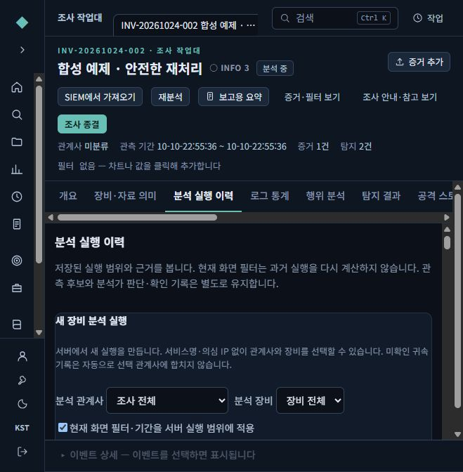
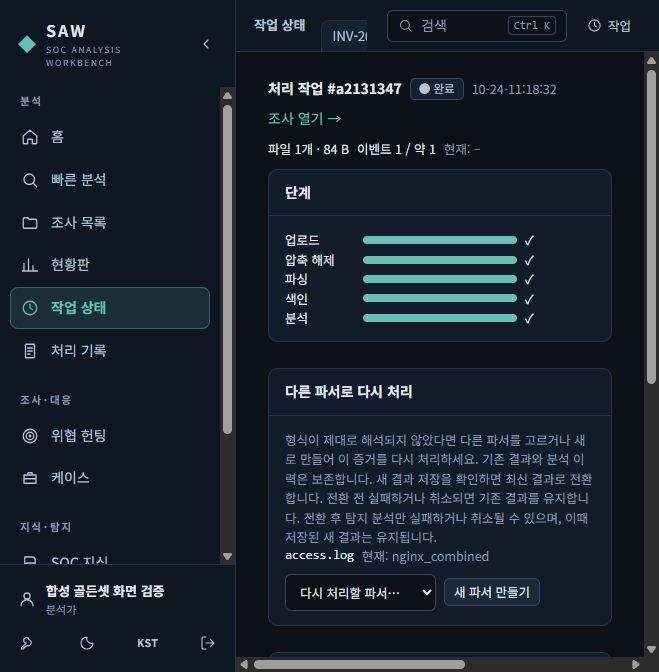
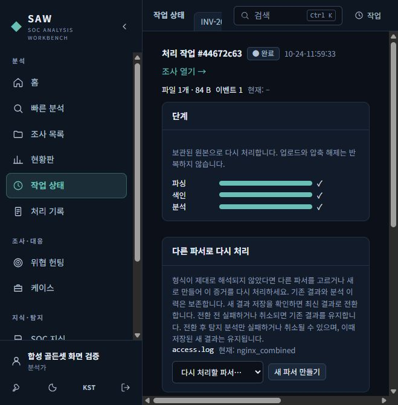
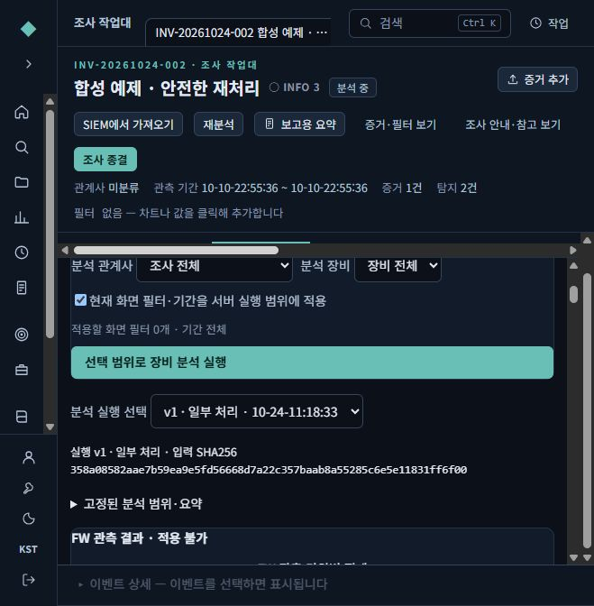
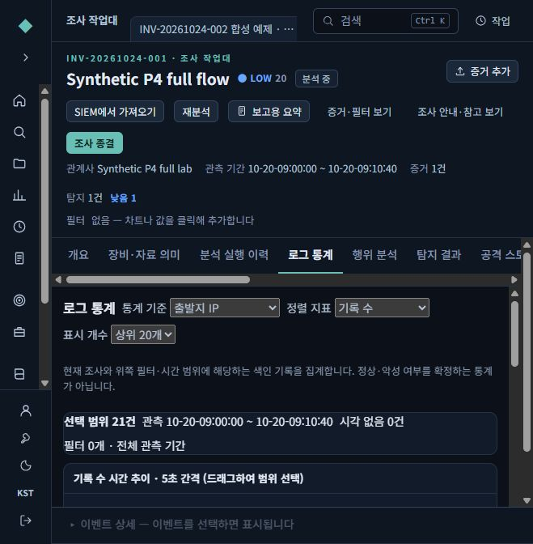
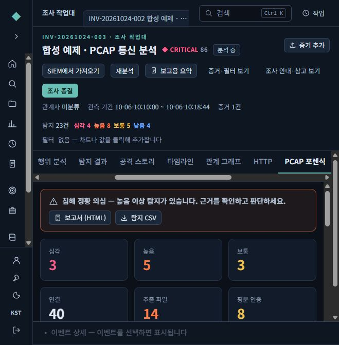
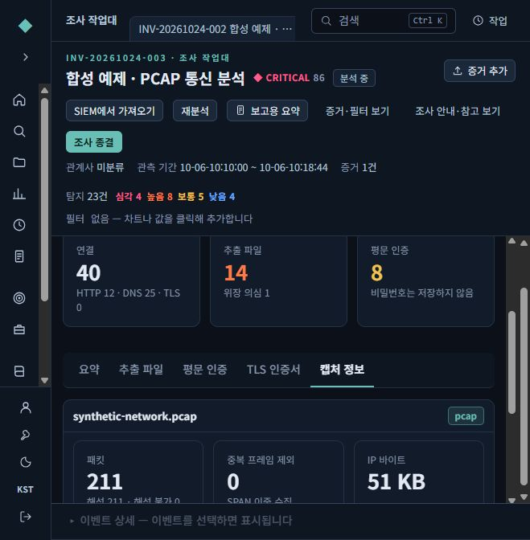
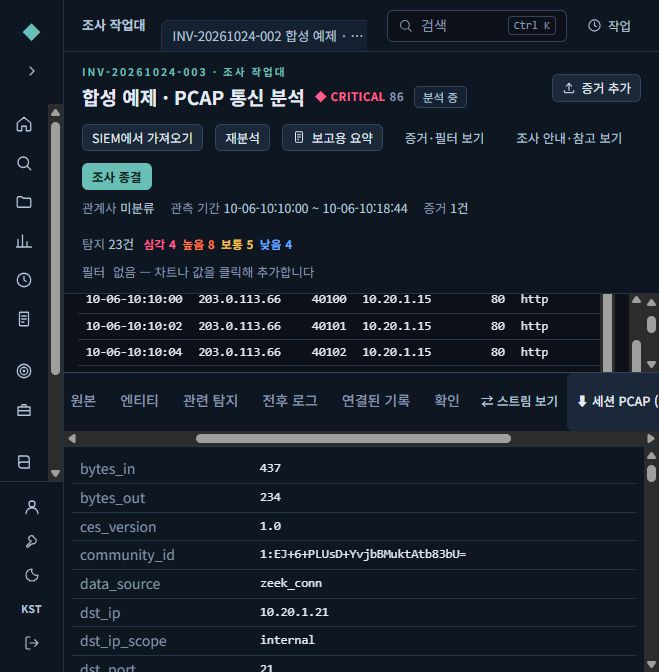

# 원본과 이전 분석을 보존하며 다시 처리하기

확인일: 2026-10-24. 파서가 로그 형식을 잘못 읽었거나 새 해석 기준을 적용해야 할 때 사용하는 안내입니다. 그림은 시험용 합성 자료를 실제 화면에서 확인한 캡처입니다. 기존 운영 계정·운영 자료는 변경하지 않았습니다.

재처리는 보관된 원본 증거를 다시 읽어 **새 처리 작업(Job)**과 새 결과를 만드는 절차입니다. 기존 원본과 이전 분석 이력을 덮어쓰는 작업이 아닙니다. 새 결과의 저장을 확인한 뒤 현재 조회할 결과를 전환합니다. 이전 분석은 그 분석을 실행할 당시의 자료 버전을 계속 가리킵니다.

## 1. 바꾸기 전에 원본과 기존 이력을 확인하세요

조사에서 증거와 처리 작업을 확인하고, **분석 실행 이력**에서 비교할 이전 실행을 확인합니다. 실행 시점의 범위·근거와 현재 화면의 필터를 구분하세요. 현재 화면에서 기간이나 장비 필터를 바꾸어도 과거 실행이 자동으로 다시 계산되지는 않습니다.

그림은 분석 실행 이력 탭의 상단입니다. 개별 실행의 버전과 근거는 해당 이력 항목을 열어 확인합니다. 위 그림에 보이지 않는 개별 이력 행까지 확인한 화면으로 해석하지 마세요.

## 2. 처리 작업에서 파서를 골라 새 작업을 만드세요

1. 해당 증거의 **작업 상태**를 엽니다.
2. **다른 파서로 다시 처리**에서 적용할 파서를 고릅니다. 필요한 형식을 지원하지 않으면 **새 파서 만들기**로 파서를 준비한 뒤 선택합니다.
3. 다시 처리하면 새 Job으로 이동합니다. 새 작업의 상태와 단계별 진행을 확인하세요. 이전 작업을 새 작업으로 오인하지 않도록 작업 번호도 확인합니다.
4. 완료 뒤 조사에서 새 결과를 확인하고, 이전 분석은 분석 실행 이력에서 따로 비교합니다.

이 그림은 기존 작업에서 파서를 고르는 화면입니다. 새 재처리 작업의 완료를 보여 주는 그림은 아닙니다. 원본을 다시 올리거나 기존 증거·이력을 삭제할 필요 없이 재처리 기능을 사용합니다. 보존된 이전 버전을 지우는 관리자 정리는 별도 작업이므로 재처리 절차와 혼동하지 마세요.

위는 실제 합성 재처리의 새 작업 **#44672c63**이 11:59:33에 완료된 화면입니다. `nginx_combined` 파서로 이벤트 1건을 처리했고 **파싱·색인·분석** 세 단계에 완료 표시가 있습니다. 보관된 원본을 다시 사용하므로 업로드와 압축 해제는 반복하지 않는다는 안내도 표시됩니다. 이 완료 화면과 앞의 파서 선택 화면을 구분해서 보세요.

## 3. 현재 결과와 과거 분석을 나누어 읽으세요

| 확인할 내용 | 보는 곳과 의미 |
|---|---|
| 지금 공개된 결과 | 현재 조사 조회와 통계에서 봅니다. 새 결과 전환 후에는 새로 처리한 자료를 기준으로 합니다. |
| 이전 분석 결과 | 분석 실행 이력에서 해당 실행을 엽니다. 당시 자료 버전·범위·근거를 유지한 기록입니다. |
| 새 처리 진행·오류 | 새 Job의 상태와 오류를 봅니다. 현재 결과가 전환되었는지도 함께 확인합니다. |

새 v3가 만들어진 뒤에도 이전 실행을 선택해 연 실제 화면입니다. **v1 · 일부 처리 · 10-24 11:18:33**과 당시 입력 SHA256이 표시됩니다. 이전 실행의 일부 처리 상태와 입력 지문이 유지되어 있으며, 새 결과가 생겼다고 과거 실행이 완료 상태로 바뀌거나 그 근거가 최신 자료로 자동 교체되지는 않습니다. 각 실행의 저장된 범위와 근거를 함께 확인하세요.

## 4. 실패한 단계를 먼저 확인하세요

현재 결과로 전환하는 시점과 그 뒤 탐지·분석하는 시점은 다릅니다.

| 실패·취소가 난 시점 | 남는 결과와 확인 방법 |
|---|---|
| 새 결과를 현재 결과로 전환하기 전 | 기존 결과를 유지합니다. 새 Job의 오류를 확인하고 파서·입력 조건을 점검합니다. |
| 새 결과를 저장하고 현재 결과로 전환한 뒤, 후속 분석 중 | 저장된 새 결과를 유지합니다. 후속 분석의 실패·취소를 새 결과의 소실이나 이전 결과로의 자동 복귀로 해석하지 않습니다. |

두 경우 모두 원본과 이전 분석 이력의 보존을 구분해 확인합니다. 실패 상태를 완료로 간주하지 말고 새 Job의 오류·단계, 현재 조회 결과, 이전 실행의 근거를 함께 확인하세요. 이 안내의 캡처는 모든 실패·취소 분기를 실제로 실행한 증거가 아닙니다.

## 5. 출발지 IP 통계의 범위를 확인하세요

조사의 **로그 통계**에서 통계 기준을 **출발지 IP**, 정렬 지표를 **기록 수**로 선택합니다. 기간·필터와 전체 선택 범위를 먼저 보고 순위를 읽으세요. 표시 개수는 표에 보일 상위 항목 수이며, 전체 입력 건수와는 다릅니다.

이 예제의 선택 범위는 합성 로그 **21행**이고 시각 없는 기록은 0건입니다. 21행이 출발지 IP 21개나 연결 21개라는 뜻은 아닙니다. 기록 수 통계만으로 정상·악성 여부를 확정할 수도 없습니다. 현재 화면의 통계와 과거 분석 실행에 저장된 범위는 따로 확인합니다.

## 6. PCAP은 분석 엔진과 캡처 범위를 함께 보세요

PCAP 증거를 올린 조사에서 **PCAP 포렌식**을 엽니다. 아래는 SAW **내장 PCAP 분석기**로 처리한 합성 예제입니다. `zeek_conn` 같은 기록 형식 이름이 나타나더라도 실제 Zeek 엔진을 실행했다는 뜻은 아닙니다.

이 예제는 **211패킷**, 연결 **40개**, HTTP **12**, DNS **25**, TLS **0**입니다. 각 수치는 해당 분석 항목의 관측 건수이며 모두 더해서 연결 수를 만드는 값은 아닙니다. TLS 0은 이 캡처의 관측 결과이지 다른 통신에 TLS가 없다는 증거가 아닙니다.

시험 환경에는 Suricata가 설치되지 않았으며 화면에도 미설치 상태로 표시됩니다. 따라서 이 결과를 Suricata 탐지 실행 결과로 설명하지 않습니다. 위 개요·캡처 정보 그림에는 Suricata 상태 항목이 직접 보이지 않으므로 엔진 상태는 해당 화면 항목에서 따로 확인하세요. 높은 위험도나 탐지 제목은 근거를 검토할 대상이며 침해 확정 판정은 아닙니다.

### 선택한 연결의 패킷만 내려받기

이벤트에서 연결 근거를 열고 **세션 PCAP**을 선택합니다. 이 예제에서 선택한 FTP 연결의 다운로드 파일은 **37패킷·3,285바이트**였으며, 선택한 연결의 출발지 IP·목적지 IP·출발지 포트·목적지 포트·전송 프로토콜(5개 조건)에 해당하는 패킷만 포함한 것을 확인했습니다.

그림은 연결 근거와 다운로드 위치를 보여 줍니다. 파일의 패킷 수·크기·5개 조건 일치는 다운로드한 파일을 별도로 검사한 결과입니다. 같은 주소의 다른 포트나 다른 프로토콜 통신까지 내려받았다는 뜻은 아닙니다. 선택한 연결의 패킷 범위를 확인하는 기능이며, 캡처에 없던 패킷이나 암호화된 내용의 복원을 보장하지 않습니다.

## 7. 프로그램 업데이트와 전체 시점 복구는 별도 절차입니다

파서를 바꾸어 재처리하는 일과 프로그램 전체를 업데이트하는 일은 다릅니다. 전체 프로그램을 업데이트할 때는 새 매체의 **UPDATE-SAW.cmd**와 [업데이트 점검·복구 안내](UPDATER-STABILIZATION-GUIDE-20261019.md)를 사용하세요. 기존 설치 위에 ZIP을 덮어 풀지 않습니다.

[기존 설치의 전체 시점 복구 안내](OFFLINE-UPDATE-GUIDE.md)는 백업 시점의 설치 전체를 되돌리는 절차입니다. 그 뒤 생긴 자료·계정 변경을 자동 병합하지 않으며, 복구 직전 상태는 별도로 보관합니다. 분석 실행 이력에서 옛 결과를 읽는 것과 설치 전체를 되돌리는 것은 다릅니다.

OpenSearch의 추가 공급업체 필드 보존 방식과 조회 한계는 [공급업체 확장 필드 안내](opensearch-vendor-extensions.md)를 참고하세요.

## 이번 안내의 확인 범위

실제 합성 화면과 선택한 세션 파일의 확인 결과를 설명했습니다. 이 문서와 그림을 공개 배포 목록에 포함하는 검사는 새 전체 매체의 설치·업데이트·복구 인수가 아닙니다.

- **새 모델 제외 전체 매체 및 해당 매체의 설치·업데이트·복구: NOT_RUN.** 기존 문서의 이전 매체 검증 결과를 이번 새 매체 결과로 대체하지 않습니다.
- **Windows 10 Enterprise LTSC 2019 build 17763, 실제 16GB 환경, 관리자 서비스 설치·재부팅 및 운영 환경 인수: 미검증.**
- 이 안내는 실제 100만 건 성능 결과, LLM 실행이나 모델 품질 향상을 주장하지 않습니다.
- 기존 운영 계정·운영 자료는 건드리지 않았습니다. 이 안내의 숫자와 그림은 합성 시험 자료에만 해당합니다.
