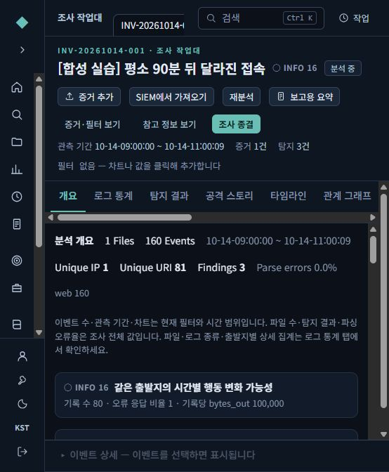
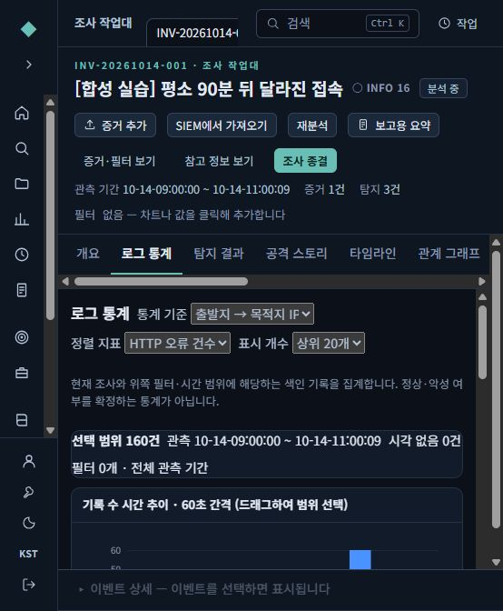
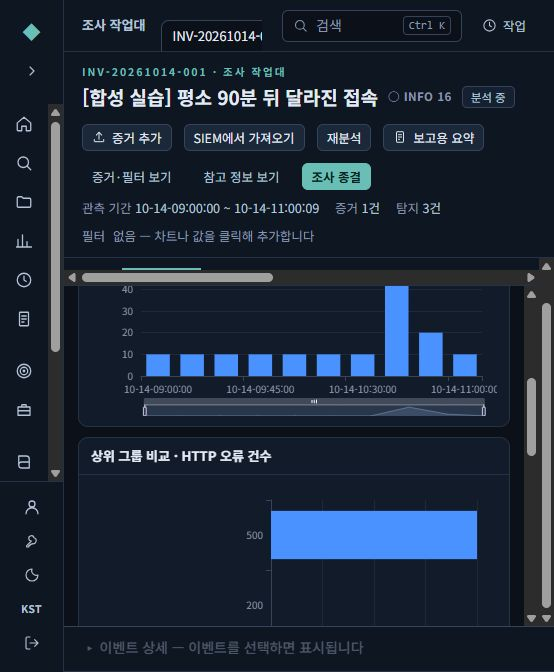
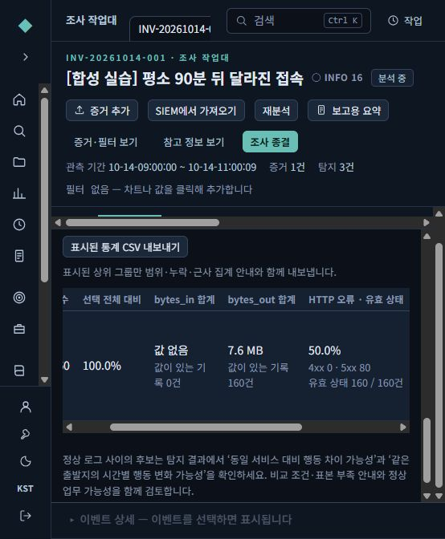
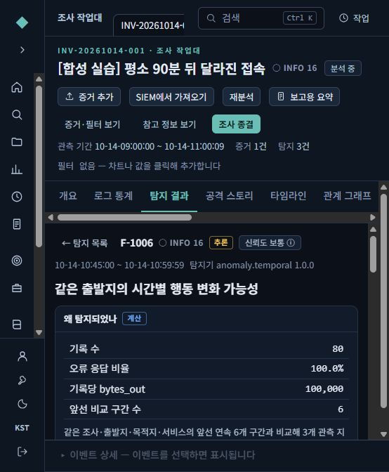
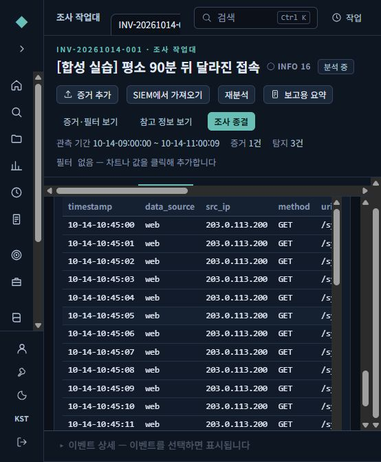
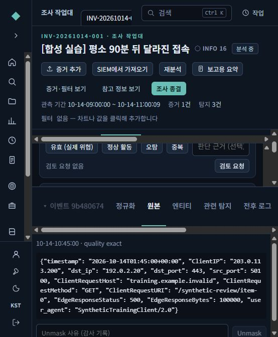
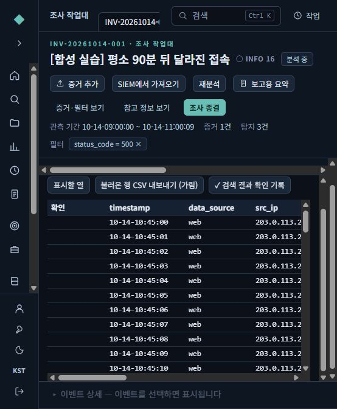

# 로그 통계와 시간별 행동 변화 사용 안내

2026-10-14 추가 기능. 모델 없이 동작한다. 정상 로그와 다른 행동을 찾아 확인 범위를 줄이는 도구이며 악성 확정이나 자동 차단 기능이 아니다.

## 먼저 해 볼 순서

1. **조사 목록 → 조사 열기 → 로그 통계**를 누른다. 처음에는 `로그 종류`로 나누어 같은 종류끼리 비교한다.
2. 통계 기준을 **출발지 IP** 또는 **출발지 → 목적지 IP**로 바꾼다. 어떤 장비가 누구에게 접근했는지 본다.
3. 정렬 지표를 **HTTP 오류 건수** 또는 **bytes_out 합계**로 바꾼다. 상위 차트에서 유독 다른 그룹을 찾는다. 큰 값 자체는 공격의 증거가 아니다.
4. 해당 행의 **이 조건으로 좁히기**로 범위를 줄이거나 **원본 로그**로 이동한다. 위쪽 필터와 시간 범위가 함께 적용된다.
5. **탐지 결과**에서 `동일 서비스 대비 행동 차이 가능성`과 `같은 출발지의 시간별 행동 변화 가능성`을 확인한다. 설명 → 근거 지표 → 원문 순서로 읽는다.
6. 필요하면 **표시된 통계 CSV 내보내기**를 누른다. 현재 조사·필터·시간·상위 제한과 누락 수가 들어간다. 전체 원본 로그를 내보내는 기능은 아니다.

기존 조사에 새 탐지를 적용하려면 **재분석**한다. 분석가가 이미 검토한 결과를 새 탐지가 자동 승인·종결하지 않는다.

## 표를 읽는 방법

| 항목 | 읽는 방법 |
|---|---|
| 기준 | 로그 종류, 파일, 출발지, 목적지, 포트, 출발지→목적지, HTTP 상태, 요청 방식 |
| 선택 범위 | 현재 필터·시간에 해당하는 전체 기록 수 |
| 표시/기타/값 없음 | 상위 그룹에 든 기록 / 그 밖의 그룹 / 분류 값 누락. 기타를 정상으로 해석하지 않는다 |
| HTTP 오류율 | 유효 상태 코드100~599 중4xx·5xx 비율. 예: 상태가 있는100건 중50건 오류이면50%. 상태 없는900건을 정상 분모에 더하지 않는다 |
| bytes_in/out | 로그 필드 값의 합계와 값 있는 기록 수. 누락은 `값 없음`, 관측된0은0. 로그 종류마다 방향·단위·중복 의미를 먼저 확인한다 |
| 최초·최종 | 동일 순간을 기준으로 비교한 관측 범위. 원문 시간대 표기를 집계에서 보존하고 화면 표시 시간대를 적용한다 |
| 근삿값 안내 | OpenSearch 상위 그룹에는 분산 집계 오차가 가능하다. 법적·정산상 정확한 전체 합계로 사용하지 않는다 |

CSV에는 표시된 상위 그룹만 들어간다. 파일명·분류 값에 수식처럼 보이는 문자열이 있어도 자동 수식으로 해석되지 않도록 보호한다. 파일을 내보내도 조사 접근 권한이나 판정 상태는 바뀌지 않는다.

## 두 가지 이상행위 비교

- **다른 출발지와 비교:** 같은 서비스·목적지·15분 구간의 다른 출발지들과 차이를 본다. 같은 프록시/NAT를 공유하는 사용자는 하나로 합쳐질 수 있다.
- **자기 과거와 비교:** 같은 조사·로그 종류·출발지·목적지·포트의 직전 연속6개15분 구간(90분)과 비교한다. 현재·미래 기록은 기준선에 넣지 않는다.

시간 비교는 요청 수, HTTP 오류 비율, 기록당 bytes_out 중 **서로 다른 두 지표 이상**이 함께 변해야 후보를 만든다. 기본 조건은 다음과 같다.

- 각 비교 구간과 후보에10건 이상, 기준선 요청량의 흔들림이 제한 이내여야 한다.
- 요청량은 최소20건·기준선 중앙값의4배, 오류 비율은 최소60%·기준선보다40%p 증가, 기록당 bytes_out은 최소65,536바이트·기준선의8배를 기준으로 삼는다. 과거 변동폭(MAD)의6배 조건도 함께 적용한다.
- 오류·전송량은 각 구간에서80% 이상 값이 있어야 사용한다. 없는 상태를200, 없는 전송량을0으로 채우지 않는다.
- 첫·마지막 관측 구간은 부분 수집 가능성이 있어 제외한다. 첫 비교에는 최소9개 관측 구간이 필요하다. 구간이 빠지면0건으로 채워 비교하지 않는다.
- 입력10만 건, 시계열200개, 구간그룹5,000개 상한을 넘으면 해당 실행의 후보 생성을 중지하고 분석 범위 안내를 남긴다. 후보 표시는 최대10개다.

대상 로그는 `web`, `waf`, `zeek_http`, `zeek_conn`이다. 이 기본 수치는 이번 구현의 고정 기준이며 화면에서 임계값을 편집하는 기능은 아니다. 정상 배치·서비스 장애·수집 변화도 후보가 될 수 있다. 기준선은 과거 관측이지 승인된 정상본이 아니다. ATT&CK 매핑이나 침해 성공을 자동 확정하지 않는다.

`시간별 행동 분석 범위 확인 필요`는 오류나 공격 판정이 아니라 제외·부족한 범위를 설명하는 결과다. 이 안내만 있고 후보가 없어도 전체 정상으로 결론내리지 않는다.

## 가상 자료로 따라하기

[실습 파일 temporal-behavior-160.jsonl](samples/temporal-behavior-160.jsonl)은 예약된 문서용 IP와 `.invalid` 호스트만 사용한160건이다. 실제 은행 자료는 없다.

1. 새 조사에 파일을 웹 로그로 업로드하고 처리 완료를 기다린다. parser 자동 선택과 수집 시간대를 확인한다.
2. 로그 통계에서 **출발지 → 목적지 IP**, 정렬은 **HTTP 오류 건수**를 선택한다.
3. `203.0.113.200 → 192.0.2.20`의160건, 유효 HTTP160건, 오류80건·50%, bytes_out 8,016,000바이트, bytes_in `값 없음`을 확인한다.
4. 탐지 결과의 **같은 출발지의 시간별 행동 변화 가능성**을 연다. UTC01:45~01:59:59 구간의80건이 이전 각10건·HTTP200·기록당200바이트와 다른 것을 확인한다. KST 표시라면10:45~10:59:59이다.
5. 그 결과의 원문을 열면 해당 구간의 HTTP500 기록80건만 보여야 한다. 이 예시는 서비스 오류와 큰 응답이 겹친 상황이며 악성으로 확정하는 예시가 아니다.
6. 승인 배치·배포·장애·수집 설정 변경 여부를 추가 확인하고 분석가 판단을 남긴다.

새 모델 후보는 [약8B 한국어·보안 비교와 반입 가이드](MODEL-8B-KOREAN-SECURITY-GUIDE.md)를 참고한다. 모델은 이 탐지기의 선행 조건이 아니다. [이번 검증 기록](STATISTICS-TEMPORAL-VALIDATION-2026-10-14.md)에서 실제 실행과 미확인 범위를 구분한다.

## 실제 화면을 보며 따라하기

아래는 같은 가상 160건을 실행한 화면이다. 좁은 창에서는 표를 가로로 밀어 오른쪽 열을 볼 수 있다. 기존 설치 ZIP에는 아직 이 화면 변경이 들어 있지 않다.

### 1. 조사 개요에서 전체 기록과 후보를 확인

160건 중 시간 변화 후보가 1개이며, 나머지 2개는 분석 범위 안내다.

### 2. 출발지·목적지와 오류 건수로 통계 선택

상위 그룹, 조회 범위와 관측 기간을 함께 확인한다.

### 3. 상태 코드별 차트로 오류가 모인 그룹 확인

500응답 80건이 있고 200응답 그룹의 오류 건수는 0이다. HTTP500 자체를 침해 성공으로 해석하지 않는다.

### 4. 오류율 분모·전송량 누락 확인 후 CSV 저장

출발지·목적지별 전체 160건 중 80건 오류로 50%이다. bytes_in은 값 없음, bytes_out은 약 7.6MiB다. 화면의 MB 표기는 바이너리 단위를 반올림한다. 표시된 통계 CSV 버튼으로 범위를 포함해 내려받을 수 있다.

### 5. 시간 변화 후보의 근거를 읽기

직전 6개 구간과 비교해 요청량 80, 오류 비율 100%, 기록당 100,000바이트가 함께 달라졌다. 이 수치는 변화 구간에 대한 값이므로 전체 조사 오류율 50%와 다르다.

### 6. 후보의 근거 이벤트에서 원문 위치 확인

근거 총 80건의 첫 페이지를 표시한다. 행을 선택하고 아래 상세 창의 원본을 누르면 합성 파일의 71번째 줄까지 확인할 수 있다.

### 7. 통계 행에서도 원본으로 이동

HTTP500 행의 원본 로그 버튼을 누르면 상단 필터가 500으로 바뀌고 80건이 표시된다. 다른 그룹을 살펴볼 때는 필터 칩을 눌러 해제한다.

