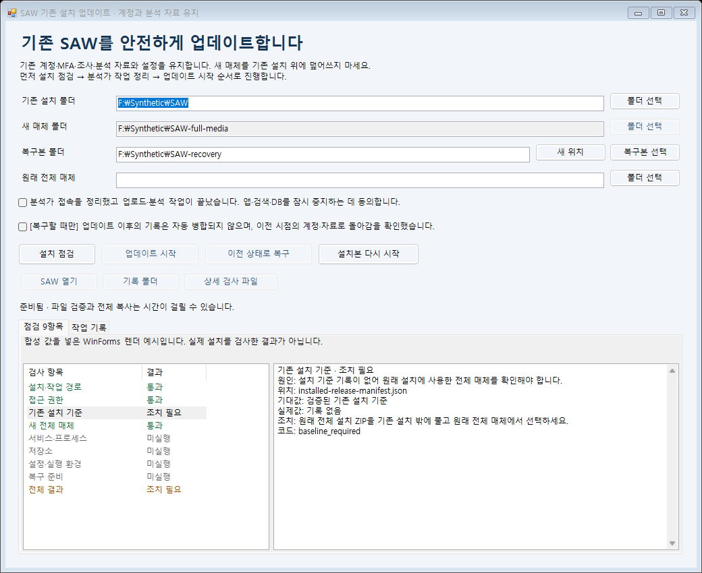
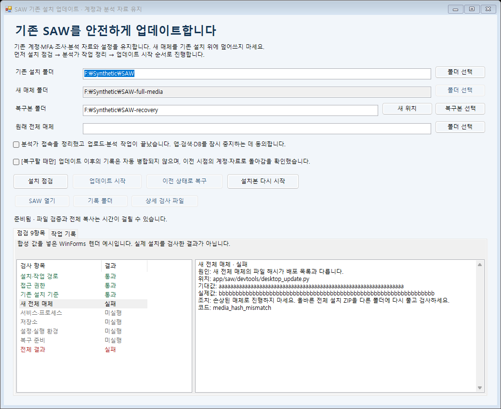
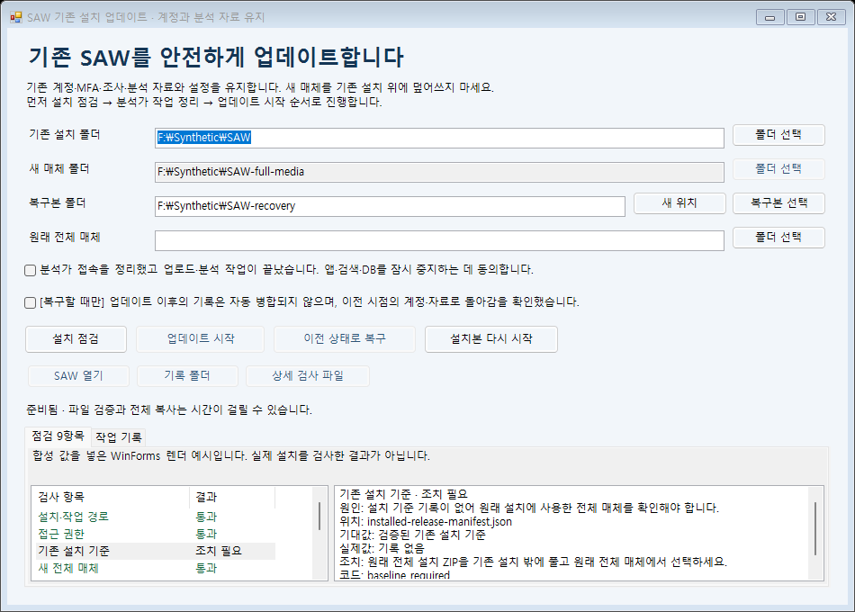
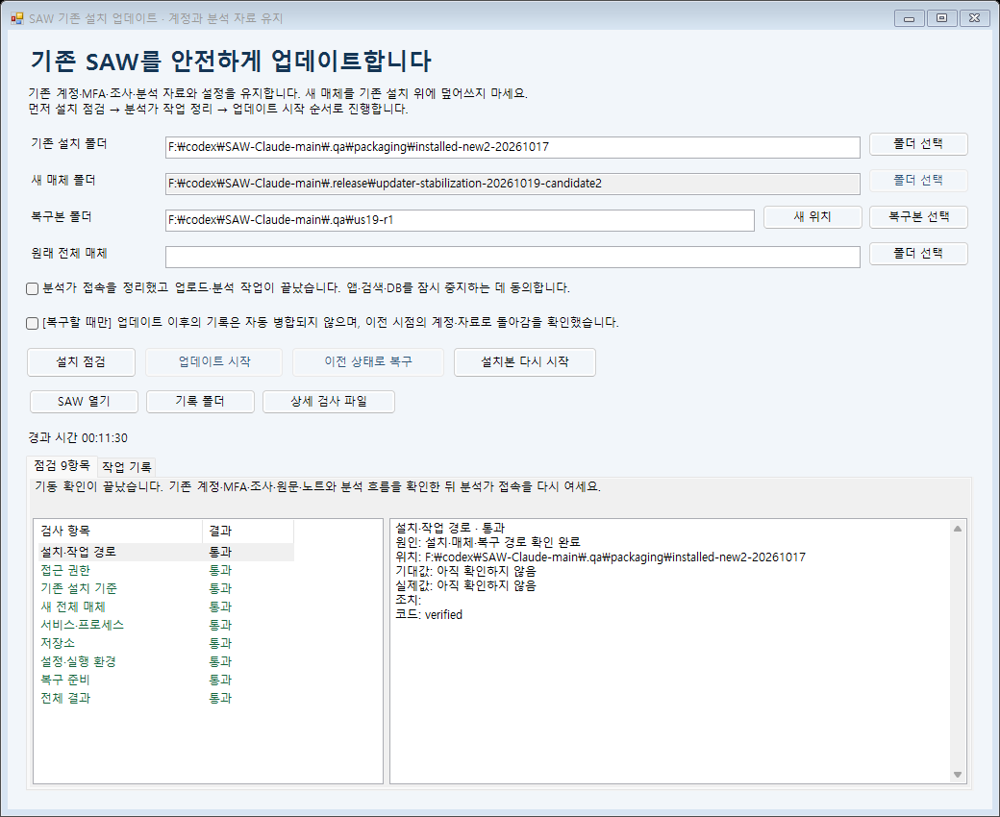

# SAW 업데이트 점검·복구 안내

2026-10-19 · 기존 계정·MFA·조사·분석 자료를 유지하는 업데이트

새 전체 매체를 기존 설치 밖에 풀고, 아래 1–5 순서대로 점검·업데이트·복구와 사용 확인을 진행하세요. 설명용 화면과 합성 설치의 실제 실행 결과는 뒤쪽 증거 절에서 구분합니다. 실제 실행 결과는 개발 PC의 합성 시험이며 대상 운영 환경 인수는 별도입니다.

- [1. 설치·매체 선택](#prepare)
- [2. 9개 항목 점검](#inspect)
- [3. 동의 후 업데이트](#apply)
- [4. 실패·복구 대응](#recover)
- [5. 실제 사용 확인](#accept)
- [실행 증거와 검증 범위](#evidence)
- [후보 7 최종 검증 결과](#native7-progress)
- [후보 7 업데이트 결과](#native7-apply)
- [후보 7 복구 결과](#native7-restore)
- [이전 후보 실행 이력](#historical-evidence)
- [후보 5 업데이트 결과](#native-apply)
- [후보 5 복구 결과](#native-restore)
- [후보 6 업데이트 결과](#native6-apply)
- [후보 6 복구 첫 시도 실패](#native6-restore-failed)

## 1. 기존 설치와 새 전체 매체를 구분하세요

| 화면 항목 | 예시 | 선택할 내용 |
|---|---|---|
| 기존 설치 폴더 | C:\SAW | 지금 사용 중인 설치 위치 |
| 새 매체 폴더 | D:\SAW-update-20261019 | 새 **전체 설치 ZIP**을 아직 없는 새 버전 전용 폴더에 푼 위치 |
| 복구본 폴더 | C:\SAW-r-20261019 | 업데이트할 때는 설치와 같은 드라이브의 **아직 없는 새 폴더** |
| 원래 전체 매체 | D:\SAW-0.1.0 | 구형 설치의 기준 기록이 없을 때, 그 설치에 실제 사용했던 전체 매체 |

기존 D:\SAW-0.1.0은 원래 설치 매체로 보존하세요. 새 ZIP은 D:\SAW-update-20261019처럼 아직 없는 새 버전 전용 폴더에 풉니다. 원래 매체 폴더 위에 새 ZIP을 덮어 풀지 마세요.

새 전체 설치 ZIP을 기존 C:\SAW 위에 풀지 마세요. 새 매체의 UPDATE-SAW.cmd를 실행해 기존 설치를 선택합니다. GitHub의 **Source code (zip)**은 설치 매체가 아닙니다. 원래 전체 매체와 새 전체 매체는 서로 다른 버전일 수 있습니다.

기존 설치의 기준 기록이 없으면 원래 전체 매체를 선택하고 다시 점검하세요. 기준 파일을 임의로 만들거나 다른 버전의 installed-release-manifest.json을 복사하지 마세요. 원래 매체와 설치 파일이 일치하는지 검증한 뒤 진행합니다.

실행기는 해당 PowerShell 프로세스에만 RemoteSigned를 지정하며 시스템·사용자 정책 값을 저장하거나 파일 차단을 자동으로 해제하지 않습니다. 조직의 그룹 정책이 우선합니다. 인터넷에서 받은 표시(MOTW)가 남은 서명 없는 스크립트는 실행이 차단될 수 있습니다. 이 경우 정책을 우회하지 말고 IT 담당자의 배포 서명·승인 절차를 확인하세요. [PowerShell 실행 정책](https://learn.microsoft.com/en-us/powershell/module/microsoft.powershell.core/about/about_execution_policies?view=powershell-5.1)

*합성 WinForms 렌더 예시. 경로와 결과는 설명용이며 실제 사용자 설치 결과가 아닙니다.*

## 2. 설치 점검에서 9개 항목을 확인하세요

**설치 점검**은 기존 서비스를 중지하거나 DB·계정·업무 자료를 변경하지 않습니다. 별도의 보호된 작업 폴더에 실행 준비 파일과 검사 기록을 만듭니다.

| 검사 항목 | 확인할 내용 |
|---|---|
| 설치·작업 경로 | 설치·매체·복구·작업 폴더의 구분과 경로 조건 |
| 접근 권한 | 읽기·쓰기 범위와 소유권 조건 |
| 기존 설치 기준 | 설치 기준 기록 또는 검증한 원래 전체 매체 |
| 새 전체 매체 | 필수 파일, 파일 크기·해시, 배포 목록 형식 |
| 서비스·프로세스 | 선택한 설치에 연결된 실행 주체 |
| 저장소 | 기존 DB·색인·원본 저장 위치와 조건 |
| 설정·실행 환경 | 지원하는 설정·런타임·마이그레이션 조건 |
| 복구 준비 | 선택한 복구 위치·복구본과 공간 조건 |
| 전체 결과 | 앞선 항목의 결과와 진행 전 필요한 조치 |

표시 상태는 **통과 / 조치 필요 / 실패 / 미실행**입니다. 미실행은 확인하지 못한 항목이며 통과가 아닙니다. 관리자 권한이 필요하면 그 안내에 따라 다시 열어 점검합니다.

항목을 선택하면 **원인·위치·기대값·실제값·조치·코드**가 나옵니다. **상세 검사 파일**은 이 창이 만든 보호된 작업 폴더의 검사 JSON을 엽니다. **작업 기록** 탭에서 전체 결과, 마지막 완료 단계, 검증된 복구본·보관 위치 안내를 확인합니다.

*해시 a… / b…는 합성 예시입니다. 실제 비밀값이나 업무 자료를 표시한 화면이 아닙니다.*

매체 오류는 안내에 따라 구분해 조치합니다. 소스 ZIP이면 전체 설치 ZIP을 준비하고, 누락·손상 파일이나 해시 불일치면 승인된 전체 매체를 다른 폴더에 다시 풉니다. 배포 목록 형식 오류가 있으면 올바른 전체 매체로 교체합니다. 임의 파일 추가·수정으로 검증을 우회하지 마세요.

작은 화면에서는 표와 상세 설명을 스크롤할 수 있습니다.

## 3. 동의한 뒤 업데이트를 시작하세요

1. 분석가 접속을 정리하고 진행 중인 업로드·분석이 끝났는지 확인합니다.
2. 복구본에 **새 위치**를 지정합니다. 이미 존재하는 복구본 폴더는 덮어쓰지 않으며, 그 폴더를 선택하면 업데이트 버튼을 사용할 수 없습니다.
3. 서버 중지 동의 항목을 확인하고 **업데이트 시작**을 누릅니다.
4. 실행기는 같은 설치의 유지보수 잠금을 잡고 조건을 다시 확인합니다. 서버 중지 → 전체 복구본 생성·검증 → 앱 교체 → 시작·마이그레이션 → 상태 확인 순서로 진행합니다.

진행 중에는 별도로 서버를 시작하거나 설치·복구 폴더를 이동하지 마세요. 검사 결과가 있어도 실제 적용 직전에 다시 검증합니다.

## 4. 실패하면 위치와 마지막 완료 단계를 먼저 확인하세요

실패는 완료가 아닙니다. **작업 기록**의 오류·마지막 완료 단계·복구본 검증 여부와 9개 검사 항목의 조치를 확인하고 설치·복구본·보관 폴더를 유지하세요. 업데이트·전체 복구 작업을 자동으로 다시 실행하지 않습니다.

복구본 복사가 끝나지 않았다면 그 폴더를 보존하고, 재검사 후 새 복구 위치가 필요한지 안내를 따릅니다. 검증된 전체 복구본이 있으면 **복구본 선택**으로 지정하고 두 동의 항목을 확인한 뒤 **이전 상태로 복구**를 요청할 수 있습니다. 복구본과 중단 기록은 다시 검증합니다.

전체 복구 중 폴더 교체 단계에서 중단되어 원래 설치 경로가 잠시 없어도, **기존 설치 폴더에 원래 경로를 그대로 입력**하고 같은 복구본으로 복구를 요청합니다. 임의로 빈 설치 폴더를 만들거나 보관 폴더를 직접 옮기지 마세요. 실행기가 검증 가능한 중단 기록·복구본·보관 상태를 확인한 뒤에만 재개합니다. 검증할 수 없으면 진행하지 않습니다.

복구는 계정·MFA·DB·색인·원본·설정을 복구본 시점으로 되돌립니다. 업데이트 이후 생긴 자료와 계정 변경은 자동 병합하지 않습니다. 복구 직전 설치는 별도 보관하며 화면에 표시된 보관 위치를 기록하세요. 보관 폴더에서 직접 서버를 시작하지 마세요.

## 5. 기동 확인 뒤 실제 사용을 인수하세요

기동 확인이 끝나도 기존 계정으로 로그인하고 MFA, 조사, Finding, 원문·증거, 노트와 필요한 분석 흐름을 확인한 뒤 분석가 접속을 다시 여세요. 이번 그림과 자동 UI 시험은 실제 계정·업무 자료 보존 확인을 대신하지 않습니다.

## 실행 증거와 검증 범위

최신 후보 7은 실제 합성 설치의 시작·점검·업데이트·전체 복구와 자료 보존·동일 계정/MFA/TLS 로그인·새 객체 보관·계정 정리·정상 중지를 모두 통과했습니다. 동결된 생산 코드의 전체 서버 시험도 1,733 통과·6 건너뜀·기존 경고 2건(1,305.21초)으로 끝났습니다. 이 결과는 Windows 11 / PowerShell 5.1 / NoAdmin의 합성 시험이며 대상 LTSC 관리자 운영 환경 인수는 별도입니다. 이전 후보의 실패·수정 이력은 뒤에서 구분합니다.

## 후보 7 최종 검증 결과

| 실제 합성 순서 | 결과 |
|---|---|
| 설치본 시작 | PASS · 69.47초 · ACL 32,688개·9행 |
| 설치 점검 | PASS · 39.36초 · ACL 32,698개·9행 |
| 업데이트 | PASS · 492.39초 · ACL 32,698개·9행·health 완료 |
| 전체 복구 | PASS · 497.54초 · ACL 32,701개·9행·health 완료 |
| 자료·계정·MFA·설정 보존 | 점검 전후·적용 후·복구 후 대조 PASS, 동일 합성 계정·암호·MFA/TLS 로그인 PASS |
| 업데이트 후 새 객체 보관 | 50바이트 객체 1개가 보관 설치에 있고 복구 시점 설치에는 없음을 확인 |
| 시험 종료 | 계정 비활성화·세션 폐기 PASS, 정상 중지 28.56초·세 포트 닫힘·PostgreSQL PID 파일 없음 |

전체 서버 시험은 **1,733 통과·6 건너뜀·기존 경고 2건(1,305.21초)**입니다. 실제 WinForms 버튼 이벤트로 수행한 합성 NoAdmin 시험이며, 물리적 더블클릭·LTSC 관리자 서비스·HTTPS 443·재부팅·실제 업무 자료의 운영 인수를 대신하지 않습니다. 배포 파일의 크기·해시·소스 버전은 함께 제공되는 배포 검증 기록을 확인하세요.

## 후보 7 실제 업데이트 결과

후보 7의 실제 WinForms 버튼 이벤트로 업데이트를 실행해 **492.39초**에 완료했습니다. ACL 객체 32,698개와 검사 9행을 통과하고 마지막 단계인 기동 확인(health)을 마쳤습니다. 적용 후 이벤트 9개, Finding 10개, 증거 2개, 노트 1개, 완료 작업 2개, 계정 2개 및 계정·암호 해시·역할·MFA, 증거·작업·노트, 설정·키·TLS·원본의 동일성 검사가 통과했습니다. 같은 합성 계정·암호·MFA 로그인과 TLS 검증도 통과했습니다.

[후보 7 실제 업데이트 완료 화면](UPDATER-STABILIZATION-GUIDE-20261019.html#native7-apply)

화면은 원본 PNG를 그대로 HTML 안에 넣었습니다. Windows 11 / PowerShell 5.1 / NoAdmin의 합성 설치 결과이며 실제 LTSC 관리자 서비스·HTTPS 443·재부팅 인수 결과가 아닙니다. 업데이트 후 추가한 50바이트 합성 객체의 보관과 복구·최종 정리도 통과했으며, 다음 복구 절에서 결과를 구분합니다.

## 후보 7 실제 복구 결과

전체 시점 복구는 **497.54초**에 완료됐습니다. ACL 객체 32,701개와 검사 9행을 통과하고 기동 확인(health)을 마쳤습니다. 복구 후 기준 대조에서 계정 2개·이벤트 9개·Finding 10개·증거 2개·노트 1개·완료 작업 2개와 schema 0014를 확인했고, 계정·암호 해시·역할·MFA·증거·작업·노트·설정·키·TLS·원본 동일성 및 같은 합성 계정·암호·MFA/TLS 로그인이 통과했습니다.

업데이트 후 추가한 50바이트 합성 객체는 복구 직전 보관 설치에 남아 있고 복구된 snapshot에는 없었습니다. 이는 객체 1개의 보관 확인이며 모든 종류의 새 계정·DB 변경 검증을 뜻하지 않습니다. 시험 계정 비활성화·세션 폐기 후 **28.56초**에 정상 중지했고 PostgreSQL·OpenSearch·API 시험 포트 닫힘과 PostgreSQL PID 파일 부재를 확인했습니다.

[후보 7 실제 복구 완료 화면](UPDATER-STABILIZATION-GUIDE-20261019.html#native7-restore)

원본 PNG 바이트를 그대로 HTML 안에 넣었습니다. 후보 6 첫 복구 실패의 원인이 확정됐다는 의미는 아니며, 이 후속 후보 7의 완료 결과로 구분합니다.

## 이전 후보 실행 이력

아래 화면과 수치는 각 후보 실행 당시의 이력입니다. 후보 6의 정확한 실패 원인은 미확정으로 보존합니다.

그림 01–03은 PowerShell 5.1 WinForms에 합성 검사 값을 넣어 렌더한 UI 예시입니다. 그림 04는 별도 합성 설치의 실제 시작 작업이며, 아래 후보 5 적용·복구 화면은 실제 작업 완료 결과입니다. 각 화면의 검증 범위를 구분하며 운영 설치의 인수 완료를 뜻하지 않습니다.

그림 04는 Windows 11 build 26200 / PowerShell 5.1 / NoAdmin 환경에서 후보 매체 2의 실제 WinForms 버튼 이벤트(PerformClick)를 통해 설치본 다시 시작을 실행한 결과입니다. 691.69초 동안 ACL 객체 32,640개와 점검 9행을 확인하고 실제 PostgreSQL·OpenSearch·HTTPS(시험 포트 58449) 기동 확인을 완료했습니다. 물리적 더블클릭 시험은 아닙니다. 그림 04만으로 업데이트·복구·자료 보존을 입증하지 않으며, 후보 5의 적용 결과는 아래에서 별도로 설명합니다. 대상 LTSC 2019 build 17763의 관리자 서비스·HTTPS 443·재부팅 검증은 아직 남아 있습니다.

*그림 04 · 실제 합성 설치의 시작 작업 완료 화면. 후보 매체 2 / NoAdmin / 시험용 HTTPS 58449. 최종 새 매체의 업데이트·복구 인수 결과가 아닙니다.*

[검증 기록](verification/updater-stabilization-20261019.json)

## 후보 5 실제 업데이트 결과

Windows 11 build 26200 / PowerShell 5.1 / NoAdmin의 별도 합성 설치에서 후보 매체 5를 실제 WinForms 버튼 이벤트(PerformClick)로 실행했습니다. 설치 점검은 63.02초, 업데이트는 678.47초에 완료됐고, ACL 객체 32,651개와 점검 9행이 통과했습니다. 마지막 완료 단계는 기동 확인(health)입니다.

점검 전·후와 적용 후 공개 비교 영수증에서 이벤트 9개, Finding 10개, 증거 2개, 노트 1개, 완료 작업 2개, 계정 2개를 확인했습니다. 계정 식별자·암호 해시·역할·MFA 상태, 증거·작업·노트, 설정·키·TLS·원본 객체의 동일성 검사를 통과했고, 적용 후 같은 합성 계정·암호·MFA 로그인과 TLS 인증서 검증도 통과했습니다. 비밀값이나 실제 업무 자료는 이 안내에 포함하지 않습니다.

[실제 후보 5 적용 화면과 검증 범위 보기](UPDATER-STABILIZATION-GUIDE-20261019.html#native-apply)

이 화면은 원본 PNG를 수정 없이 HTML 안에 넣었습니다. 실제 서비스와 런타임을 사용한 합성 설치 시험이며 물리적 더블클릭이나 운영 서버 인수 시험은 아닙니다. 복구와 복구 후 새 자료 보관 결과는 다음 절에 별도로 기록했습니다. 이 화면은 후보 5 실행 당시의 기록이며 최신 검증 결과는 후보 7 절에서 확인합니다. 대상 LTSC 2019의 관리자 서비스·HTTPS 443·재부팅 및 실제 업무 자료 인수는 별도 확인이 필요합니다.

## 후보 5 실제 복구 결과

같은 후보 매체 5와 합성 설치에서 이전 상태로 복구를 실행해 613.99초에 완료했습니다. ACL 객체 32,683개와 점검 9행이 통과했고 마지막 완료 단계는 기동 확인(health)입니다. 복구 후 기준 자료 대조와 같은 합성 계정·암호·MFA 로그인, TLS 인증서 검증도 통과했습니다.

업데이트 뒤 추가한 50바이트 합성 객체는 복구 직전 설치의 보관 폴더에 남아 있고, 복구된 시점의 설치에는 없음을 확인했습니다. 이는 새 객체 1개의 보관 검증이며 모든 종류의 새 계정·DB 변경을 검증한 결과는 아닙니다. 시험을 마친 뒤 합성 계정을 비활성화하고 세션을 폐기했으며, PostgreSQL·OpenSearch·API 시험 포트가 닫히고 PostgreSQL PID 파일이 없는 상태까지 확인했습니다.

[실제 후보 5 복구 화면과 검증 범위 보기](UPDATER-STABILIZATION-GUIDE-20261019.html#native-restore)

아래 화면도 원본 PNG를 그대로 내장했습니다. 실제 WinForms 버튼 이벤트로 실행한 개발 PC의 합성 NoAdmin 시험입니다. 대상 LTSC 2019 관리자 서비스·HTTPS 443·재부팅·물리적 더블클릭·운영 자료 인수는 아직 확인하지 않았습니다. 이 절은 후보 5 당시의 결과이며 최종 후보 검증 결과와 배포 상태는 별도 기록에서 확인합니다.

## 후보 6 실제 업데이트 결과

후보 6의 별도 합성 NoAdmin 설치에서 실제 WinForms 버튼 이벤트로 시작 52.72초, 점검 39.93초, 업데이트 508.17초를 완료했습니다. 업데이트는 ACL 객체 32,658개와 9개 검사 항목을 통과하고 기동 확인(health)까지 마쳤습니다.

점검 전·후와 적용 후 비교에서 이벤트 9개, Finding 10개, 증거 2개, 노트 1개, 완료 작업 2개, 계정 2개를 확인했습니다. 계정·암호 해시·역할·MFA 상태, 증거·작업·노트와 설정·키·TLS·원본 객체의 동일성 및 적용 후 같은 합성 계정·암호·MFA 로그인·TLS 검증을 통과했습니다.

[후보 6 실제 업데이트 화면](UPDATER-STABILIZATION-GUIDE-20261019.html#native6-apply)

## 후보 6 복구 첫 시도 실패

후보 6의 첫 복구 시도는 40.52초에 접근 권한 사전 검사에서 실패했습니다. 코드 unsafe_access, 현재 단계 validate, 전체 결과 preflight_failed이며, 이후 기준·서비스·저장소·설정·복구 검사는 미실행입니다. 검증된 복구본(recovery_verified)과 재시도 가능(can_retry) 상태가 표시됐지만 복구 완료를 뜻하지 않습니다.

승인된 오류 종류·건수 확인에서 설치 범위 32,690개 중 접근 권한 정보 조회 실패(access_metadata_unreadable) 4건을 확인했고 목록 생략은 없었습니다. 경로·SID·파일 내용은 확인하지 않았으며, 최초 실패는 Win32 오류 번호를 보존하지 않아 정확한 원인을 확정하지 못했습니다. 권한을 바꾸지 않은 이후 전체 재검사 32,690개는 8.0초에 통과했지만, 이를 최초 실패 원인의 확인이나 해결 증명으로 사용하지 않습니다. 복구 후 로그인·자료 대조와 새 자료 보관은 미실행입니다. 후보 6 시험 설치는 별도의 기존 안전 정지 도구로 28.73초에 정상 중지했고 PostgreSQL·OpenSearch·API의 세 시험 포트 닫힘과 PostgreSQL PID 파일 부재를 확인했습니다. 이후 후보 7의 합성 계정 준비가 기존 계정의 활성 상태 때문에 중단돼, 안전 정리 도구로 후보 6 시험 계정 비활성화·세션 폐기를 완료한 뒤 같은 합성 계정을 새 시험에 준비했습니다. 이 정리 결과는 후보 6 복구 성공을 뜻하지 않습니다. 아래 실패 화면을 성공 이력과 구분해 보존하며, 후보 5의 복구 성공으로 후보 6의 실패를 대체하지 않습니다. 후보 6 동결 코드의 전체 서버 시험은 1,647 통과·6 건너뜀·기존 경고 2건(1,376.79초)으로 끝났습니다. 그 뒤 ACL 원인·위치·건수 표시 보완과 제한된 전체 재검사 처리를 포함한 후보 7 매체를 빌드했습니다. 후속 검증 결과는 아래 후보 7 절에서 구분합니다. 이 후보 6 기록을 복구 성공으로 바꾸지 않으며 대상 운영 환경 인수도 별도입니다.

[후보 6 실제 복구 실패 화면](UPDATER-STABILIZATION-GUIDE-20261019.html#native6-restore-failed)

[기존 더블클릭 안내](DOUBLE-CLICK-UPDATE-GUIDE.md) · [이 안내의 HTML](UPDATER-STABILIZATION-GUIDE-20261019.html)
