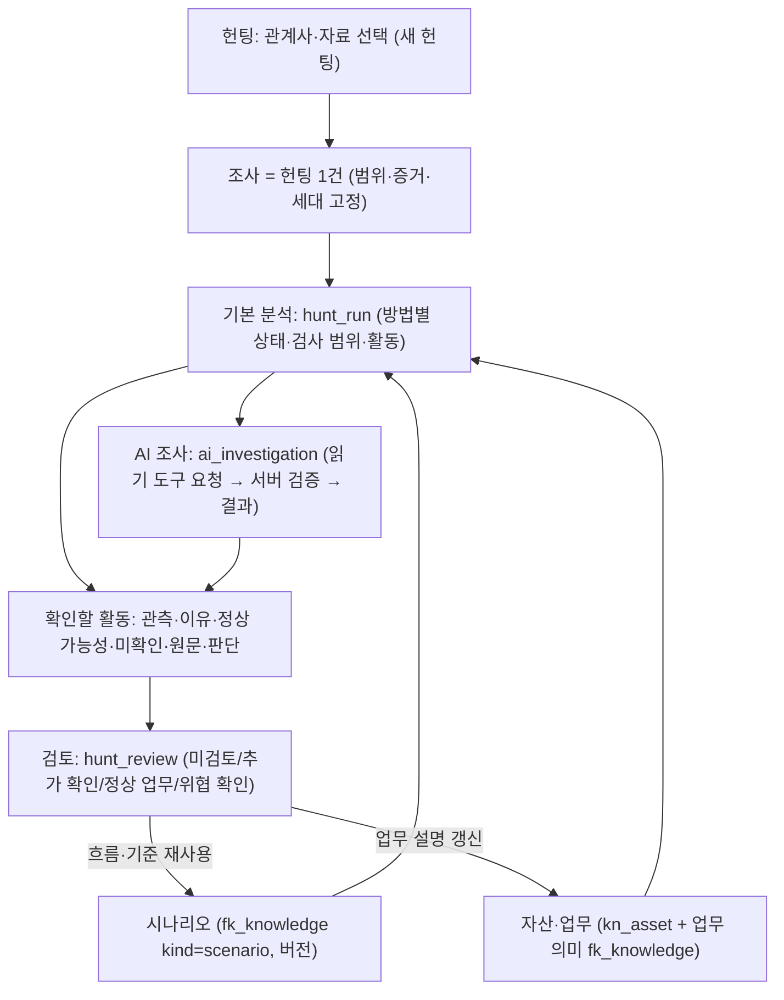

# ADR-0020: 자동 위협헌팅 구조 — 주 메뉴 3개, 헌팅 실행, 시나리오, 자산·업무, AI 조사

- 상태: Accepted
- 날짜: 2026-11-14
- 기준 요구: `SAW_Claude_Implementation_Prompt_20261113`(이 개편의 단일 요구사항 기준)
- 갱신하는 결정: ADR-0007(결정적 처리 우선, LLM은 설명·요약·초안)의 "수동 질의 수락 전제"를 아래 5번으로 바꾼다. 권한·마스킹·원문 보존·최종 판단은 분석가라는 원칙은 그대로다.

## Context — 2026-11-13 실제 상태

| 확인 대상 | 결과 |
|---|---|
| 기본 브랜치 `main` | a6cd0a0 (v0.2.0 병합). 이후 버전은 PR #7~#14로 쌓여 있고 병합되지 않았다 |
| 게시된 매체 | v0.2.5-pilot.20261111 (태그 1b7fd8f, manifest e4548279…, 스키마 0026). Latest는 v0.2.3 |
| 0.2.5 매체의 사례 | W01~W60 JSON·그림·ZIP 포함(설치 리허설 a18에서 60/300/120/60 확인) |
| 0.2.5 화면의 사례집 진입 | **왼쪽 메뉴·메뉴 검색에 없음**, 홈 단추만 있음. C 사례 상세에서는 W 영역이 숨겨짐. `codex/casebook-access-20261112`(PR #14)가 같은 원인을 따로 고쳤고 이 브랜치에 병합했다 |
| 이 브랜치 | `claude/flow-knowledge-20261112`, 버전 0.2.6, 스키마 0029. **매체는 아직 만들지 않았다** |

기존 기능 대응(재사용 근거)

| 요구 | 기존 구현 | 판단 |
|---|---|---|
| 범위 선택 뒤 자동 후보 | `question_bundles`(웹·전송·반복·확산), `detectors/`(이상·동종·시간 변화), 업로드 뒤 자동 분석 | 재사용. 결과가 화면 여러 곳에 흩어져 있었다 |
| 시간 흐름·상태 | `saw/flows`(0.2.6에서 추가) | 재사용 |
| 수동 질의 헌팅 | `saw/hunting`(가설 필수) | 보조 도구로 이동 |
| 자산 | `saw/knowledge/asset.py`(JSON 편집·CSV 일괄 덮어쓰기) | 저장소 재사용, 입력·갱신 UX 교체 |
| 시나리오 | 질문 조건 저장(`question_presets`), 탐지 룰 | 실행 가능한 "흐름 시나리오"는 없었다 |
| AI | `saw/llm`(선택한 탐지 설명·초안, 템플릿 응답기 기본) | Provider·권한 재사용, 조사 루프는 없었다 |
| 판단·후속 확인·보고 | `checks`, `followups`, `briefing` | 재사용 |

## Decision

1. **주 메뉴 3개**: 헌팅(`/`), 시나리오(`/scenarios`), 자산·업무(`/assets`). 나머지는 `도구·설정`(`/settings`)에 모은다.
   기존 주소(`/investigations`, `/board`, `/analyze`, `/hunting`, `/cases`, `/knowledge`, `/casebook`, `/practice`, `/detections`, `/parsers` …)는 모두 그대로 열린다. 화면을 합친 것이지 자료 모델을 지운 것이 아니다.
2. **헌팅 = 기존 조사**. 새 객체를 만들지 않고 조사(관계사 1개 + 기간 + 증거)를 헌팅으로 쓴다. 헌팅 실행은 `hunt_run`에 추가만 한다.
   - 실행: 범위(관계사·기간·원천별 건수·시각 없는 기록), 방법별 상태(후보 있음 / 조건 일치 없음 / 자료 부족 / 일부 처리 / 실패 / 미지원)와 검사한 범위, 사용한 지식·시나리오 버전, 활동.
   - 활동: 관측 사실 / 확인 이유 / 정상 가능성 / 미확인 / 원문·집계 참조 / 계산 값. 기존 질문·탐지·업무 흐름·시나리오 결과를 한 목록으로 모은다(복사하지 않고 참조).
   - 검토: `hunt_review`에 추가만 한다. 진행 상태·계산 결과·분석가 판단을 서로 바꿔 쓰지 않는다. "조건 일치 없음"은 자동으로 정상 종결되지 않는다.
3. **기본 분석(AI 미연결)**: 의심 대상·가설·시나리오·자산 없이 시작한다. 기존 방법에 "조회 대상 변화"(같은 기능을 여러 대상으로 요청, 같은 기능 이용자 중앙값과 비교)를 더했다. 방법은 선택 자료 전체를 시간 구간 단위로 읽고, 읽은 건수를 방법별로 남긴다.
4. **시나리오**: 하나의 구조화 정의(`ScenarioContent`)가 설명 문장·검증·미리 보기·실행·버전을 만든다. 저장은 기존 지식 버전 관리(수정=새 버전, 중지·복원, 상충, 409)를 그대로 쓴다.
   실행기가 있는 종류만 "실행 가능"이고, 없는 예제는 "설명 자료"로 표시한다(빈 결과로 포장하지 않는다).
5. **AI 조사**: 실제 모델이 계획 → 읽기 도구 요청 → 서버 검증·실행 → 결과 확인 → 다음 요청을 반복한다(ADR-0007 갱신).
   - 승인된 헌팅 범위 안의 읽기 조회는 분석가가 매번 누르지 않는다. 범위 밖 기간·다른 조사·쓰기·코드 실행은 도구가 없거나 거부한다.
   - 수치는 엔진이 계산한다. 모델의 주장은 인용한 단계가 실제로 있는지, 문장의 수치가 그 결과에 있는지 확인하고 실패를 표시한다.
   - 모델 상태는 미연결 / 연결됨·추론 검증 필요 / 사용 가능 / 실행 실패로 나눈다. 템플릿 응답기는 AI로 표시하지 않는다.
6. **자산·업무**: 기존 `kn_asset` 표를 쓰고 `data`에 주소 유효기간·출처·확인일·업무를 더한다(스키마 변경 없음).

## 유지 / 통합 / 이동 / 제거

| 구분 | 내용 |
|---|---|
| 유지 | 원본 로그·증거·행 참조, 범위, 자료 세대, 실행 버전, 관계사 권한, 마스킹, 판단 이력, 조사·사건·메모·평가 자료, C/W/F 사례 |
| 통합 | 홈·조사 목록·현황판 → 헌팅 목록(상태 필터). 조사 제안·업무 흐름·질문 결과·시나리오 결과 → "확인할 활동" 한 목록. 질문 조건·흐름 → 시나리오 |
| 이동 | 붙여넣기 분석·수동 질의·사건 묶음·작업 상태·처리 기록·사전·평가 자료·탐지 룰·파서·콘텐츠·모델 → 도구·설정. 분석 사례집 → 시나리오의 "분석 예시" |
| 제거 | 주 메뉴의 14개 항목, 헌팅 시작의 가설 필수 동선(새 헌팅은 관계사·자료만) |
| 남긴 것(미정리) | 작업대의 기존 영역 ①~④와 전문 분석 탭은 그대로 있다. 이전 화면의 코드도 지우지 않았다 |
| 보류 | 모델 재학습, 자동 차단, 대형 현황판, 새 데이터 플랫폼 |

## Consequences

- 헌팅 실행은 요청 처리 중에 계산한다(계산 중 DB 잠금 없음). 업로드 뒤 자동 실행은 작업 큐 안에서 돈다.
- 작성 중인 판단 메모는 브라우저 세션에만 보관된다(저장한 판단은 서버에 남는다).
- 시나리오 실행기는 6종이다. 예제 10개 중 4개는 실행기가 없다.
- 실제 모델이 없는 환경에서는 AI 조사의 연결부·도구 실행기·기록·화면까지만 검증됐다.
- 새 매체·설치 리허설·대상 LTSC 검증은 하지 않았다.
