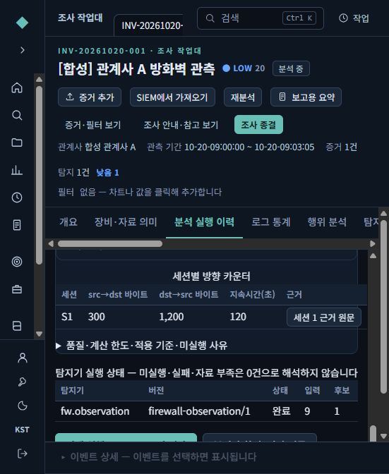
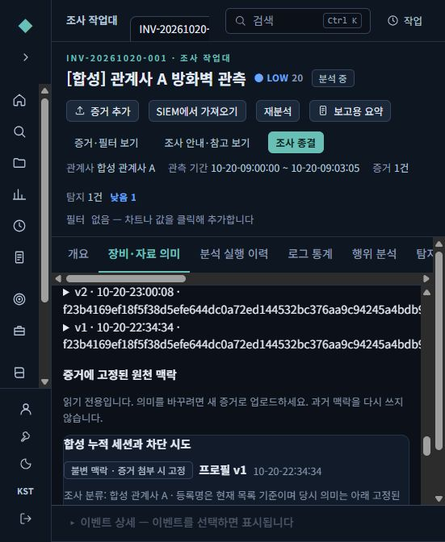
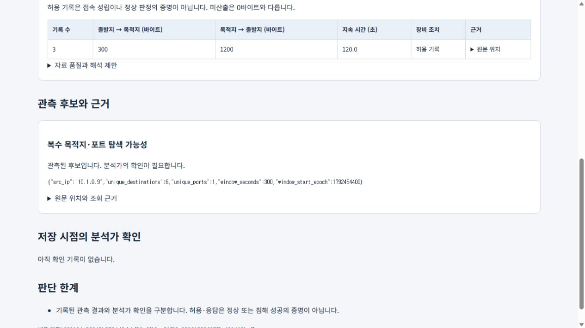

# P1 관계사·방화벽 실행 검증

기준 HEAD4072e9d에서 승인된 증분 작업. 합성 자료만 사용했다.
원본 F:/claude/saw, 운영 설치·계정·은행 자료와 기존 릴리스를 수정하지 않았다.

## 구현

- 안정된 관계사 ID, 조사별 장비, 불변 장비 프로필 및 증거 맥락. 마이그레이션0015/0016.
- 일반 연결 CSV의 출처를 connection으로 보존하고 Zeek로 가장하지 않음.
- 귀속 충돌·미분류, 방향·단위·누적·시간·조치 의미를 별도 처리.
- SQLite 디스크 집계로 bounded FW 세션/거부 시도/탐색·장기·전송 비대칭·새 연결 주기성 후보.
- 입력 범위와 버전이 고정된 AnalysisRun/DetectorExecution/FindingSnapshot/ReportVersion.
- 원천 ACL을 Check 공유·인용·증거·자산 문맥·보고서까지 전파.
- 장비/관계사/기간 범위 Job의 lease·취소·재시도·원천 변경 검증, 완료 상태와 실행 저장 원자화.
- 프로필 시간대가 검증되면 발생/시작/종료 시각을 색인과 분석에서 동일하게 적용. 원래 해석은 provenance로 보존.
- 원천 문자열과 프로필 중 낮은 시간 정밀도로 계산하여 분 단위 자료를 초 단위 분석으로 승격하지 않음.
- 새 UI에서 장비 의미, 기록/세션/시도 수, 근거 원문, 불변 실행과 보고서 확인.

## 실제 브라우저

환경: 새 .qa/affiliate-p1-20261020/browser-v1, 전용 SQLite/event store, localhost58371.
가상 claude-check 계정의 정상 로그인·MFA를 사용했다. 인증 우회나 사용자 운영 계정 사용 없음.

1. 관계사 A의 합성 조사와 FW-LAB-01 선택.
2. 실제 API로 올린9개 CSV기록 처리: S1의 start/interim/end3개와 거부시도6개.
3. 브라우저에서 관계사·장비 범위 Job 생성, COMPLETED 및 실행v2 선택 확인.
4. 기록9/세션1/시작기록접속1/거부시도6/탐색후보1. 세션300/1200bytes·120초.
5. 탐색 근거 버튼으로 정확6개 원문 조회. 전체9개를 후보 근거로 혼합하지 않음.
6. HTML보고서v1 저장·열람, 같은300/1200값과 후보 확인.
7. 프로필v1을 초안으로 복사했을 때 second 정밀도 원본값 유지. UI에서v2 저장 성공.
8. 기존 증거는 프로필v1/SHA를 계속 사용. 새 버전을 과거 증거에 소급 적용하지 않음.

개발 브라우저 서버는 이 시험용이다. 제품 전체 인수나 LTSC 설치 시험과 구분한다.

## 자동 시험과 재검토

- 첫 전체서버 R1: 1792통과/3실패/6건너뜀,1434.44초. 실패 이력은 보존.
  - 일반CSV의 가이던스 연결 누락 수정.
  - 일반CSV를 Zeek/C2로 기대하던 옛 시험을 검증된 의미 계약으로 수정; 별도 실제FW positive 시험 유지.
  - 진행 중 추가된 보고서시험이 구버전 로딩을 참조한 실패는 현재 렌더러22개 관련 재시험으로 확인.
- R2 전체서버: **1833통과/6건너뜀/2기존경고,1458.83초**, exit0. 실행 도중 추가된 최종 시간범위/정밀도 변경 전체를 이 숫자로 대체하지 않는다. 해당 최종 변경은 아래50/70개 회귀와 독립 리뷰로 검증했다. P5에서 최종 통합 코드 전체를 다시 실행한다.
- 웹 최종 전체: **230개/35파일 통과,12.75초**, exit0. 프로필 초안 정밀도 보존 수정까지 포함했다. 제품 빌드(TypeScript+Vite)도 통과했다.
- 시간범위 실제 업로드 RED(input0)→GREEN(input3/300bytes).
- 원천/프로필 정밀도 RED1→GREEN, 보수적 정밀도6사례·FW 분단위 반례 포함50개 통과.
- 관측/시간/행위/범위Job 교차70개 통과. 마지막 정밀도 경계7개는 별도50개 집합에 포함.
- 가이던스20개 통과: 기록3개/세션1개를 반복 연결로 단정하지 않고 content1.0.1 변경 후 기존 캡처 보존.
- 독립 리뷰에서 P1 최종 지정 범위의 미해결 Critical/Important/Minor0. 앞서 발견한 시간 정밀도 결함 수정 후 직접 재시험.
- 개발기 실제 PostgreSQL16.15/OpenSearch2.19.6/Nori2.19.6: **16통과/0실패/0건너뜀**,133.50초. 마이그레이션·실제업로드·범위Job/ACL/취소/재시도. 정상종료 및 전용포트닫힘 확인. [공개 영수증](affiliate-p1-native-20261020.json).
- native 첫 실행은 wrapper hook 인자오류로 미실행, 두번째는2통과/14setup오류(HTTP429 cluster_block_exception). 실제디스크 사용률의 flood-stage보호가 원인임을 확인했다. 세번째 전용시험은 디스크검사를 켠 채 절대여유20/12/6gb 기준과 최소25GiB preflight로16개 통과했다. 제품/운영 기본값 변경 없음.
- 전체서버의6건너뜀은 native PG미지정1, Windows symlink권한1, 전용 initdb binary미지정3, POSIX비트1이다. native PG1은 위별도시험에서실행했다. 나머지는P5/대상환경인수와구분한다.

집합은 서로 겹치므로 숫자를 합산하지 않는다.
상세 로컬 증적: .qa/affiliate-p1-20261020/server-full-r1.log,server-full-r2.log,
close-review.md,p1-ui-report.md,p1-guidance-unit-report.md,profile-scope-red.log.

## 남은 범위

P2 정책/룰 활성 버전·5장비 분석, P3 후속확인·XLSX, P4 Golden/반출, P5 성능·최종매체는 후속 단계다.
제조사별 실제 필드 검증, 깨끗한 LTSC2019 build17763, 실제16GB 공동부하, 관리자 서비스/재부팅,
운영 자료 반입·학습·모델 전환·외부 반출 승인은 이번 결과로 충족하지 않는다.
History503 및 과거 권한metadata4건의 정확한 원인은 기존대로 미확정이다.
