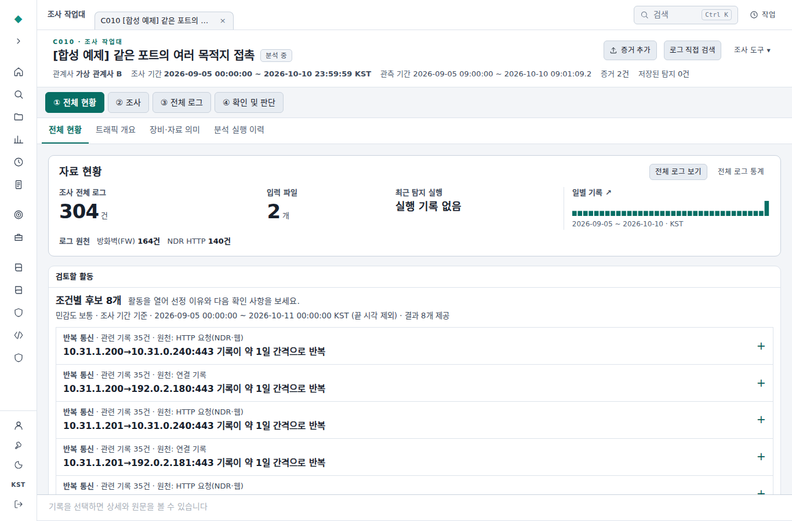
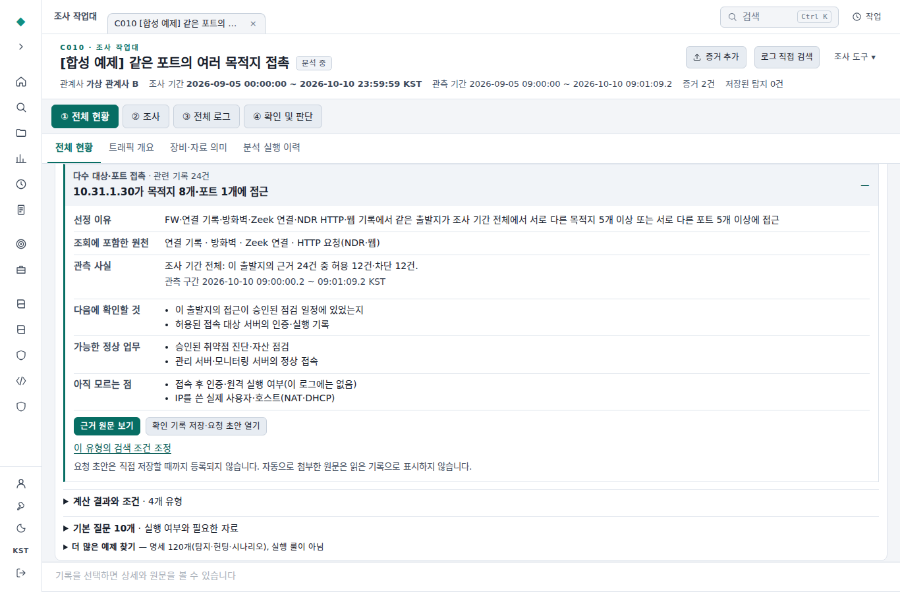

# 관계사 조사 작업대 사용성 검토 (2026-11-03)

기준은 가상 로그 연습 기능을 추가한 PR #9의 b3e02a8입니다. 아래 화면은 변경한 실제 프런트엔드와 합성 자료로 확인한 결과입니다. 운영 설치본 캡처나 사용자 연구 결과는 아닙니다.

## 첫 화면에서 자료 범위 확인

1366×900, 라이트 테마. C010의 합성 CSV를 기존 전용 파서로 읽은 NDR 140건과 방화벽 164건, 총 304건입니다. 기본 민감도에서 일정한 간격의 반복 기록이 후보로 표시됩니다. 저장된 탐지 건수와 현재 로그에서 계산한 후보 수는 별도입니다.

## 조건에 맞은 이유와 추가 자료 요청

같은 C010에서 민감도를 높여 다수 접촉 유형을 선택한 예입니다. 출발지 10.31.1.30이 8개 목적지의 한 포트에 접촉한 FW 기록은 24건(허용 12건·차단 12건)입니다. 허용은 실제 인증 또는 명령 실행 성공을 뜻하지 않습니다. 요청 초안의 주소·포트는 대표 근거에서 가져오며 모든 대상을 열거했다고 간주하지 않습니다.

## 검증 범위
- 실행한 전체 프런트엔드 테스트 56개 파일, 389개 테스트 통과. TypeScript 및 Vite 프로덕션 빌드 통과.
- Python에서 전송 방향·시간창·주기 표시, 자동 관측과 수동 확인의 분리, 기존 연습 원문 및 매체 복사를 다룬 24개 테스트 통과. 질의 범위·원문 건수에는 실제 SQLite 저장소를 사용했습니다.
- 릴리스 빌더로 스테이징한 웹 자산에 연습 CSV 40개가 포함됐습니다. API 응답을 합성 자료로 제공한 Chromium에서 1366×900 작업대와 640×640 작업 흐름을 확인했습니다.
- 좁은 화면에서 조건을 충족한 24건의 정확한 원문 범위(끝 시각 포함), 원문에서 후보 복귀, 조건 편집, 확인 기록 생성 후 요청 초안 열기를 확인했습니다. 확인 기록 1건·후속 요청 저장 0건, 네 지점에서 페이지 전체의 가로 넘침 없음. 운영 DB를 사용하지 않았습니다.
- 연습 C003의 대표 행 펼치기, 오답과 권장 판단 비교, 다른 보기 해설, 키보드로 다시 선택 및 후속 질문 전환을 확인했습니다.
- 이 환경에는 FastAPI·argon2 등 전체 서버 의존성이 없어 HTTP API 회귀 전체를 실행하지 않았습니다. 네이티브 OpenSearch·PostgreSQL 성능, Windows LTSC 2019 설치·업데이트, 운영 배포, 분석 소요 시간 단축률은 이번 검증에 포함하지 않았습니다.
